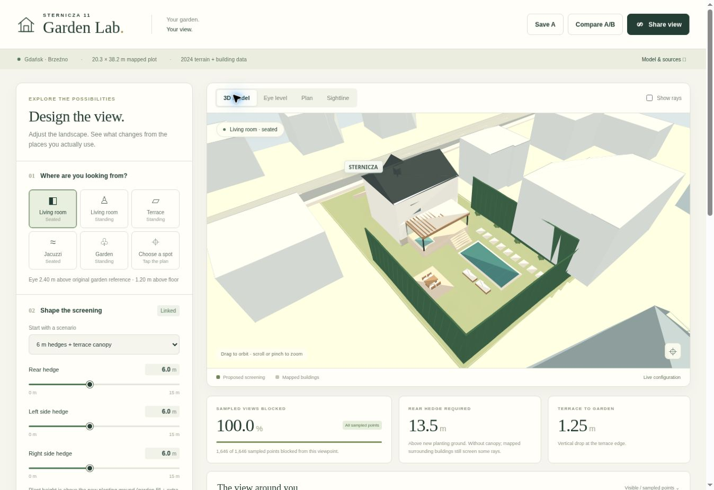

# Sternicza · Garden Lab

An interactive, browser-only garden privacy simulator for Sternicza 11, Gdańsk. Explore the actual mapped plot and neighbouring buildings, change the proposed hedge, ground and terrace geometry, and compare editable thuja and earthwork budgets.

**[Open the live simulator](https://paweltroka.github.io/TROKA.Software.SmartHouse/)**



## Use it

Choose a viewpoint, then adjust hedge height or pick a scenario. Switch between **3D model**, **Eye level**, **Plan**, and **Sightline**. Click the plan to move the observer. Save scenario A, change the design, then compare A/B.

**Rear, left and right hedge heights are independent by default.** Enable the explicit linked-editing switch only when you want the next height edit to move all three sides together. Turning linking on does not immediately overwrite the current different heights. Scenario presets set their specified heights but preserve your linking preference.

**Fine-tune the assumptions** includes optional building height and distance comparisons. **Budget assumptions · PLN** contains planting density, per-side supplier quotes, material rates, delivery capacity and project allowances. The budget beneath the sightline results updates with the design; expand **Quantities, itemised costs & sources** for the calculation and dated source links.

**Share view** creates a `v=2` URL containing changed settings, including cost inputs and building adjustments. Older `v=1` links remain readable. Existing local v1 preferences migrate to independent hedge editing, so the previous automatically linked default does not persist. An explicit linking setting in a shared link is still respected. **Export scenario** downloads schema-version-2 JSON containing settings, visibility results, the complete cost estimate and active building adjustments. Saved A/B comparisons include these inputs.

The app has no backend, analytics, account requirement or external runtime requests. Three.js r160 is vendored with its MIT licence. A reduced SVG renderer keeps 3D interaction available on browsers without WebGL. Plan and section views use SVG independently of the 3D renderer.

## Local development

Requires Node.js 18+ for the tests/build script and any ordinary static HTTP server. No npm dependencies or installation step are needed.

```sh
npm test
npm run build
python3 -m http.server 8000 --directory public
```

Open `http://localhost:8000/`. You can also serve the source folder directly. Opening `index.html` as a `file:` URL will not work because the browser must fetch modules and the site dataset over HTTP.

## GitHub Pages

The live app is published at **https://paweltroka.github.io/TROKA.Software.SmartHouse/**. GitHub Pages is already enabled and deploys the static application from **gh-pages / (root)**. No custom domain, paid service, secrets or build-time credentials are needed.

The source is maintained in `garden-lab/` on `main`. To publish later changes with an authenticated Git checkout, run the tests and build, then copy the contents of `garden-lab/public/` to a worktree of the `gh-pages` branch and commit/push that branch. Keep the `.nojekyll` file. The repository's existing house model files are unrelated to this app and are preserved on `main`.

## Coordinates and source data

- Parcel geometry: GUGiK ULDK parcels `226101_1.0034.401` and `226101_1.0034.400`. The combined design plot is approximately **20.32 × 38.21 m**, area **766.86 m²**. Inclusion of parcel 400 is a design assumption, not a title check.
- Source horizontal system: **EPSG:2180**. The app uses a local frame with x along the frontage and y into the rear garden, approximately SSW.
- Vertical datum: **PL-EVRF2007-NH**, retained as absolute metres internally.
- Main house/garage and context footprints: [GUGiK Gdańsk 2024 LoD1 building models](https://opendata.geoportal.gov.pl/InneDane/Budynki3D/LOD1/2024/22/2261.zip).
- Terrain: [2024 1 m DTM tile](https://opendata.geoportal.gov.pl/NumDaneWys/NMT/81008/81008_1561323_N-34-50-C-d-1-1.asc), native-grid crop with bilinear interpolation.
- Nearby roof points: [2024 airborne LiDAR tile](https://opendata.geoportal.gov.pl/NumDaneWys/DanePomiaroweLAZ/81005/81005_1559930_N-34-50-C-d-1-1-3-1.laz), class 6 building returns reduced to one maximum per plan voxel. This source is a large download; the app ships only the compact derived dataset.
- Detailed provenance and assumptions are embedded in `data/site-data.json` and the **Model & sources** dialog.

## What is measured, proposed and approximate

Mapped property/footprint geometry and the terrain crop are data-derived. Nearby blocks include sampled roof elevations; the farther central blocks have only LoD1 median roofs. The tall thin return near PCK 3 is unverified and excluded by default, with an optional sensitivity toggle.

The house's living floor starts at an **assumed 1.2 m above the original near-house garden reference**. This value is not a measured floor survey. The terrace, jacuzzi, pool, canopy, new openings, furniture and finishes are proposed. The main house's pitched roof is schematic. The default **0.5 m hedge inset** is a design choice: setting it to zero reproduces the earlier boundary-screen calculations.

The 3D view displays proposed walls and window openings, but these are not used as verified occluders in the ray score. Ornamental planting is illustrative and does not improve the numerical score. The score covers five target apartment volumes regardless of which direction the camera faces.

## Building sensitivity comparisons

The five target apartment blocks can be adjusted independently: **PCK 3**, the west and east blocks, the farther central block and its continuation. Select a block under **Fine-tune the assumptions → Surrounding buildings**. The readout shows the mapped baseline and current comparison side by side.

- **Height adjustment** changes roof-top height above the block's fixed base. All roof, facade and optional high-feature sample elevations scale consistently above that base. The allowed adjustment is −10 to +15 m, with a minimum modeled building height of 2 m.
- **Distance adjustment** translates the whole building along its original bearing from the house's rear-wall midpoint to the building's footprint area centroid. Positive values move it farther away; negative values move it closer. The adjustment range is −15 to +40 m, with a minimum centre distance of 5 m. The footprint shape and elevations remain unchanged; moving the observer does not change this reference.
- Adjusted geometry feeds **3D, plan, section and visibility calculations together**. A visible what-if status identifies active overrides. **Reset this building** or **Reset all** restores the original mapped coordinates exactly, without accumulating earlier edits.

These controls are sensitivity scenarios. They do not modify the source dataset or survey the buildings again. A translated building keeps its original base elevation rather than snapping to terrain at its hypothetical new location, and hypothetical positions are not checked for collisions or planning feasibility.

## Sightline model

For an observer at absolute eye height `E`, target roof/facade height `B`, and screen intersection fraction `r` along the horizontal ray:

```text
required top elevation = (1 − r) × E + r × B
required hedge height = required top elevation − planting-ground elevation
```

The engine intersects finite hedge segments, the finite canopy roof and front/side fascia, and approximate surrounding-building prisms. The required rear hedge metric ignores canopy protection, but retains occlusion from mapped surrounding buildings. It refers to new planting ground, or original ground when existing hedge tops are held fixed.

**Raising the garden is distinct from raising the hedge beds.** The house floor and terrace stay fixed. A garden observer moves with garden fill; a living-room observer does not. New planting rises with the soil only when the corresponding switch is enabled. Adding soil never lifts retained foliage. The terrain model applies uniform fill within the rear-garden area; retaining structures, drainage, soil settling and construction feasibility are outside scope.

Coverage is the **unweighted fraction of sampled target points blocked from one eye position**. It is not visual-field area, not a guarantee for all points in the garden, and not an assurance that real foliage is opaque. Real gaps, foliage density, roof details and survey uncertainty can affect the result. Measured roof targets are conservatively retained rather than silently hidden by a median-height flat roof approximation; synthetic back-facing facade samples are filtered.

## Thuja and rear-garden cost model

The budget is in **PLN** and uses editable planning inputs. Price observations were reviewed on **11 November 2026** and are recorded with supplier links, units and tax treatment in [`data/cost-sources.json`](data/cost-sources.json). Displayed retail plant prices are reference offers, not guaranteed availability or a national market price range. Explicit net observations remain identified as net; the app does not impose one VAT rate on all work. Use supplier-confirmed final amounts, including applicable tax, for a purchasing budget.

### Thujas

Only the modeled **rear, left and right rear-garden hedge segments** are priced. No front hedge is silently added. Each side's count is its total segment length divided by the selected centre-to-centre spacing, rounded up. Heights are priced separately, so changing the rear hedge leaves the left and right plant prices unchanged.

Automatic **Smaragd** stock-price bands cover small plants through **4 m**. They use observed nursery offers rather than extrapolating a cost-per-metre curve. Different nurseries and stock types can make the bands non-monotonic. Above 4 m, the affected side and combined total show **Quote needed**; the incomplete known subtotal remains visible. Tall specimen reference offers are listed separately in the sources and are not treated as interchangeable hedge stock.

Enter a positive **Rear / Left / Right: custom tree price** to use your own PLN-per-tree quote; zero selects automatic pricing. The automatic-price multiplier does not alter a custom quote. Planting labour is per tree, while tree delivery and lifting are whole-order allowances. **Buy new thujas** can be switched off independently of the screening geometry to budget only earthworks or retain existing plants. Plant height and spacing do not establish that real foliage will form an opaque screen.

### Soil quantities and raising the garden

The automatic fill area is the mapped land behind the house's rear-wall reference, excluding the **house footprint, terrace, pool and retained garage**. Overlapping exclusions are subtracted once. Removing the garage makes its footprint available for fill, but demolition costs are not included. Terrace depth therefore changes the priced fill area. At the initial 4.2 m terrace depth with the garage removed, the automatic area is approximately **338.69 m²**, rather than the property's full 766.86 m².

Finished in-place volume is:

```text
rear-garden fill = selected fill area × garden raise
extra bed fill = bed area × additional bed raise
total added volume = rear-garden fill + extra bed fill
```

Raised-bed strips are centred on the active hedge segments, clipped to the property and exclusions, and united so overlapping corners count once. Only the extra bed height is added above the general garden raise. With the initial 0.5 m hedge inset and 1 m bed width, the combined bed area is approximately **57.62 m²**.

The topsoil setting is a cap **within the chosen added depth**, not another layer added on top. A shallow raise cannot contain more topsoil than its total thickness. Combined garden and bed raises receive a single topsoil cap over each area. The remaining volume is bulk fill. The loose-delivery multiplier converts both finished material volumes to delivery quantities; it is an editable assumption, not a soil investigation. Truck loads are rounded up separately for bulk fill and topsoil.

For example, a **0.5 m garden raise** over the initial automatic area requires approximately **169.35 m³ finished / 203.22 m³ loose** at a 1.20× multiplier. Raising only the initial hedge beds by 0.5 m requires approximately **28.81 m³ finished / 34.57 m³ loose**. These are added-volume calculations; the model does not level the existing terrain to a single horizontal elevation.

A positive **Fill area override** changes cost quantities only and is capped at the mapped gross rear area. It does not reshape the rendered fill or privacy geometry. When combining an override with raised beds, the quantity calculation assumes the selected garden-fill area overlaps the beds up to the smaller of the two areas.

### Editable budget assumptions

The main defaults are visible in the interface and defined in `src/costs.js`:

| Input | Initial value | Basis |
| --- | --- | --- |
| Tree spacing | 0.80 m | Editable layout assumption |
| Planting | PLN 75/tree | Labour allowance |
| Tree delivery | PLN 1,000/order | Transport allowance |
| Tree lifting/equipment | PLN 0 | Not budgeted until entered |
| Extra hedge-bed width | 1.00 m | Geometry assumption |
| Topsoil within added depth | 0.15 m | Material specification assumption |
| Loose-delivery multiplier | 1.20× | Quantity allowance |
| Bulk fill material | PLN 75/loose m³ | Editable planning rate, excluding transport |
| Topsoil material | PLN 110/loose m³ | Editable planning rate, excluding transport |
| Spreading/compaction | PLN 50/finished m³ | Editable work rate |
| Truck capacity | 10 loose m³/load | Access and vehicle assumption |
| Soil transport | PLN 500/load | Editable allowance |
| Retaining edges | PLN 8,000/project | Provisional allowance |
| Drainage | PLN 3,000/project | Provisional allowance |
| Access/preparation | PLN 1,500/project | Provisional allowance |
| Upper-budget uncertainty | 20% | Applied once to the high estimate only |

The lower and upper figures combine observed plant-price bands and the selected uncertainty allowance; they are **not a statistical confidence interval or a contractor quote**. Material/work rates and fixed site allowances must be updated for actual access and specifications. Set transport to zero when a supplier price already includes delivery. A zero allowance means that item is not budgeted, not that it is unnecessary. All earthwork allowances are zeroed automatically when there is no added soil, and tree allowances are zeroed when no trees are being purchased.

The estimate excludes garage demolition, reuse of excavated pool soil, stripping/disposal of existing topsoil, new paving, professional design and the rest of the renovation. Retaining and drainage allowances do not determine engineering feasibility. **Reset cost assumptions** restores budget defaults without resetting the garden design.

## Checks

The test suite covers finite ray intersections, the audited roof-ray benchmarks, terrain interpolation, garden versus bed raise, retained foliage, fixed house floors, screen inset, finite canopy roof/front/side edges, approximate building occlusion and garage removal.

Cost regressions cover per-side tree pricing, zero-work totals, retained planting, polygon exclusions and overlaps, garden/bed volumes, topsoil partitioning, loose quantities, material-specific truck loads, area overrides, quote-required tall stock, custom unit prices and applying contingency once. Building tests cover unchanged zero overrides, area centroids, coherent height and position transformations, independence, caching without cumulative edits, exact reset and feeding changed targets into sightline calculations. State tests cover independent/link-controlled editing, legacy migration, v1/v2 URLs, budget and building settings, and validation of untrusted URL values.

Audited zero-inset benchmark requirements are **13.7132423316 m** for the seated living-room controlling PCK 3 ray and **10.4933350440 m** for the garden ray at local y = 30 m. These are requirements for particular sampled rays, not suggested hedge purchases.

## Structure

| File | Purpose |
| --- | --- |
| `src/geometry.js` | Terrain, observers, finite intersections and sampled visibility |
| `src/scene.js` | 3D model, cameras and WebGL/SVG rendering |
| `src/diagrams.js` | Interactive plan and precise sightline section |
| `src/state.js` | Validated controls, independent hedge editing, migration and versioned share links |
| `src/buildings.js` | Non-destructive building height/distance sensitivity transforms |
| `src/costs.js` | Hedge quantities, fill geometry, material/load quantities and editable PLN budgets |
| `src/budget-view.js` | Budget summaries, itemised costs and price-source presentation |
| `src/app.js` | Interface and model integration |
| `data/site-data.json` | Compact derived site and surrounding-building dataset |
| `data/cost-sources.json` | Dated supplier observations, tax notes and planning-assumption evidence |
| `tests/` | Numerical and state checks |
| `vendor/` | Pinned Three.js r160 and its licence |

