# Gdańsk · Garden Lab

An interactive, browser-only garden privacy and sunlight simulator for **Sternicza 11 and Konrada Korzeniowskiego 40 in Brzeźno, and Nadmorska 17 in Jelitkowo**. Each property uses its own mapped plot, house, neighbourhood, terrain, proposals and saved scenarios.

**[Open Nadmorska 17](https://paweltroka.github.io/TROKA.Software.SmartHouse/?site=nadmorska-17&v=1.38.0)** · **[Open Korzeniowskiego 40](https://paweltroka.github.io/TROKA.Software.SmartHouse/?site=korzeniowskiego-40&v=1.38.0)** · **[Open Sternicza 11](https://paweltroka.github.io/TROKA.Software.SmartHouse/?site=sternicza-11&v=1.38.0)**

## Doors, sliding spa covers and fitted guest rooms · 1.38.0

**Doors, gates & covers** beside the viewer controls the independent ground/upper terrace doors, both gates, both side-sliding spa covers and the office/gym arrangements. Gates start closed; HST doors retain the two-thirds-open default. The panel stays accessible in fullscreen. Covers update visible geometry, walking support and sunlight together.

The compact rear-left pine grove returns to its earlier coordinates, with the nearest pair **2.00 m apart**. The **3.20 × 6.50 m pool** moves rearward to **(15.50, 24.50)**, just before the grove. The cold plunge meets its garden-facing approach level instead of sitting on a raised apron. Schema **34** preserves manual trees and archived comparison settings while updating the active prior proposal once.

The kitchen window is clear above; fitted corner storage closes the pantry/cooking junction. Renovation finishes cover all retained chimney cores, and open stair-floor edges receive continuous guards. Each guest room has a **1.40 × 2.00 m mattress**, work desk and bed-facing wall TV. The office has a **2.60 m desk with two computers** and an optional **0.90 × 2.00 m single guest bed**.

The basement gym adds a short dual-stack cable station, premium smart bike, adjustable dumbbells, wheeled bench, training screen, mirror and accessory storage. The bench parks beside the wall to free the central activity space. The technical/laundry room and two garage spaces remain.

[Controls, room fit, equipment references and saved-design behavior](docs/interactive-living-1.38.md)

## Retained trees, garden routes and fitted rooms · 1.37.0

The original pine positions are restored. Schema **33** reverses only a complete recognized automatic 1.36 relocation; custom planting remains in place, and pool/style changes do not move trees. The pool is now **3.20 × 6.50 m**, nearer the house along the left/east boundary. Two compact chaises run parallel to its long edge, with optional short-edge beds for three or four total.

The cold plunge is recessed flush with its apron. Decorated stone-and-mineral paths connect all six garden destinations, with **seven shielded warm path lights**. Fitted kitchen storage now reaches the ceiling and fills the available upper, corner and side spaces while keeping the connected peninsula, concealed chimney, sink window and wider entrance.

The basement remainder contains a **17.03 m² compact gym** and an **11.19 m² technical/laundry room**, outside both parking lanes. The renovation uses the proposed **2.30 m clear basement headroom**; Current retains the original 1.70 m cellar comparison. A **2.20 m perimeter fence** and separate **1.20 m pedestrian / 6.60 m garage gates** coordinate with all 34 renovation styles. Gate states persist independently and agree across rendering, walking and analysis.

[Controls, dimensions, preserved planting, cost scope and verification](docs/garden-and-basement-1.37.md)

## Fullscreen, connected kitchen and open garden · 1.36.0

**Fullscreen** expands either the main model or the interior studio, using native browser fullscreen where available and a full-window fallback otherwise. **Exit fullscreen** or **Esc** returns to the normal layout while preserving the current model and walking session. The same expanded view follows the interior-to-garden walking handoff.

All **34 renovation styles** now connect the kitchen peninsula to the right-hand sink run. Its **2.20 × 0.85 m** span includes the connection; the refrigerator-side free end retracts **55 cm**, leaving **1.18 m** of modeled entry clearance. Matching full-height cabinet panels conceal the retained chimney. A **1.10 m timber slat guard** opens the stair-side hall while preserving its **1.13 m access opening**. Current keeps the original interior.

The coordinated garden places the **3.5 × 8 m pool along the left/east edge**, with three inward-facing sunbeds and optional front/rear pairs for five or seven beds. The fire lounge becomes the central garden focal point, aligned with the terrace jacuzzi. Outdoor kitchens are removed. Schema **32** preserves custom trees and explicit saved choices while relocating recognized older automatic planting presets around the revised pool.

The preferred left-edge composition has a measured sunlight tradeoff: a bounded comparison of nine dates in June–August 2026 estimates **3.6181 equivalent direct-sun hours/day** averaged over its water, against **6.8906** for the released 1.35 arrangement. This limited area/time sample documents the choice; it does not identify a new sunlight optimum.

[Controls, dimensions, migration and sunlight comparison](docs/open-living-garden-1.36.md) · [Reproducible sunlight report](data/left-edge-pool-verification-1.36.json)

## Comfortable exploration and minimal design families · 1.35.0

Walking now uses the original interior controller's speed, fixed 70° lens, drag direction and sensitivity both inside and outside. Smooth height transitions replace hard stair and terrain snaps. Free exploration is the default: cross terrace edges, walk into the pool or jacuzzi, pass through objects, and use E/Q or touch controls to move vertically. R / Follow ground resumes floor and terrain following. A separate physical mode remains available for circulation checks.

Every renovation now has an open kitchen edge toward living/dining: one 1.80 × 0.85 m island, clear access on both sides, retained fitted storage and one side-garden sink window. The street kitchen window, intrusive tall block, extra centre block and obstructing dining console are removed. The full rear living HST remains.

Twelve additional renovations expand the catalogue to **35 choices including Current**, with a focus on Nordic, warm, soft, Belgian and Japanese minimalism, contemporary white/glass/concrete architecture, Organic Limestone and two restrained Bali/tropical retreats. Their actual facade openings, room furniture, garden compositions and photographic finishes differ. Finer joinery, stone edges and surface coatings improve close views without adding another full-scene rendering pass.

[Controls, kitchen dimensions, style guide and verification scope](docs/comfortable-exploration-1.35.md)

## Continuous walking and the summer garden · 1.34.0

**Walk** now connects the garden and renovated house in one scene, with the same WASD/arrow and touch controls inside and out. Shared stair treads connect basement, living floor, first floor and attic. Room Eye level actions enter this same walker. The drawing-based Current comparison remains available.

The terrace spa is centered, with animated Aurora/Lagoon/Amber water moods. Canopies and balconies are column-free cantilever concepts. The living-room HST has three slim panels and an opening slider; two leaves stack onto the left fixed panel without rebuilding the scene. Kitchens retain generous closed storage and open only toward living/dining; the upstairs fixture is a compact hydromassage bath.

The pool's feasible summer-sun position is shared across styles, with sunbeds on one, two or three sides. Austrian pines return as the default, with photographed bark and calculated boundary positions for all 14 species choices. The study estimates 6.94 equivalent direct-sun hours per summer day over the pool, compared with 4.93 for the earlier pool/Excelsa layout. These are modeled water-area averages.

Distinct gable/upper-storey cladding, metric photographic grain, bevels and softer warm pendant strings improve the real-time scene. Schema 30 preserves earlier shared comparisons while the active previous session adopts the requested changes once.

[Release scope and controls](docs/resort-update-1.34.md) · [Summer sun and planting calculations](docs/summer-garden-1.34.md)

## Substantial renovation designs · 1.33.0

All 22 renovation styles now change **actual window openings, glazing patterns, facade depth, room furnishings and garden arrangements**. The retained footprint, roof, storeys, stairs, mapped surroundings and original Current baseline stay consistent. Six fitted garden layouts coordinate the pool, dining, sunken lounge, resting places, planting and outdoor kitchen. Three kitchen programmes and a room-facing office option accompany the styled furniture.

A catalogue of **32 photographic PBR source materials** replaces broad reuse of generic textures. Timber, stone, plaster, brick, roof coverings and upholstery use their own colour, normal and roughness maps, with physical scale, natural grain and material-specific response. Small photographic samples appear in the style catalogue and the expanded finishes panel. **House details**, **Garden overview** and **Daylight** make comparisons easier while style changes preserve the camera and lighting.

Old saved gardens remain recoverable under schema 29. The style garden arrangement can be switched off, and the pavilion study keeps its own arrangement when active. Renovation pricing remains quote-only, including the proposed glazing, supporting work, joinery and garden kitchen.

[Open the renovated Beach House](https://paweltroka.github.io/TROKA.Software.SmartHouse/?site=sternicza-11&v=1.33.0#v=29&site=sternicza-11&designStyle=beach-house&styleGardenLayout=true&pavilionEnabled=false&mode=orbit&showDimensions=false) · [Scope and verification](docs/renovation-depth-1.33.md) · [Materials, provenance and delivery](docs/renovation-materials.md)

## Surrounding-building accuracy · 1.32.1

The 24 November accuracy follow-up uses the reconstructed neighbouring roofs and walls for **3D rendering, local privacy and sunlight rays**. This removes the former mismatch between a visible ridge/lower wing and an analytical median-height prism. PCK 1, 3 and 5 now have distinct flat decks, central pyramidal skylights and six chimney stacks, with measured top heights and estimated fixture extents. The separate optional high-feature samples retain their existing control.

Observed openings are registered once across a complete elevation, including mapped walls split into short segments. The garden-facing 9a and 13a façades gain their observed grouped windows and projecting balconies/recessed loggia; generic side windows use the same floor datum. PCK 5's side colours now use the visible horizontal fields. The opposite 5/7 upper terrace and recessed back-wall arrangement remain unresolved instead of adding a door above a measured low roof. The [appearance record](docs/sternicza-appearance-observations.md) identifies these limits.

The fixes apply on top of the coordinated resort and optional pavilion releases below. Original measured footprints, roof returns and official building identities remain intact. Dense façade inspection follows the resolved wall surfaces.

## Optional corner pavilion · 1.32.0

Sternicza has an **off-by-default pavilion alternative** with rear/east-corner and former-garage placements. Enabling it moves the pool west and rearranges dining, fire lounge and resting places. Turning it off restores the previous garden programme. Compare 6.5, 8, 10 and 12 m height studies from the same eye, with transparent glass and the actual finite walls, roof and floor slabs included in privacy and shade calculations.

The PCK3 comparison retains the same alternative garden in both cases and removes only pavilion construction from its baseline. Percentages describe sampled sightlines, not visible façade area. The separate roof-envelope diagnostic identifies rays passing beside the footprint; more height cannot block those rays. Roof height is measured from original terrain, independent of proposed garden fill.

**No permitted building height is established.** Official city queries found no covering current MPZP in the queried layers. The revised draft general plan shows 12 m in zone 649SW at this corner, but remains a draft and does not grant permission for this pavilion. The complete pavilion project is a separate quote-only budget item. Internal stairs and detailed rooms remain undesigned.

[Open the pavilion study](https://paweltroka.github.io/TROKA.Software.SmartHouse/?site=sternicza-11&v=1.32.1#v=28&site=sternicza-11&pavilionEnabled=true&designStyle=beach-house&mode=orbit&showDimensions=false) · [Study, planning sources and comparison results](docs/corner-pavilion-study-1.32.md)

## Coordinated resort living · 1.31.0

The 22 renovation choices now include **Beach House** and rearrange indoor and outdoor furniture as complete living compositions. Lounge groups, dining, bedroom reading corners, balcony seating and shaded lamps follow each style. **Current design** retains the original arrangement. Beach House is a separate contemporary scheme with pale timber, sand tones, linen and sea-glass accents; Coastal keeps its white weatherboards and Hamptons character, while Baltic Dune uses weathered boards and canvas.

Garden light is concentrated around occupied spaces with a quieter perimeter. Use **Garden evening** to preview the lighting after sunset, and expand the short living guide for the selected design. The plan and 3D views share movable-furniture positions. Saved styles, the two-car garage, mapped surroundings and the sea-height study remain available.

[Design decisions and validation](docs/resort-living-1.31.md) · [Architectural references](docs/design-style-research.md)

## Measured neighbourhood and sea views · 1.30.0

Sternicza now includes **490 surrounding canopy and shrub groups**, derived from classified GUGiK laser returns acquired on **2024-10-01**. Crown positions, elevations and extents follow the scan; individual stems, branches and leaves are reconstructed. Separate municipal inventory records are retained without assigning unverified species to grouped crowns. Summer, winter and date-based foliage controls allow comparisons, and existing crowns can participate in privacy and sunlight calculations without entering the planting budget.

Twelve neighbouring buildings have reference-informed façade colours, window arrangements and selected balcony/entrance details. Nine additional roofs use measured building returns for their resolved silhouettes and local obstruction geometry. Ground-return colour adds registered surface variation where observations exist. Other façades, hidden elevations and branch topology remain approximate; the source notes distinguish measured geometry from reconstruction.

The 23 November reference review corrects PCK 1, 3 and 5 to **five residential window rows**, four principal columns on the garden/street faces and three balcony stacks on the observed side elevations. Small basement openings are separate from the residential floors. The blue/mint and yellow fields on PCK 3, horizontal colour bands on PCK 5 and yellow/salmon fields on PCK 1 now follow the supplied views more closely. Measured crown groups overhanging buildings retain their foliage, with unsupported trunks through roofs omitted.

The west neighbour (building 4h) also uses separate roof patches for its main roof and measured lower extensions. Vertical wall transitions connect those levels, replacing the steep dark roof sheets created by interpolating all levels as one continuous surface. Supported ridge and eave measurements remain in the reconstruction; patch boundaries are estimates between the available samples.

**How high to see the sea?** follows the full measured route from four positions on the plot to the mapped shoreline. Compare distant sea with water 1 km offshore, choose a tested bearing, adjust eye height and clearance, and inspect the controlling obstacle in a profile and map. The model includes earth curvature, conservative native DSM cell maxima and explicit missing-data/further-coast checks. The default house-axis estimates are **15.8 m eye height above original ground for distant sea**, and **22.9 m for water 1 km beyond the shore**, with a 1 m clearance allowance in the best tested direction. These are historical-surface planning estimates, not surveyed or guaranteed sea views.

Saved-state schema **28**, the three properties, existing design proposals and the two-car default are retained. Nature settings are saved and shareable; sea results and their assumptions are included in scenario JSON exports.

[Evidence and implementation scope](docs/sternicza-realism-1-30.md) · [Nature data and reproduction](docs/sternicza-nature-provenance.md) · [Façade observations](docs/sternicza-appearance-observations.md) · [Sea model, sources and limitations](docs/sea-visibility-1.30.md)

## Historical release: architectural materials and model detail · 1.29.0

The interactive renderer now uses six self-hosted photographic material sets, physical texture scale, softened furniture edges, shaped cushions with seams, woven cane with real openings, and detailed instanced foliage. High detail adds contact shading, a reflection of the actual garden in the pool, and finer sun shadows. Both cars have curved bodywork, glazing, tyres and alloy rims while retaining their checked physical envelopes.

Choose **House, finishes & scene settings → Rendering quality → High detail** for the full rendering path on a capable desktop. Navigation temporarily reduces the extra shading work; the completed view settles after interaction. Eco and mobile retain the same design with a lighter rendering path.

All 21 renovation styles, Current house, existing dimensions, two-car layout and saved-state schema **28** are retained. This remains a real-time architectural visualization with representative photographic finishes and procedural models; it is not a claim that every view is indistinguishable from a photograph.

[Rendering changes, source attribution, budgets and verification](docs/architectural-rendering-1.29.md)

## Historical release: Coastal and the retained two-car proposal · 1.28.0

**Coastal** is now an explicitly named, separate physical renovation: horizontal weatherboards, white casings and louvred shutters, pale timber decking, cross-braced guards, slipcovered seating, cane/timber dining furniture, louvred joinery, boarded headboards and linen lighting. Its geometry and textures differ from Baltic Dune. The catalogue offers **21 renovations plus Current house**, with Coastal also searchable as Hamptons, seaside or beach house.

**Sternicza starts with its two-car basement proposal enabled.** Choosing Current, Original drawings or another style preserves it. An independent switch is available on every interior floor for viewing the archived cellar. Schema **28** repairs the last-used garage-era legacy save once; future explicit off choices, archived scenario A and explicit off links remain authoritative. Both actual cars stay in the shared model.

[Open Coastal with the two-car garage](https://paweltroka.github.io/TROKA.Software.SmartHouse/?site=sternicza-11&v=1.28.0#v=28&site=sternicza-11&designStyle=coastal&basementGarageEnabled=true) · [Coastal interior](https://paweltroka.github.io/TROKA.Software.SmartHouse/?site=sternicza-11&v=1.28.0#v=28&site=sternicza-11&designStyle=coastal&basementGarageEnabled=true&interiorEnabled=true&interiorView=dollhouse&mode=plan) · [Change and migration details](docs/coastal-garage-1.28.md)

## Historical release: complete house renovations · 1.27.0

The whole-house style selector now applies **20 physical renovation concepts**, including different furniture constructions, fitted joinery, wall treatments, ceilings, lighting, textures, facade assemblies, outdoor seating and balcony guards. **Current house · no renovation** selects the original drawing layout. Choosing a style applies the revised room programme throughout the house, with coordinated interiors and exterior finishes.

The ground bathroom has one deep soaking tub, a shower, a dual vanity, WC and bidet. Upstairs has one larger hydrotherapy spa with jets and lighting, a two-person shower, one vanity and WC. Furniture orientation, window clearance, wardrobe placement and circulation have been revised.

Both viewers use the same registered house, openings, furnishings, floor levels, terrace and balcony. Room views look into the actual garden model. First style adoption installs the marked **10.77 × 4.00 m** decks; their editable dimensions remain synchronized. Current preserves the original windows, so a separately enabled balcony is identified as lacking access until a renovation is chosen. The two-car conversion remains an explicit engineering study.

Schema **27** preserves this coordinated selection in saved designs and links, and migrates the earlier independent interior style. Historical drawing discrepancies, compact guest rooms, the low cellar and structural/product-clearance limits remain visible.

[Open the Japandi interior](https://paweltroka.github.io/TROKA.Software.SmartHouse/?site=sternicza-11&v=1.27.0#v=27&site=sternicza-11&designStyle=japandi&interiorEnabled=true&interiorView=dollhouse&mode=plan) · [Full style and renovation review](docs/complete-renovation-1.27.md) · [Layout review](docs/interior-layout-review-1.27.0.md) · [Release evidence](https://paweltroka.github.io/TROKA.Software.SmartHouse/release-evidence/1.27.0/validation.html)

## Historical release: Sternicza interior studio · 1.26.0

**Interiors** opens a separate workspace for the basement, ground floor, first floor and attic. Compare **Original drawings** with **Your renovation**, inspect the measured **Floor plan**, orbit a furnished **Dollhouse**, or enter a selected room at **Eye level**. The room schedule keeps the printed drawing areas separate from reconstructed polygon areas. The wall-change overlay identifies removed and added partitions.

The ground renovation combines the kitchen, dining and living spaces, joins the right-side bathroom and kitchen, and adds broad garden glazing. Upstairs it retains a master bedroom, office and rear guest room, divides the front room into two independently accessed guest rooms, adds the bay wardrobe, and models the marked sauna and spa fittings. The cellar comparison retains both car envelopes and exposes conflicts with the stair and flues. The attic retains the truss and headroom constraints.

Choose the neutral interior or any of the 20 design styles independently of the wall layout, or follow the garden style. **Apply terrace & balcony** carries the two proposed **10.77 × 4.00 m** platforms, the **+3.05 m** upper level and all three balcony doors into the garden. Merely viewing an interior does not replace the outdoor design. Save A, Compare A/B, shared links and exports preserve the interior settings under schema **26**, including older garden designs.

The historical section shows **1.70 m clear cellar height**, independent of the current garden level. The new front guest rooms are compact singles, the marked sauna corner is shallower than the reference two-person cabin, and filled baths, removed walls, glazing and balcony supports need structural design. The bay's printed clear width is **3.07 m**; the wardrobe schedule accounts for the new partition. Interior fit and furnishing are proposals; costs are outside the garden estimate.

[Open the renovated interior in Hidden Bali](https://paweltroka.github.io/TROKA.Software.SmartHouse/?site=sternicza-11&v=1.26.0#v=26&site=sternicza-11&mode=plan&interiorEnabled=true&interiorLayout=renovation&interiorView=dollhouse&interiorStyle=hidden-bali) · [Detailed drawing review](docs/interior-plan-review-1.26.0.md) · [Release evidence](https://paweltroka.github.io/TROKA.Software.SmartHouse/release-evidence/1.26.0/validation.html)

## House renovation styles and required two-car garage · 1.25.0

Selecting any of the 20 proposed styles now includes a coordinated **house renovation**, with actual façade detail as well as finishes. Treatments range from timber battens and weatherboards to stone or clinker accents, restrained shutters, window caps and slender façade bands. They fit the existing building envelope and openings on all three properties. **Current design** adds no house renovation and restores the original exterior; the separate **Include house renovation** switch allows a garden-only comparison. Independent balcony, glazing and basement-garage proposals retain their own controls.

The Sternicza basement is a **required two-car layout**. Older single-car links, saved designs and saved comparison A are upgraded to two spaces and at least **5.8 m clear width**, preserving wider settings. The garage stays enabled or disabled as saved. Explicitly narrow two-car experiments still show their width failure instead of being silently widened. An inherited single-car installation quote is cleared when its physical scope is upgraded.

Schema **25** saves the new house scope. Version 24 style selections now include the house renovation, and their former paint-only upgrade quotes must be reconfirmed; an explicit house opt-out saved with version 25 remains off. **Current design** always keeps the original exterior.

[Open the two-car garage](https://paweltroka.github.io/TROKA.Software.SmartHouse/?site=sternicza-11&v=1.25.0#v=25&site=sternicza-11&basementGarageEnabled=true&mode=orbit&preset=front&showDimensions=false) · [Try the Bali renovation](https://paweltroka.github.io/TROKA.Software.SmartHouse/?site=sternicza-11&v=1.25.0#v=25&site=sternicza-11&designStyle=hidden-bali&showDimensions=false) · [Release scope and verification](docs/house-renovation-two-car-1.25.md)

## Design Studio, physical review and rendering · 1.24.0

Choose **20 coordinated garden concepts** in Design Studio: Organic Modern, Luxury Hidden Bali Resort, Mediterranean Villa, Contemporary Modern Minimalism, Scandinavian, Japandi, Organic Scandinavian, Organic Japandi, Space Age, Luxury Contemporary Party Club and ten further directions. Each changes the paving, furniture, cover details and pendant forms. A separate switch previews house exterior colours. The site's mapped geometry, planting and selected dimensions remain the basis for comparison.

The searchable catalogue has keyboard navigation and mobile layouts. Session Undo/Redo preserves the current viewpoint and daylight. Auto, Eco and High detail settings bound the rendering buffer; optional gentle water motion pauses in diagrams, offscreen and under reduced-motion preferences. Actual scene statistics are available under scene settings.

**Design checks** brings finished-footprint intersections, spa service space, pool levels, stair-foot variation, mapped-area discrepancies and garage checks together. The physical audit corrects concave-boundary containment and outside-footprint distance reporting, puts all pool coping above the high side of its terrain footprint, and includes classic-pool coping and terrace stairs in shade calculations. A proposed short outboard canopy beam keeps its western support clear of the compact jacuzzi's service zone.

Indexed terrain preserves the existing triangles while storing about **82% fewer terrain vertex entries**. Static detail batches, resource disposal, daylight invalidation, colour handling and surface materials are also revised. These metrics describe the model and renderer; they are not a device-independent FPS claim or a photorealistic survey.

Style-specific work has a separate **incremental installed quote** above the existing base finish allowances. Zero remains unquoted. Schema **24** saves the recipe, house preview and rendering preferences, while older designs open with their earlier layout and neutral presentation.

[Open Garden Studio](https://paweltroka.github.io/TROKA.Software.SmartHouse/?site=sternicza-11&v=1.24.0#v=24&site=sternicza-11&showDimensions=false) · [Try Hidden Bali](https://paweltroka.github.io/TROKA.Software.SmartHouse/?site=sternicza-11&v=1.24.0#v=24&site=sternicza-11&designStyle=hidden-bali&showDimensions=false) · [Release scope and review](docs/garden-studio-1.24.md) · [Design sources](docs/design-style-research.md) · [Physical audit](docs/design-checks-1.24.md)

## Terrace, balcony, pool eye and two-car garage · 1.23.0

Fresh Sternicza designs now start with a **4.0 m terrace**, the **custom infinity/overflow jacuzzi enabled**, and an **8.5 × 4.0 m canopy with its underside 3.0 m above the terrace**. The Living terrace selector can replace that canopy with a **34 m² first-floor balcony**. Its finished deck follows the editable first-floor level, with a proposed 0.25 m slab, front beam, three supports, clear guards and rear access door. The default clear heights are 2.75 m below the slab and 2.51 m below the beam. The balcony has its own quote-only budget; the canopy allowance is removed while a balcony is selected.

**Pool · Swimming eye level** places the camera 0.15 m above the actual rendered water, adjustable from 0.05–0.40 m. A separate balcony viewpoint appears when the balcony is selected.

The optional basement now starts with **two Cyberster-sized cars side by side**, a **5.8 m clear entrance**, and a **6.6 m vehicle gate**. The two 2.9 m lanes leave 395 mm from mirrors to outside walls and 790 mm between mirror envelopes. The wider opening requires proposed side-return entrance stairs and a short landing at the retained front door. The complete forward/reverse clearance sweeps include that landing. At the default assumptions, the minimum underside clearance after the 1 mm numerical allowance is 41.25 mm, against a 30 mm selected reserve. Structural headroom reaches a minimum of 2.246 m. Scissor doors, street turning, drainage thresholds and actual structure remain unverified.

The supplied street photo informs the house finishes, pitched/cross-gable roof form, brick raised basement, entrance and white paired windows. First-floor cameras align with rendered apertures. Source geometry, photo inferences and proposed renovations are distinguished in the [house evidence record](data/house-appearance.json).

The front hedge now has exactly two separate openings, for pedestrians and vehicles, with planting elsewhere. The pedestrian route follows the selected entrance-stair arrangement.

**Historical schema 23 behavior:** sparse v20–22 links kept their former 4.2 m terrace, canopy-off, overflow-off and 3.2 m single-car defaults. Version 25 supersedes the single-car migration with the required two-car layout; the unrelated historic terrace settings remain preserved. The other properties keep their existing defaults. Reset or a v23 link loads the revised Sternicza design.

[Open fresh Sternicza defaults](https://paweltroka.github.io/TROKA.Software.SmartHouse/?site=sternicza-11&v=1.23.0#v=23&site=sternicza-11) · [Try the balcony and two-car garage](https://paweltroka.github.io/TROKA.Software.SmartHouse/?site=sternicza-11&v=1.23.0#v=23&site=sternicza-11&terraceCoverType=balcony&basementGarageEnabled=true&showDimensions=false) · [Reproducible dimensions and clearance results](data/sternicza-refinements-1.23.0.json)

## Basement garage and Cyberster clearance · 1.22.0

Sternicza has an optional basement conversion under the raised house. **Try raised basement** uses the full approximately 9.13 m mapped approach and a clearly shown 2.0 m continuation inside the house (1.6 m curved transition plus a 0.4 m flat apron). Controls adjust basement height, slab allowance, extra lowering, ramp width, indoor run, gradient ceiling and car clearance/reserve. A profile shows the dimensioned car in forward or reverse entry while the complete-drive result stays independent of its preview position.

The baseline uses the published Polish **105.6 mm laden** Cyberster ground clearance, 2.690 m wheelbase and both overhangs. It assumes a conservative flat underside. With 2.30 m basement clear height and 0.25 m slab allowance, the floor is about 1.40 m below the modeled street entry. The candidate's minimum static gap is about 42 mm; after a 1 mm numerical allowance, about 41 mm remains against a 30 mm planning reserve. The same floor with no indoor continuation leaves only about 5 mm; another 0.60 m lowering produces modeled contact.

These are conditional geometry results. The street connection, actual basement levels/structure, containment threshold, drainage and scissor-door/roof envelopes need measured design. The model has a true terrain cut, retaining walls, proposed front opening and basement bay; the front vehicle hedge gap moves into line. Closed-car overhead passage, structural headroom and remaining flat bay are separate checks.

The conversion has a quote-only budget line; zero is unquoted and keeps the total incomplete. Schema 22 saves and shares all settings, keeps older links off, and isolates this option from the other properties.

[Open the basement concept](https://paweltroka.github.io/TROKA.Software.SmartHouse/?site=sternicza-11&v=1.22.0#v=22&site=sternicza-11&basementGarageEnabled=true&showDimensions=false) · [Engineering assumptions and sources](docs/basement-garage-cyberster-study.md)

## PCK3 screening structures · 1.21.0

Sternicza now has three optional comparisons above the viewer and in **Privacy structures**: **Spa canopy + screens**, **Planted pergola**, and **Combine both**. The actions retain the current trees, garden layout, ground levels, observer, date and quotes. **Off / Without these structures** removes the pergola, local screens and terrace canopy for a consistent landscape-only comparison.

The spa option combines an 8.5 m canopy extending 1 m past the current terrace depth (capped at 6 m), a 0.5 m fascia, and a 3.6 m screen with a 1.5 m return. Panels rise 2.2 m above the terrace. Their 0.65 m centreline gap leaves about 0.605 m to the nearest support face beyond the compact tub. Dimensions remain adjustable. The open pergola starts at 5 × 2 m and 5 m above its lowest proposed ground corner; its position and height (2.5–6 m) can be changed independently.

Finite posts, beams and timber slats are shared between the visibility calculations, sunlight, WebGL, plan and sections. Empty trellis gaps stay open. **Dense established planting** adds an explicit ideal foliage envelope on the rear and east sides, with no solid roof. It is a coverage comparison, not a promise that new climbers fill the trellis within a year or stay opaque through winter. Layout warnings identify footprint conflicts, plot overhang and reduced spa service space.

With the current default trees and levels, the percentage of sampled PCK3 rays blocked is:

| Option | Living room seated | Terrace standing | Jacuzzi centre seated | Garden standing |
|---|---:|---:|---:|---:|
| Existing landscape | 8.3% | 10.2% | 14.6% | 39.0% |
| Spa canopy + screens | 100% | 98.6% | 100% | 39.0% |
| Planted 5 m pergola | 27.9% | 94.3% | 38.3% | 39.0% |
| Combine both | 100% | 100% | 100% | 39.0% |

Across the seven modeled spa seats, the spa option blocks 99.6–100% of sampled rays and the combined option blocks 100%. These percentages describe one eye position and unweighted facade/roof sample rays, not visible area or guaranteed complete real-world concealment. The garden position remains exposed beyond the finite structures. The new PCK3 card recomputes the before/after values for the actual selected design and viewpoint.

### Planning and cost scope

The [Gdańsk landscape resolution, §5(2)](https://download.cloudgdansk.pl/gzdiz-pl/d/2025046077/uchwala-krajobrazowa-gdanska.pdf) provides a 6 m ceiling for genuine small garden architecture; actual size, construction and function determine classification. It is not permission for a tall fence. Fences in single-family areas are generally limited to 2.2 m and at least 35% openness, subject to specified exceptions. A raised terrace does not automatically establish a new legal measurement datum. Canopy, foundations, local plan, heritage constraints and rights to the municipal rear strip need project-specific confirmation. See also the [Construction Law](https://eli.gov.pl/api/acts/DU/2026/524/text/U/D20260524Lj.pdf). The presets are design concepts, not approvals.

Pergola/planting and spa screens have separate full installed quote fields. Zero stays **unquoted and excluded** even when generic planning allowances are enabled, so an active unquoted structure marks the total incomplete. The existing canopy line is counted once.

Schema **21** saves every option, dimension and quote in local scenarios, A/B comparisons, shared links and JSON exports. Older designs open with the two new structures disabled. Other properties retain their own designs and hide these Sternicza-specific controls.

## Light from every inner-thuja lantern · 1.20.1

Every hanging lantern on the garden-facing sides of the thujas now lights nearby foliage and ground. Previously only four hedge fittings cast real surface light; the remaining fittings had glowing cores and shades. Each installed hedge lantern now has a warm local light, with four times the previous nominal output and a 6 m falloff range instead of 4.2 m. The 85% hedge dimmer remains adjustable under **Garden after dark → Lighting & neighbouring windows**.

This correction is specific to the hedge lanterns. Dining pendants, neighbouring windows, layout, fitting counts and saved lighting settings retain their existing values. Schema 20 continues to load existing designs; the stronger hedge rendering also applies when opening an older saved design with its own dimmer setting. The light count is bounded at 39, including at most 24 hedge lights; hedge lights do not add shadow maps. Local garden illumination is contained within the mapped plot so that the brighter fittings do not create a floodlit band through the hedge onto neighbouring ground. This is a visual boundary constraint, not a physical hedge-shadow model.

[Open the corrected Nadmorska night view](https://paweltroka.github.io/TROKA.Software.SmartHouse/?site=nadmorska-17&v=1.20.1#v=20&site=nadmorska-17&mode=orbit&sunMinutes=1410&showDimensions=false&nightHedgeIntensity=85). See [release validation](docs/release-1.20.1-validation.md) for the focused lighting checks.

## Brighter pendants and a busier evening · 1.20.0

The night scene starts with **70% neighbouring-window activity**, **80% dining-pendant brightness** and **85% thuja-lantern brightness**, up from 35%, 65% and 55%. All three properties retain independent switches and dimmers under **Garden after dark → Lighting & neighbouring windows**.

Every woven shade now has a gentle warm inner glow, including the hedge lanterns without individual surface lights. Hedge halos are slightly broader and stronger. The glow follows its own dimmer and turns off with daylight or its group/master switch. The number of GPU lights remains bounded; furniture, planting, fixture positions and cost quantities are unchanged.

[Open the brighter Nadmorska night view](https://paweltroka.github.io/TROKA.Software.SmartHouse/?site=nadmorska-17&v=1.20.0#v=20&site=nadmorska-17&sunMinutes=1410&showDimensions=false&nightWindowActivity=70&nightPendantIntensity=80&nightHedgeIntensity=85).

Schema 20 preserves historical lighting in older saved designs and links, including explicit zero/off choices. Use the sliders to brighten an existing custom layout without resetting it. See [release validation](docs/release-1.20.0-validation.md) for the 448 automated checks and the WebGL comparison of neighbouring windows.

## Garden pendants and inner-hedge lanterns · 1.19.0

Three staggered woven-style pendants hang above the outdoor dining area. Smaller warm lanterns follow the inner sides of the actual planted thuja spans, with slim independent posts and short arms. Gate openings remain clear; fittings avoid mapped buildings, pool coping, spa structures, steps, parcel edges and specimen trunks. Short or low hedge spans can omit a lantern. The three current defaults contain **3 garden pendants** each, plus **24 / 7 / 24 hedge lanterns** for Sternicza / Korzeniowskiego / Nadmorska.

Open **Garden after dark → Preview night → Lighting & neighbouring windows**. Garden pendants start at **65%** and Thuja-side lanterns at **55%**, each with its own switch and dimmer. The **Garden lights** switch controls all garden channels; **Landscape accent brightness** controls the existing path, tree, step and water lighting independently. Neighbouring windows keep their separate controls. All lighting fades with solar elevation, and shade/support models remain visible when unlit.

Saved designs and shared links retain the new controls in schema 19. Opening an older design adds the optional light defaults without moving its trees, pool, terrace or observer. Pendant and hedge fixtures use a shared placement module for rendering and budget quantities; turning a light off does not remove its installation cost. The budget applies the existing generic fitting allowance to the added counts and explicitly requests a complete shade/support installation quote. These are illustrative lighting scenarios, not supplier-specific photometry or structural designs.

Real surface lighting remains bounded to at most 19 local lights: the existing maximum 12, three dining pendants and four hedge lights. Every hanging fitting has a visible core and halo. The lightweight SVG fallback keeps the same fixtures and switches; it does not simulate surface lighting. See [release validation](docs/release-1.19.0-validation.md).

## Nadmorska 17, Jelitkowo · 1.18.0

The third property is built from its own cadastral parcels, mapped building footprints, 2024 terrain and selected LiDAR roof samples. The original user-supplied cadastral screenshot identifies parcels **226101_1.0008.135/8 and 226101_1.0008.136/2**. Their official ULDK polygons form a **709.29 m²** union. The listing advertises **800 m²**, and an earlier manual outline was **809 m²**; the simulator displays this discrepancy and follows the mapped boundary without enlargement. Mapping does not verify the sale boundary or ownership.

The broad garden faces **303.04° true / northwest**. The principal Nadmorska entrance street is to the right/northeast, not opposite the garden. Ground-level street and four upstairs street presets look toward that actual side, with matching camera and analysis coordinates. The opposite edge faces the neighbouring property. Two mapped road parcels and an interpreted southwest access strip make the corner context visible. The southwest strip's width is illustrative.

The own-house model follows its irregular footprint and sampled roofs, with cream walls, a brick-coloured plinth and terracotta roof finish inspired by the supplied exterior photograph. Neighbour windows are illustrative. The lounge floor starts **1.50 m above the original garden reference**, from the owner's R4 measurement, with no new garden fill by default. Its registration to the terrain grid remains approximate. First-floor and tower-level rises and window positions are editable concepts; the tower is a small room, not a full second storey.

The initial proposal fits a **7 × 3 m pool**, **10 × 3.8 m raised terrace**, compact **2.2 × 2.2 m jacuzzi**, stairs, dining and loungers inside the mapped property. Four-metre hedges follow all four boundary roles. The neighbour-facing edge is continuous; proposed pedestrian and vehicle gaps are on the actual entrance side and stay clear in rendering, dimensions, quantities and visibility rays. The mapped ks200 sewer route needs site verification before choosing pool foundations or utility diversions. No new specimen trees are copied from Sternicza.

Nadmorska inherits the daylight, seasonal shade, night lighting, lit-neighbour-window controls, ground and upstairs viewpoints, dimensions, tree editing, comparison A/B, sharing and export features. Its budget includes its pool and jacuzzi, terrace and garden work; absent sauna, plunge and fire lounge are excluded. Published product references remain benchmarks and installed ranges remain planning allowances until replaced by quotes. Switching off allowances leaves missing quotes visible.

See [site evidence and rebuilding](docs/nadmorska-site-model.md) and [release validation](docs/release-1.18.0-validation.md). Earlier properties, schema-19 state and historical share links retain their respective geometry and saved designs.

## Garden after dark and upper-floor views · 1.17.0

A new **Garden after dark** panel offers **Preview night** (23:30 on the selected date), Daylight, separate garden/window switches, two brightness controls and a neighbouring-window activity control. Lights follow calculated solar elevation, fading in between +1° and −6°.

The proposed garden scheme includes warm tree uplights, low path lights, a terrace-step strip, underwater pool/spa light, sauna light and a restrained ember glow. Nearby and across-street buildings have a stable illustrative selection of lit panes. Building 4h's two recorded blank garden elevations remain blank. Brightness is a visual scenario, not a photometric or electrical specification; window activity does not represent actual residents. Geometric screening counts remain independent of lighting.

Eight added viewpoints cover first-floor bedroom/office and second-floor **strych** outlooks to the garden and street, each seated and standing. First-floor and strych levels initially sit **3.00 m** and **6.00 m above the living floor**, editable under **Calibrate upstairs floor heights**. Seated eyes use 1.20 m and standing eyes 1.65 m above their supporting floor. Concept window views start 0.25 m outside the mapped façade; actual room/window positions and roof openings are not surveyed. The camera and screening calculations use the same observer coordinates.

Schema **19** retains existing layouts, trees, quotes and solar settings when opening v18 saves or links. New floor/light controls and viewpoint IDs travel with saved designs, comparisons, exports and shared views. The 9 m Excelsa default and pictured planting positions from v1.16 are unchanged.

**Verification:** all **395 automated tests pass**, and the 53-asset static build succeeds. Tests cover the eight observer positions, floor calibration, saved-state migration, twilight behaviour, independent lighting controls, stable neighbouring-window selection, blank 4h elevations and finite fixture/light budgets on both properties. The new HTML hosts are present with no duplicate IDs.

**Visual review remains pending.** Local Chromium could not start because the execution environment denied its process socket; the connected Browser route timed out. The hosted Chromium workflow and Pages publication were still queued at the release handover. No successful WebGL screenshot or browser interaction result is claimed. See [the release record](docs/release-1.17.0-validation.md) and [PR #16](https://github.com/PawelTroka/TROKA.Software.SmartHouse/pull/16) for status.

## Priced tree alternatives and the 9 m Excelsa default · 1.16.0

The latest Sternicza planting uses **three 9 m Thuja plicata ‘Excelsa’, with 2 m crowns**, at the same pictured positions: **(19.30, 30.20), (13.80, 35.80), (18.45, 35.57) m**. Their plant-only reference is **9,500 PLN each / 28,500 PLN for three**, with VAT and availability to confirm. The 8 × 3.5 m pool, full-perimeter 4 m hedges, raised garden and spa geometry remain as in the reference design.

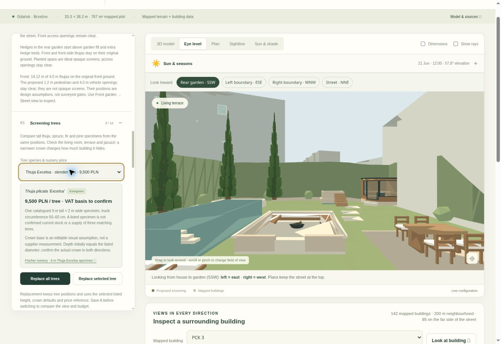

**Start with a scenario** now compares these three positions using Excelsa, 9 m white fir, 9–10 m Norway spruce, 6–7 m Brabant, 7 m Serbian spruce, imported 8–9 m Austrian pine, or 11 m Nordmann fir. The original broad 10 m pines and hedges-only remain named comparisons. Dropdown labels show the three-plant subtotal.

For an edited planting, choose **Tree species & nursery price → Replace selected tree / Replace all trees**. This keeps IDs, positions, rotation and inclusion, while applying the selected listed height, crown defaults and price reference. Save A before changing species, then use Compare A/B. Adding, moving, duplicating and independently sizing trees remains available.

Prices now distinguish published stock dimensions from assumed crowns and show the supplier's VAT basis. The two EUR prices use a labelled fixed **4.30 PLN/EUR planning conversion**. Markflor Brabant remains **net**. Enlarging an unquoted crown requires a custom price; changing a priced specimen's dimensions clears its old quote. Delivery, lifting, planting, anchoring and establishment are separate budget items. Individual specimen pages do not establish stock for three matching trees.

### Screening trade-off

The lower plant subtotal does not imply equal screening. At these fixed positions, the dense-envelope model hides **44.2% of PCK3 facade samples from the terrace with Excelsa**, against **95.9% with the original broad pines**. Roof samples still visible are **348 / 365 versus 52 / 365**. The new thuja, fir and spruce drawings have distinct botanical forms but stay within the same conical envelopes used by the calculations; cheaper trees never inherit the broad pine crowns.

See the [complete price, geometry and seven-viewpoint comparison](docs/tree-alternatives-2026-11-14.md), including all source links and placement limits, and the [reproducible analysis script](scripts/compare-tree-alternatives.mjs).

### Existing designs and validation

Schema **18** selects Excelsa for a fresh design. Schema **17** links and saves retain the original pictured pines; v1–v16 migrations and Korzeniowskiego's defaults remain intact. **Apply 9 m Excelsa** explicitly replaces the planting without changing the selected garden programme or other design settings. **Restore original pine reference** remains separate. Edits to an opened comparison link update its URL as well as local storage, so reload keeps the current comparison.

**Validation:** all **370 automated checks pass**, the 48-asset static build succeeds, and the hosted preview was checked for all seven options, individual/all-tree swaps, A/B, quote invalidation, reload persistence, legacy v17 restoration and property isolation. The hosted browser used the SVG fallback; its WebGL capability was disabled, so live WebGL rendering is not claimed for this release. Geometry/shadow containment is covered by automated mesh tests and code review. See the [validation record](docs/release-1.16.0-validation.md).

The sections below describe earlier releases and their historical defaults.

## Pictured planting that survives reload · 1.15.1

The explicit **Apply pictured tree positions** action places the three reference pines at (19.30, 30.20), (13.80, 35.80), and (18.45, 35.57) m, all 10 m high. It opens the dimensioned whole-plot plan, preserves the selected pool and hedge settings, and replaces the shared URL state so an older linked design cannot restore different trees on reload. A live match status and coordinate table make the applied geometry visible.

The attached reference has the same decoded pixels as the previous attachment. Its tree centres already match the source reference to roughly one screenshot pixel; the fix makes applying that reference explicit and reload-stable. The current longer pool is 3.5 × 8.0 m.

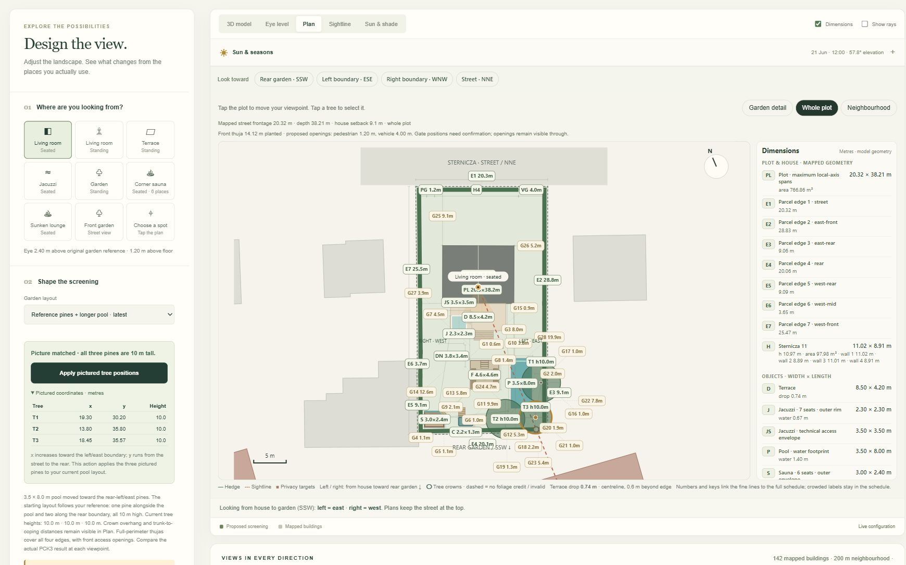

### Perimeter screening research

The [geometric comparison and recommendation](docs/perimeter-screening-study-2026-11-14.md) tests 15 cases across nine fixed viewpoints. It includes actual required edge-screen heights, wider specimen crowns, extra trees restricted to boundary strips, a terrace canopy and a clearly hypothetical narrow-conifer row. The [complete tree and supplier research](docs/research-edge-screening-trees-2026-11-14.md) and [blank 4h wall options](docs/research-4h-wall-options-2026-11-14.md) distinguish published product information from confirmed site quotations.

A continuous ideal opaque screen needs up to 13.15 m above the proposed planting grade for the tested PCK3 rays. This is not equivalent to a 13 m conifer with a tapered tip. The pool leaves only about 2.00 m to the east boundary, while documented giant-tree examples have 2.6–2.7 m root balls. The study keeps these installation limits visible. No alternative planting is silently applied to the user's reference design.

**Validation:** 351 automated checks pass; the build succeeds. Browser checks verify old linked-state recovery, reload persistence, the retained 6 m historical and 8 m current pools, hedge settings and a compatible custom tree price. See the [release validation record](docs/release-1.15.1-validation.md).

## Reference pines, a closer 8 m pool and the blank 4h wall · 1.15.0

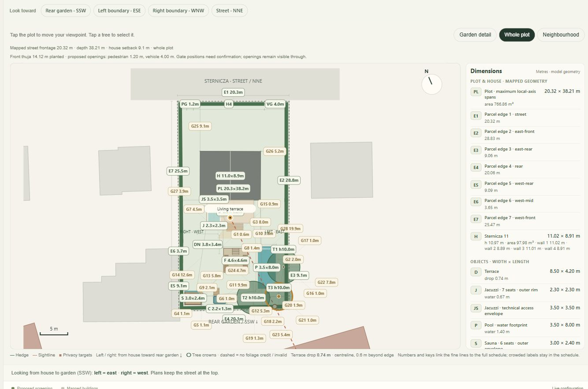

The new default follows the user's 14 November plan: **three 10 m Austrian pines**, with one alongside the pool near the left/east boundary and two along the rear. Their local positions are **(19.30, 30.20), (13.80, 35.80), (18.45, 35.57) m**. The reference crown diameters remain **6, 6 and 5 m**. Tree 1–3 spacing is 5.44 m; tree 2–3 is 4.66 m.

The pool is now **8 × 3.5 m**, 2 m longer than v1.14, at **(14.52, 26.30) m**. It moves **6.80 m rearward and 1.18 m inward**, letting it fit alongside the first pine and close to the rear pair. Measured from the full outer coping, the trunk-centre gaps are **1.00, 1.30 and 1.00 m**. The coping retains **2.00 m to the east plot edge** and **1.36 m to the sunken-lounge coping**.

These are concept clearances, not surveyed root-ball or excavation requirements. The crowns deliberately follow the supplied reference, including approximately **2.00 m east overhang for Tree 1, 0.81 m rear overhang for Tree 2, and 0.64 m east / 0.16 m rear overhang for Tree 3**. The model keeps those assumptions and the over-pool crowns visible.

### PCK3 visibility from unchanged viewpoints

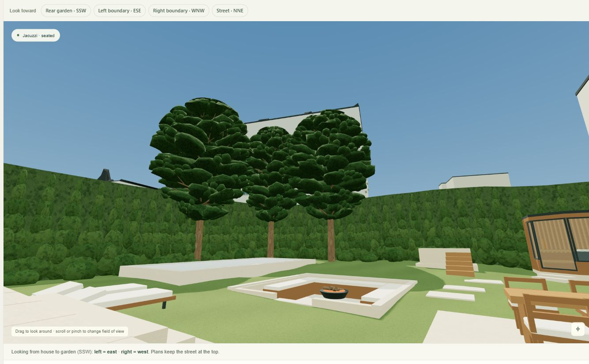

| Viewpoint | Dense façade points hidden | Roof points still exposed / 365 |
|---|---:|---:|
| Living room, seated | 90.35% | 105 |
| Living room, standing | 89.09% | 131 |
| Terrace | 95.86% | 52 |
| Jacuzzi | 96.68% | 51 |
| Garden preset | 99.96% | 0 |
| Sauna | 100.00% | 0 |
| Sunken lounge | 99.88% | 0 |

The new arrangement improves living-room, jacuzzi and garden wall screening compared with v1.14. It does not conceal PCK3 from every location: the dining viewpoints still expose about 22–25% of wall samples, and roof exposure increases from the house and terrace. Dense wall and roof counts remain separate. Actual foliage has gaps. Moving the pool under the crowns also changes sunlight: on the modeled 21 June, direct sun reaches **0/24 pool samples at 12:00, 4/24 at 15:00 and 19/24 at 17:00**. These are snapshots, not daily sunlight hours. See the [complete geometry, visibility and sunlight comparison](docs/reference-pool-screening-comparison.md).

### Building 4h and retained context

Building 4h is the irregular neighbour against the plot's physical right/west edge, mapped as `building-4`. Its two garden-facing wall segments are now blank, following the user's observation: no decorative panes, frames, mullions or sills. Other elevations remain illustrative. The official building footprint and height remain unchanged, and the façade inspector makes clear that exposed wall area is not a window count.

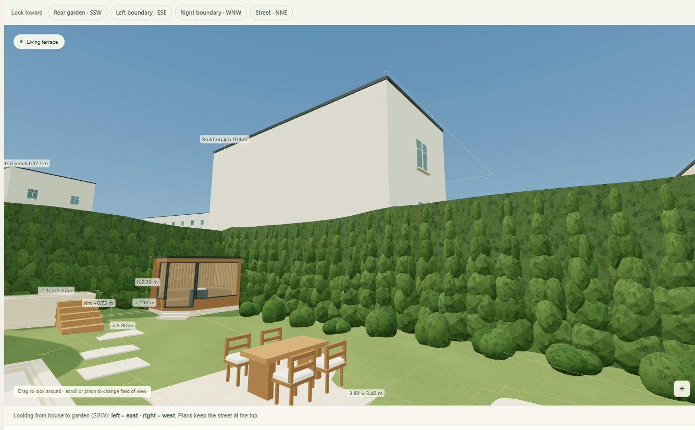

The **142 mapped surrounding buildings**, across-street views, **4 m thujas around every plot edge**, compact six-person sauna and seven-seat jacuzzi remain available. Historical layouts stay under their original Garden layout choices. The new pool's scenario list contains its reference pines and hedges-only, avoiding old planting presets that would overlap the moved pool.

### Budget and saved designs

The revised planning range is **802,926–1,382,131 PLN**, with the 20% uncertainty allowance applied to the upper total once. The three-pine supply reference remains **179,700 PLN**; the hedge supply, planting and delivery subtotal remains **52,375 PLN**. The **150,000–230,000 PLN installed-pool allowance is unchanged** and explicitly requires a project quotation for the new 8 × 3.5 m dimensions and position. Slightly lower total allowances reflect less garden fill, lawn and irrigation beneath the larger footprint; they do not indicate a cheaper pool quote.

Schema **v17** opens the new reference arrangement. Existing v16 links and saved designs retain the original 6 m pool, corner trees, custom edits, hedge settings and entered prices. The latest-design link above or Reset selects the new default.

**Validation:** 348 automated checks pass, the static build succeeds, and hosted WebGL checks confirm the revised dimensions, three 10 m trees, PCK3 counts, budget and blank 4h wall. See the [1.15 validation record](docs/release-1.15.0-validation.md).

## Rear-left corner, natural tree models and all-direction views · 1.14.0

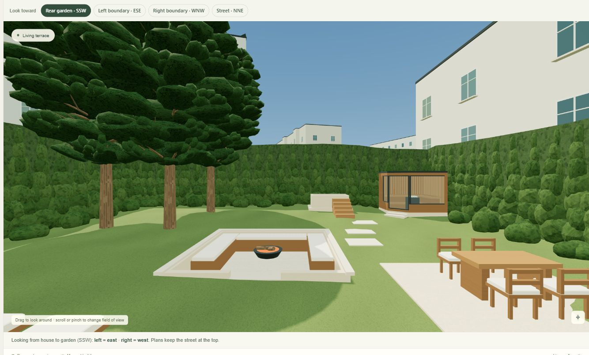

The new **Rear-left corner grove** keeps all three pine trunks in the far-left/east part of the rear garden, at **(17.30, 31.00), (14.80, 31.10), (14.50, 34.90) m**. Their footprint spans **2.8 × 3.9 m**, with the nearest two trunks **2.50 m apart**. No pine is pulled forward into the centre of the lawn. All three nominal crowns overlap and fit within the mapped parcel; the closest crown has only about 7 mm of nominal boundary margin, so this is a model fit rather than a surveyed planting clearance.

The default uses **10 m height and 6 m crown diameter**, the upper end of the existing supplier's listed **9–10 m / 4–6 m** stock band. The actual three specimens, crown density, root balls and spacing require supplier confirmation. The plant reference remains **179,700 PLN**, excluding the separately budgeted delivery, lifting and establishment. A named comparison retains the same positions at the **9.5 m / 5 m** catalogue midpoint. Older arrangements remain explicit comparisons.

**The corner preference is now a fixed design constraint. It does not completely hide PCK3.** With dense nominal crowns, the 0.25 m façade grid reports:

| Unchanged viewpoint | Visible façade points | Hidden façade samples |
|---|---:|---:|
| Living room, seated | 859 / 5,214 | 83.5% |
| Living room, standing | 930 / 5,214 | 82.2% |
| Jacuzzi, seated | 2,649 / 9,702 | 72.7% |
| Named garden viewpoint | 139 / 5,214 | 97.3% |

These are samples, not visible surface area. Real needle pads and branch gaps can expose more than the opaque analytical envelope. The previous forward arrangement hides more from the house but does not satisfy the user's requested corner layout. The [corner geometry study](docs/rear-corner-screening-comparison.md) records those tradeoffs without moving the observers or the mapped building.

Pines now use deterministic tapered bark trunks, branch whorls and irregular needle pads, contained within their measured envelopes. Thuja foliage, materials, water and nearby building façade detail have been refined. Decorative windows and finishes are illustrative and do not change mapped footprints or heights.

The context expands from **18 to 142 surrounding buildings**, including **85 on the far side of Sternicza**, using the original official GUGiK 2024 CityGML source within a **200 m radius**. These LoD1 flat tops describe median laser heights, not surveyed roof ridges. Selected existing detailed roof returns remain intact. A separate 4 m context DTM extends the visible ground while the property retains its original 1 m analytical terrain. See the [source record](docs/sternicza-neighborhood-expansion.md).

Use **Look toward → Rear garden / Left boundary / Right boundary / Street**, or select any mapped building under **Inspect a surrounding building** and choose **Look at building**. These controls turn the camera without moving the eye. The inspector gives a separate dense façade check for every mapped building; unmapped roof detail is explicitly unavailable. The mapped house blocks cross-house rays from outdoor viewpoints, while indoor presets retain the glazing sightline assumption.

Full-perimeter thujas still cover front, left, right and rear: **107.27 m / 137 plants**, with **1.2 m pedestrian and 4.0 m vehicle openings**. The pool remains **6 × 3.5 m**, sauna **3 × 2.4 m**, and seven-seat spa **2.3 × 2.3 m**. The total planning range remains **804,296–1,384,672 PLN**, including the upper 20% allowance once.

Schema **v16** gives fresh designs the corner layout. Sparse v15 links and saved designs preserve the exact previous `spa-aligned` arrangement and all earlier migrations remain available. Use the latest link above or Reset to apply the new default.

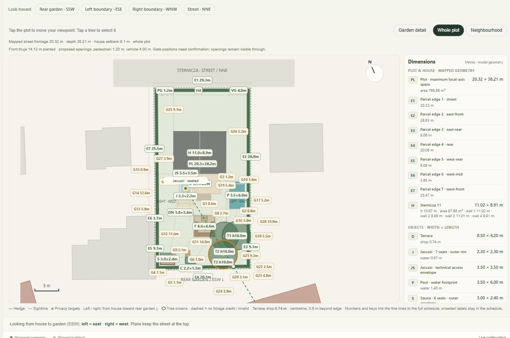

**Validation:** 339 automated checks pass and the hosted WebGL preview confirms the tree group, full-perimeter dimensions, street hedge comparison and all-building inspector. See the [1.14 release validation](docs/release-1.14.0-validation.md).

## PCK3 façade screen and full-perimeter thujas · 1.13.0

The default now spreads three overlapping 9.5 m Austrian-pine crowns across PCK3's façade, following the supplied visual reference. The trees are at **(17.00, 26.80), (14.40, 28.40), (12.60, 32.70) m**. The nearest and centre trunks are **3.05 m apart**, with another **4.66 m** between centre and rear tree; the crowns form a connected group and remain inside the parcel.

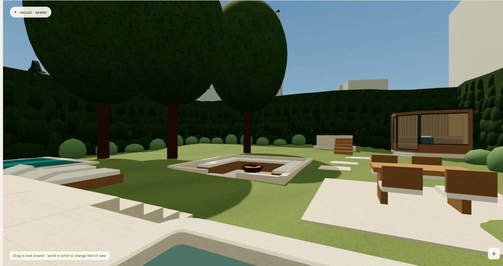

The pool moves toward the house and shortens to **6.0 × 3.5 m**, leaving **1.02 m between the nearest trunk and far coping**. This space brings the screening crown forward enough to intercept the higher living-room sightlines. The compact six-person sauna and seven-seat jacuzzi retain their established dimensions.

**The façade now has a separate 0.25 m grid check.** Actual WebGL review revealed a window gap that the previous coarse façade samples missed, including an unsampled upper wall band. The new readout reports the dense façade result separately from the mapped roof samples, without mixing their different densities into one percentage.

| Unchanged viewpoint | v1.12 visible façade points | New visible façade points | New visible roof samples |
|---|---:|---:|---:|
| Living room, seated | 1,868 / 5,214 | **49 / 5,214** | 5 / 365 |
| Living room, standing | 1,980 / 5,214 | **63 / 5,214** | 8 / 365 |
| Jacuzzi, seated | 1,290 / 9,702 | **572 / 9,702** | 4 / 365 |
| Named garden viewpoint | 34 / 5,214 | **493 / 5,214** | 115 / 365 |

Living-room and jacuzzi screening improves substantially, but **PCK3 is not completely concealed**. Small openings and roof-edge slivers remain. The named rear-garden viewpoint is more exposed than before, and the sunken lounge still has material exposure. The garden camera is unchanged and now 1.00 m from the rear trunk centre; its screening remains sensitive to position and includes trunk occlusion. Living-room and jacuzzi tree screening comes entirely from crowns. These are finite sample counts, not visible wall area or a guarantee of real foliage. See the [geometry and view comparison](docs/aligned-grove-screening-comparison.md).

**Thujas now follow the entire plot perimeter:** front, full left side, full right side and rear. Side planting continues beside the house to the street. The front retains the proposed 1.2 m pedestrian and 4.0 m vehicle openings. At 0.5 m inset there are **107.27 m of planted hedge**, versus 72.24 m before; at 0.8 m spacing the budget includes **137 thujas**, versus 93. The new front-side sections remain on existing grade; rear fill does not lift the front garden.

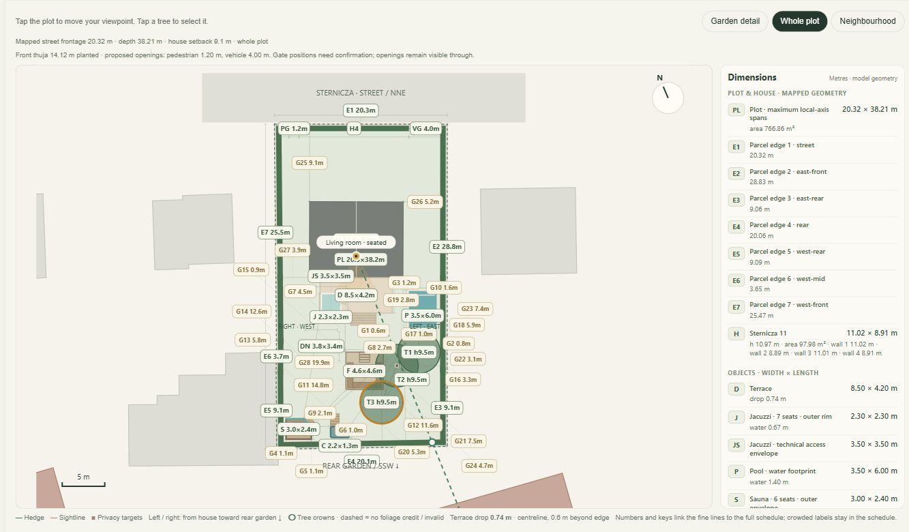

The hedge subtotal is **52,375 PLN** before contingency: 41,100 plants, 10,275 planting and 1,000 shared delivery. The complete current planning range is **804,296–1,384,672 PLN**, with 20% uncertainty applied to the upper total once. The smaller pool retains its existing installed planning allowance pending a project quotation. Added front-side irrigation and revised rear quantities are included.

Schema **v15** preserves the full-perimeter setting explicitly. Existing v14 and older links retain their original planting extents, pool and trees. The latest link above or Reset opens the revised design.

**Validation:** all **307 automated checks pass**, the static build succeeds, and the hosted WebGL preview matches the dense façade counts and full-perimeter quantities. See the [release validation record](docs/release-1.13.0-validation.md).

## Close pine grove · 1.12.0

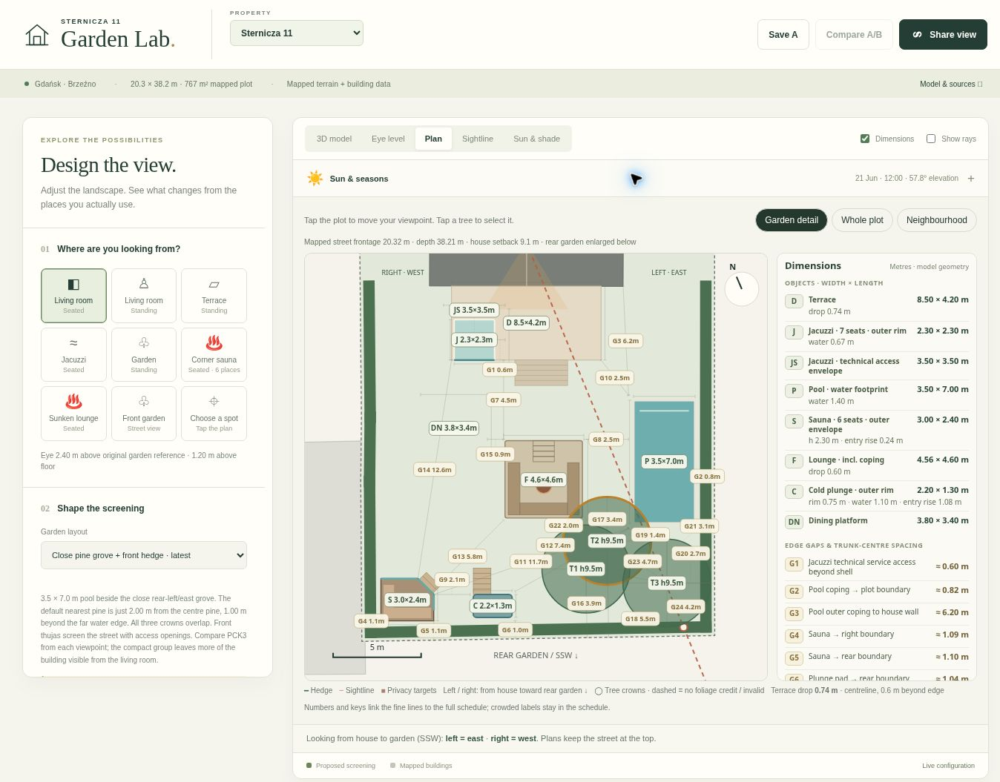

The nearest pine now stands **2.00 m from the centre pine**, correcting the previous 8.52 m separation. All three nominal 5 m crowns overlap as one close grove at the rear-left/east pool end. The trees remain 9.5 m Austrian pines at **(13.0, 34.1), (14.2, 32.5), (17.6, 34.9) m**. All three modeled crowns fit inside the parcel.

The **7 × 3.5 m pool** starts at **(15.7, 24.5) m** and ends 1.00 m before the nearest trunk, with a **1.42 m trunk-centre to outer-coping gap**. The independent **4 m front thuja hedge**, its pedestrian and vehicle openings, compact sauna and seven-seat jacuzzi remain part of the default. Plant quantities and planning prices are unchanged.

The close spacing is the requested design preference. It hides about **41% of PCK3 samples from the seated living room, 40% standing, 85% from the jacuzzi and over 99% from the named garden viewpoint**. Those results stay visible in the simulator. The previous spaced-pine layout remains available for comparison. This is modeled crown geometry; real branches have gaps, and the close planting needs nursery/root-ball confirmation. See the [close-grove measurements and screening comparison](docs/tight-grove-screening-comparison.md).

**Validation:** all 279 automated checks pass and the static build succeeds. The hosted preview confirms the 2.00 m spacing on plan, selected-tree coordinates, front hedge, capacities, budget and live PCK3 count. See the [release check record](docs/release-1.12.0-validation.md).

Schema **v14** gives fresh designs the close grove. Existing v13 links and saved designs retain their published pool and tree positions; the latest-design link above or Reset selects the corrected default.

## Front street hedge and pool-end pine screen · 1.11.0

The new **Pool-end pines + front hedge · latest** layout adds the street screen and brings the nearest pine forward beside the far end of the pool. The pool moves **5.0 m toward the house**, from local y24.5 to y19.5, and shortens from **8.0 to 7.0 m** while retaining its **3.5 m width**. The compact six-person sauna and seven-seat spa remain the same sizes.

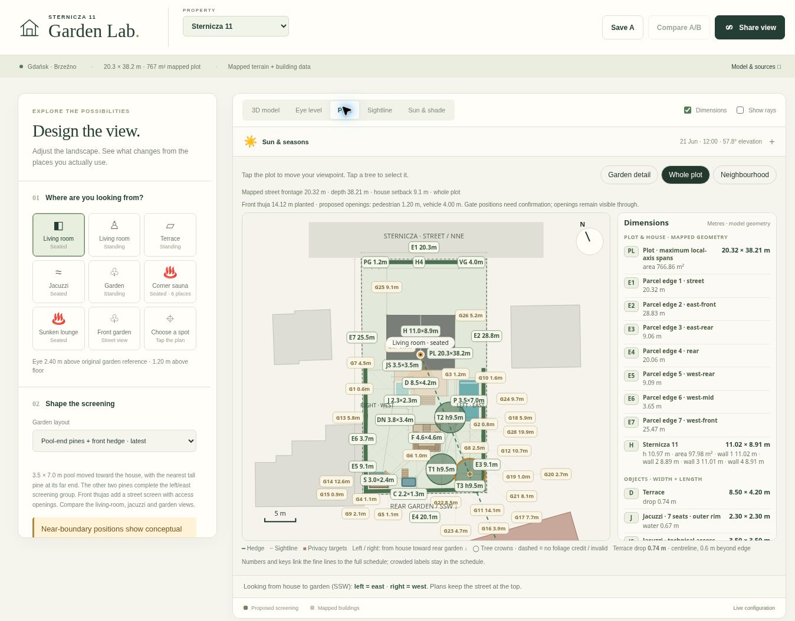

### Front street privacy

The fresh Sternicza default includes **4 m thujas across 14.12 m of planted frontage**, at the existing front-ground elevation. The proposed **1.20 m pedestrian opening** aligns with the illustrated west-side approach; the **4.00 m vehicle opening** sits at the east-side passage. These are explicit design positions, not surveyed gates. Openings and oblique side-passage views remain clear. The two hedge spans require **19 thujas at 0.8 m spacing**.

Use the independent **Front hedge · street** height control, the **Front garden · Street view** button, or **Plan → Whole plot** to inspect the screen and its dimensions. The front viewpoint describes the street screen instead of displaying unrelated rear-building coverage percentages. Rendering, sightline intersections, sunlight and quantities all use the same two planted spans. Rear earthworks never raise the front hedge.

### Three pines beside the moved pool

The three 9.5 m Austrian pines now stand at **(13.0,34.1), (14.4,25.7), (17.6,34.9) m**, with unchanged 5 m crown diameters and 2.5 m clear stems. The nearest tree sits **0.80 m toward the house from the far water end**, beside that corner, with **1.02 m from trunk centre to outer coping**. All three nominal crowns fit inside the mapped parcel. This is a staggered screen, with the two rear pines remaining in the left/east garden area.

The pool has a **1.23 m shortest outer-coping-to-house gap**, **1.56 m to the terrace edge**, and **0.82 m to the left/east plot boundary**. These are geometric planning clearances, not surveyed construction approvals. Root-ball, lifting and maintenance details still need to match the purchased specimens.

| PCK3 viewpoint | Previous v1.10 hidden samples | New v1.11 hidden samples |
| --- | ---: | ---: |
| Living room · seated | 51.9% | **90.2%** |
| Living room · standing | 48.6% | **90.0%** |
| Terrace · standing | 81.9% | **96.9%** |
| Jacuzzi · seated | 90.0% | **92.0%** |
| Garden preset · standing | 99.8% | **99.8%** |
| Sunken lounge · seated | 94.3% | **94.5%** |
| Sauna · seated | 100% | **100%** |

The [full 19-view study](docs/pool-end-screening-comparison.md), [recorded geometry and results](docs/pool-end-screening-comparison.json), and [reproducible comparison](scripts/compare-pool-end-screening.mjs) include the remaining exposed positions. Dining is **78.0%** screened, the right garden path **64.6%**, the new inner pool path **59.8%**, and the far pool end **76.4%**. The design improves the main occupied views; it does not conceal PCK3 from every walking position. These percentages count target samples, not façade area, and assume dense crown envelopes with no foliage gaps.

On June 21, the moved pool has **16/24 sunlit samples at noon** and **8/24 at 15:00**, versus 11/27 and 1/27 before. The forward pine also adds terrace shade: noon drops from 32/32 to **25/32** on June 21, and from 29/32 to **10/32** on September 21. The same scene geometry drives both the privacy and sunlight calculations.

### Budget and saved designs

Front thujas add **5,700 PLN in referenced plant supply**, **1,425 PLN in planting allowance**, and **494–918 PLN in drip-irrigation allowance**. The existing hedge-delivery allowance is counted once. Proposed new gate and driveway construction are not priced as part of this hedge addition.

The complete updated garden planning range is **785,885–1,360,869 PLN**; the upper bound includes a **20% uncertainty allowance once**. The shorter pool retains its **150,000–230,000 PLN installed planning range** until a project quote establishes a saving. Its smaller footprint adds 3.5 m² to landscape/fill quantities. See the [itemised budget and supplier references](docs/garden-budget-2026-11-13.md).

**Validation:** all 271 automated checks pass and the static build succeeds. The hosted preview was checked for the whole-plot dimensions, street view, independent front-height control, hedge quantities and main PCK3 counts. See the [release check record](docs/release-1.11.0-validation.md).

Schema **v13** explicitly preserves the new programme and independent front setting. Older shared links and saved designs keep their original pool, trees and front-off state; the new-default link above or Reset loads the revised design. Korzeniowskiego retains its existing front and garden proposal.

## Previous release: left-edge pines, compact spa, measurements and budget · 1.10.0

The **Previous compact spa · rear-left grove** option retains this published garden geometry. The pool stays along the physical left/east boundary, the smaller sauna remains tucked against the rear-right/west corner, and the jacuzzi remains recessed at the outside edge of the living-room terrace. The terrain and fixed living-floor reference remain shared by the drawings, visibility and sun calculations.

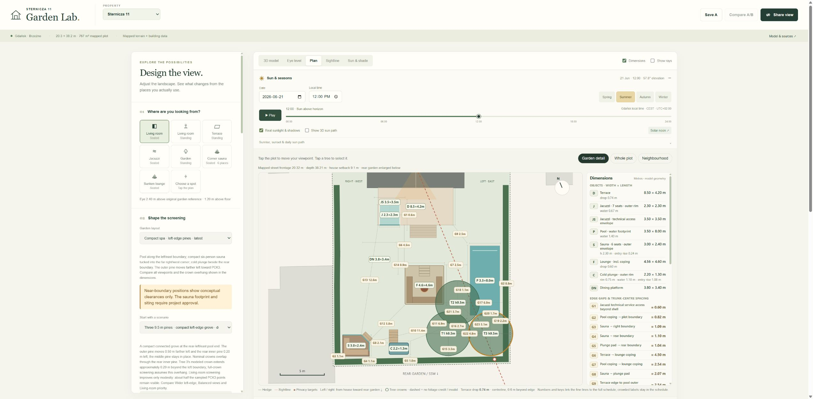

### Compact pines farther left, with the tradeoff measured

All three pines remain **9.5 m tall**, with nominal **5 × 5 m crowns**, in a compact grove at the rear-left/east end of the pool. Their trunk positions are **(13.30, 34.50), (14.35, 31.00), (18.10, 34.50) m**. Larger X means farther left/east looking from the house. The outer pine moves **0.50 m farther left**, the rear inner pine moves **0.20 m left and 0.05 m rearward**, and the middle pine stays in place.

The trunk group remains **4.8 × 3.5 m** and its nominal crowns form a **connected overlapping group**: pine 1 overlaps both other crowns. The outer trunk is approximately **2.21 m inside** the actual parcel boundary and its modeled crown extends approximately **0.29 m beyond** it. The preset and tree warnings disclose this assumption. **Contained corner** restores the previous grove with all crowns inside the parcel.

| PCK3 viewpoint | Previous contained grove, under current compact geometry | New compact left-edge default |
| --- | ---: | ---: |
| Living room seated | 213 / 420 visible samples | **202 / 420** |
| Living room standing | 225 / 420 | **216 / 420** |
| Terrace standing | 83 / 420 | **76 / 420** |
| Jacuzzi seated | 33 / 460 | **46 / 460** |
| Named garden position | 1 / 420 | **1 / 420** |

The house-screening improvement is modest: the new grove hides **51.9%** of seated and **48.6%** of standing living-room samples, **90.0%** at the jacuzzi and **99.8%** at the named garden position. It **does not hide PCK3 completely**. Counts are sampled target points, not façade-area percentages; real foliage has gaps.

**Wider left-edge · stronger house screen** retains the more spread-out arrangement as an explicit comparison. It hides 63.6% of seated and 60.0% of standing living-room samples, but its 5 m crowns no longer overlap and the outer crown extends 1.49 m beyond the boundary. **Balanced views** and **Living-room priority** also remain available. The [17-view comparison](docs/left-edge-screening-comparison.md), [recorded geometry/results](docs/left-edge-screening-comparison.json) and [reproducible study](scripts/search-left-edge-pck3-layouts.mjs) cover all positions and tradeoffs. At June 21 noon the default pool's sunlit samples change from 13/27 to 11/27, and at 15:00 from 0/27 to 1/27; compare seasons and times before choosing.

### Capacity-based sauna and jacuzzi

| Feature | New geometry | Basis |
| --- | --- | --- |
| Six-person corner sauna | **3.00 × 2.40 × 2.30 m** external envelope, six distinct seated positions | RoyalSauna Premium size reference; diagonal glazing remains a custom concept. Previous enclosure was 4.20 × 4.10 × 2.65 m. |
| Seven-seat jacuzzi | **2.30 × 2.30 × 0.90 m** external reference, seven illustrative seat positions | Wellis Vienna Life has seven actual seated places. Previous 2.20 m square was not oversized for seven. |
| Jacuzzi service space | **0.60 m on every side**, **3.50 × 3.50 m** total envelope | Technical access through removable decking and garden-side access; not extra water area. |

The default is a sealed factory-style spa recessed flush with the deck. **Custom overflow / infinity concept** is a separate toggle and complete installed budget alternative. It is not represented as a certified modification to the Vienna shell. The modeled water level, sun receivers and rendering update together. Sauna bench geometry, glass, approach steps and sitting height follow the smaller enclosure and actual grade. The illustration is not a manufacturer construction drawing.

### Measurements from garden to neighbourhood

Keep **Dimensions** on and choose **Garden detail**, **Whole plot** or **Neighbourhood** in Plan or Sun & shade. Fine lines and numbered keys accompany a complete measurement schedule. The 3D/eye views use small labels with collision and occlusion handling.

Measurements now include every parcel segment and actual polygon area, house wall segments and setbacks, oriented building envelopes, nearby-building roof heights, shortest plot-to-building and house-to-building gaps, feature-to-feature gaps, tree spacing, trunk-to-boundary distances and service access. An envelope is explicitly distinguished from the actual footprint or wall length.

The mapped model gives **20.32 × 38.21 m maximum local-axis plot spans**, **766.86 m² actual polygon area**, **9.10 m from the house to the street-side parcel boundary**, **6.75 m from PCK3's footprint to the nearest actual parcel segment**, and **27.27 m from the house footprint to PCK3's footprint**. These are model-derived measurements, not a construction survey. Building sensitivity adjustments update these distances and heights without being applied twice.

### Itemised garden costs and supplier references

The budget now covers the five spa installations plus terrace and steps, paths and paving, furniture, ornamental planting, lawn, irrigation, lighting, shared garden utilities, garage demolition, design and an optional canopy. Specimen delivery, lifting, planting, anchoring and establishment are included as explicit planning ranges when enabled.

| Default category | PLN before contingency |
| --- | ---: |
| 4 m hedge planting | 28,750 |
| 0.5 m raised-garden earthworks | 46,129 |
| Three large pines and services | 195,750–221,100 |
| Pool, seven-seat spa, sauna, plunge and sunken lounge | 355,000–550,000 |
| Garden finishes and enabling works | 151,952–278,978 |
| **Total before contingency** | **777,581–1,124,956** |
| **Displayed planning range, 20% on upper figure only** | **777,581–1,349,948** |

Published product prices and installed-work assumptions are separately labelled. No site-specific supplier quotations have been received. Positive quote fields replace the entire relevant line; catalog benchmarks are never added again. Disabling planning allowances makes missing quotes explicit instead of treating unpriced work as free. [The price and methodology audit](docs/garden-budget-2026-11-13.md) documents sources reviewed on **13 November 2026**, scope mismatches, tax treatment and provisional quantities. House renovation, a basement garage, front driveway/boundary work, major incoming utility upgrades and running bills are outside this rear-garden total.

**State version 12** preserves old links and saved designs, including the previous v11 trees, large sauna, 2.2 m overflow-style tub and quote-only budget. The latest link above explicitly loads the new defaults. Korzeniowskiego retains its own geometry and default budget scope.

**Verification:** All **247 automated checks** pass and the static build succeeds. Hosted browser review with the actual WebGL renderer confirms the compact grove, smaller sauna, seven-seat spa, readable garden and neighbourhood measurement schedules, PCK3 counts at the living room / jacuzzi / garden, the wider-layout comparison, installed-quote replacement and explicit missing-quote handling. No browser errors or warnings occurred in the reviewed preview. The documented map measurements and supplier price references were independently audited.

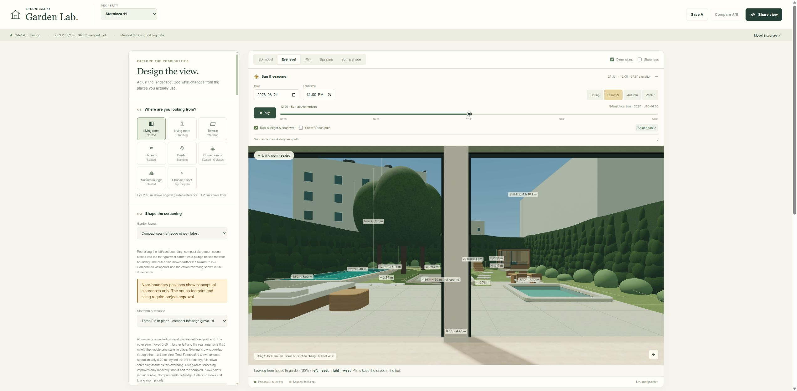

## Previous rear-left grove · 1.9.0

Fresh/reset Sternicza designs now group **three 9.5 m Austrian pines** behind and along the far end of the left/east pool. Left means looking from the house into the rear garden. Their trunk centres occupy a **4.50 × 3.50 m** rectangle, with **3.67–4.78 m** spacing between trunks. The modeled **5 m crowns overlap**, forming a canopy envelope approximately **9.50 × 8.50 m**. The pool, corner sauna, plunge, edge jacuzzi, sunken lounge, terrain and dimension overlay retain the perimeter layout introduced in 1.8.

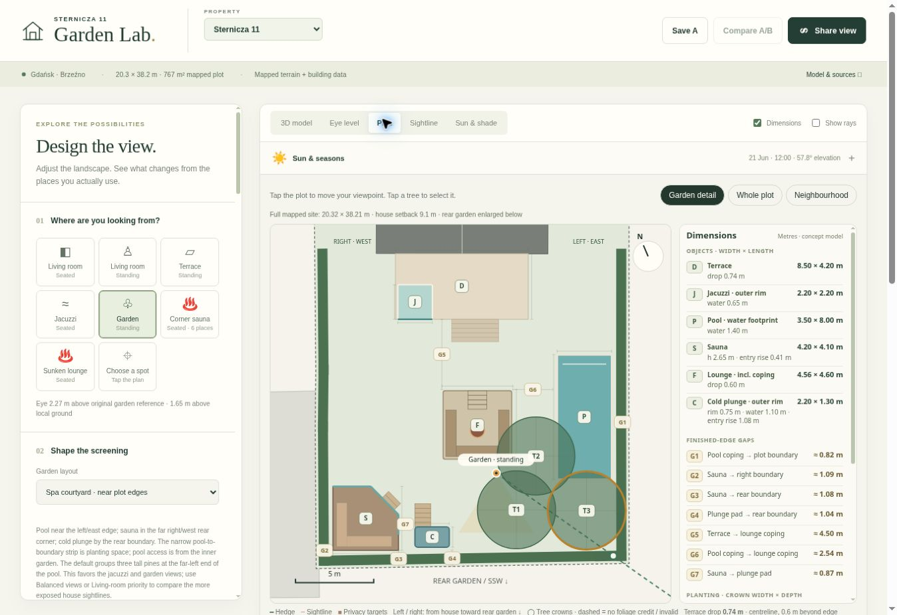

The requested composition has a measurable tradeoff. It slightly improves PCK3 screening from the named jacuzzi and garden positions, but moving the forward tree back substantially weakens the living-room screen. It does **not** conceal PCK3 completely from all three areas.

| View | Previous balanced arrangement: visible PCK3 samples | New corner grove: visible PCK3 samples |
| --- | ---: | ---: |
| Living room seated | 41 / 420 | **213 / 420** |
| Living room standing | 44 / 420 | **225 / 420** |
| Terrace standing | 20 / 420 | **83 / 420** |
| Jacuzzi seated | 44 / 460 | **34 / 460** |
| Garden preset | 2 / 420 | **1 / 420** |
| Sunken lounge | 17 / 420 | **27 / 420** |

These are target sample counts, not percentages of visible façade area. Real foliage has gaps. From the elevated living room, the rearward crowns appear lower; some diagonal rays also leave the plot before reaching the rear planting band. The named garden position is one point, not the whole garden. The [17-view study](docs/corner-screening-comparison.md), [recorded measurements](docs/corner-screening-comparison.json) and [reproducible search](scripts/search-corner-pck3-layouts.mjs) document the layout, assumptions and constraints.

**Start with a scenario** now offers **Rear-left grove · default**, **Balanced views · previous default**, and **Living-room priority**, alongside the existing mixed-size, budget and hedges-only choices. Each of the three-tall-tree arrangements has the same **179,700 PLN plant reference subtotal**. Moving trees does not change stock size or plant price. Delivery, lifting, planting and establishment remain separately editable.

The corner grove also changes shade. On June 21 at noon, the pool stays at **13/27 sunlit grid points**, while the terrace increases from **25/32 to 32/32**. At 15:00, the pool changes from **9/27 to 0/27**. Use **Sun & shade** to compare the time and season that matter to you; the compact grove is not uniformly sunnier.

**State version 11** preserves existing designs. Sparse v10 links and saves restore the exact previous balanced three-tree arrangement, including the perimeter spa and enabled dimensions. Explicit tree positions, empty arrays, disabled trees and quotes remain intact. Earlier versions and Korzeniowskiego keep their own baselines. Use the current Sternicza link above, Reset, or select the new grove to load the new proposal.

**Verification:** All **218 automated checks** pass and the static build succeeds. Hosted browser checks confirm the new default, actual PCK3 counts from the seated living room, jacuzzi and garden, the unchanged plant subtotal, the Balanced views comparison, three overlapping crowns and the dimension schedule. A sparse v10 link restores the previous arrangement and 41/420 seated PCK3 count. The cloud browser does not support WebGL, so these hosted visual checks used the existing lightweight renderer and SVG plan; the WebGL-specific geometry remains covered by the existing automated tests.

## Previous perimeter layout and dimensions · 1.8.0

Version 1.8 introduced **Spa courtyard · near plot edges**, retained as a previous garden programme. The pool is farther toward the physical **left/east**, the six-person sauna is tucked into the far **right/west rear corner**, and the cold plunge is next to the rear boundary. The large terrace and edge jacuzzi remain, with the sunken fire lounge in the middle. Its former planting default is now the **Balanced views** comparison; the results and screenshots in this section describe that earlier arrangement.

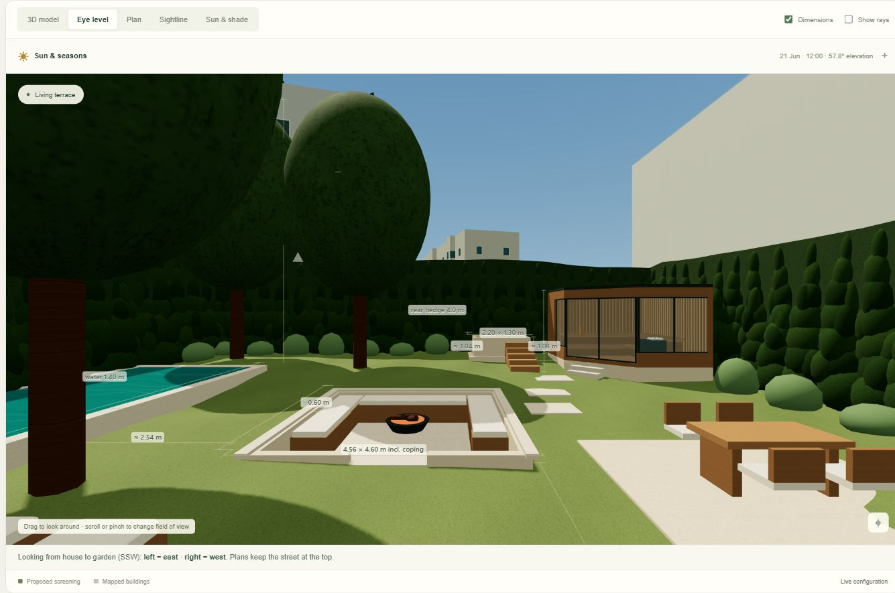

### Finished edges and real levels

| Feature | Size | Mapped boundary clearance |
| --- | --- | --- |
| Pool | 3.50 × 8.00 m water; 0.28 m coping | **≈ 0.82 m** from outer coping to the east/left parcel edge |
| Sauna | 4.20 × 4.10 m outer envelope; 2.65 m external height | **≈ 1.09 m west/right**, **≈ 1.08 m rear** |
| Cold plunge | 2.20 × 1.30 m outer rim; 1.10 m water depth | **≈ 1.04 m** from the outer pad to the rear parcel edge |
| Sunken lounge | 4.40 × 4.40 m pit; **4.56 × 4.60 m including coping** | **2.54 m** between its outer coping and the pool coping |
| Living terrace | 8.50 × 4.20 m, including the 2.20 × 2.20 m edge jacuzzi | **≈ 0.74 m** down to the proposed garden at the existing reference point |

The dimensions use the actual mapped boundary segments, including the small inward kink beside the pool. They are not measured from an axis-aligned rectangle. The rear garden keeps the measured slope under the selected uniform fill. Sauna and plunge pads reach down to the low side of their footprints; their access treads use the actual approach grade. The sauna has two treads with approximately 0.136 m risers; the plunge has five 0.30 m treads and approximately 0.179 m risers.

The pool-to-boundary strip is planting space, not a full clear walkway behind a thick hedge. Pool access is from the inner garden; hedge width and trimming must fit the narrow strip. These are model clearances, not approved building setbacks. The near-boundary sauna needs a project-specific siting check.

### Third full-height pine restored

The balanced default now has **three 9.5 m Austrian pines**, each with the existing catalog **5 m crown** assumption. Pine 3 is brought forward beside the pool, where its height intercepts the elevated living-room rays. The reference plant subtotal is **179,700 PLN**; delivery, lifting, planting and establishment remain separately editable and unquoted unless supplied.

The new layouts are tested against PCK3 from **seven named viewpoints plus ten additional occupied/path locations**, using the current spa geometry. The balanced design materially improves the living room, terrace and jacuzzi compared with the previous behind-pool planting, while preserving better garden coverage than a house-only arrangement. It still leaves residual sampled views: **three trees do not establish 100% concealment from everywhere**. Crowns are dense idealized shapes, and actual foliage gaps can expose more.

**Start with a scenario** includes:

- **Three 9.5 m pines · balanced views · default**: the main proposal.
- **Three 9.5 m pines · living-room priority**: puts more screening in front of the house, with more exposure around the fire lounge and pool paths.
- **Two 9.5 m + one 5.5 m pine**: optimized lower-cost comparison; 136,700 PLN plants only.
- **One 9.5 m + two 5.5 m pines**: budget comparison; 93,700 PLN plants only.
- **Hedges only**: same spa, 4 m hedges and 0.5 m fill without specimen trees.

The comparison includes both historical planting arrangements, same-position size changes and instantaneous sunlight checks. Full results and reproduction details are in [the new screening comparison](docs/edge-screening-comparison.md) and [machine-readable results](docs/edge-screening-comparison.json) and `scripts/search-edge-pck3-layouts.mjs`. Tree trunks retain concept planting space, but their crowns intentionally overhang parts of the pool/spa edges. The modeled crowns stay clear of the fire bowl itself; this is not a fire-safety or arboricultural certification. The additional screening also changes shade, so compare **Sun & shade** at your own times and seasons.

### Subtle dimension overlay

The **Dimensions** checkbox above the viewer is on in fresh designs. It shows fine lines and metre labels in the 3D model, eye view, plan and garden shade map. Sightline sections label only objects actually cut by that section. Measurements include feature width/length, boundary gaps, selected gaps between features, terrace and lounge drops, water depths, sauna height, separate hedge heights, and tree height/crown sizes.

3D labels remain small, avoid overlapping one another and disappear behind opaque geometry. With dimensions on, the plan starts in **Garden detail**: a closer drawing with quiet keys and a complete measurement schedule beside it (below it on a phone). **Whole plot** and **Neighbourhood** remain available. The sunlight map uses the same readable keys and schedule. Measurement bases are included in the scenario export. Lines are non-interactive, so selecting a viewpoint or tree still works. The switch is independent of sightline rays and is saved/shared with the design. JSON exports include the full metric records even when the overlay is hidden.

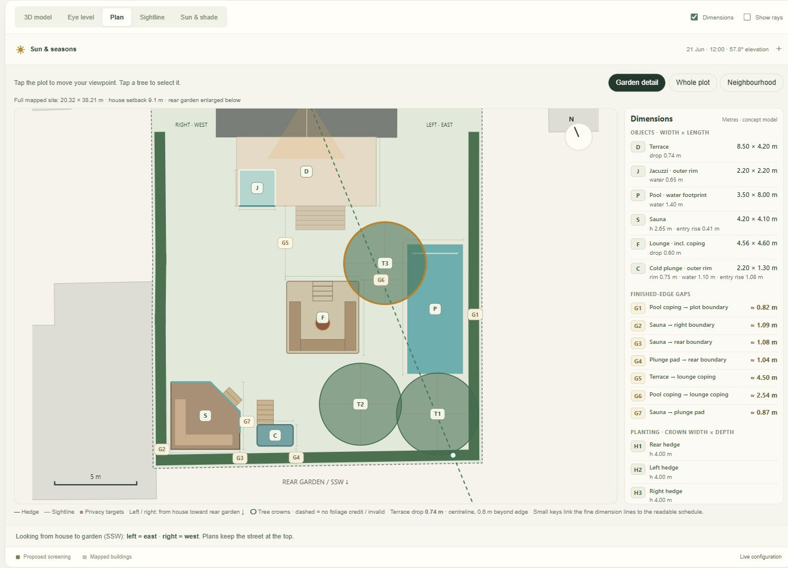

**State version 10** preserves older designs: v9 keeps the original spa and its actual pines; v1–8 keep the original west-pool arrangement. Existing scenarios do not silently acquire taller trees or move their pool. Select the new garden layout, use Reset, or follow the current Sternicza link above to load the latest defaults. Known named planting layouts transfer to a compatible preset; custom trees remain with conflict warnings. Korzeniowskiego retains its own geometry.

**Verification:** 212 automated checks pass and the static build succeeds. Hosted browser checks cover the three-pine presets, live PCK3 counts, independent hedges, fill-responsive terrace drop, dimension visibility, readable plan and sun-map schedules, v9 saved designs, property isolation and a 390 × 844 phone layout. All 40 current dimension records appear in the schedule; the phone schedule scrolls without horizontal overflow. The browser reported no script errors.

## Previous spa courtyard · 1.7.0

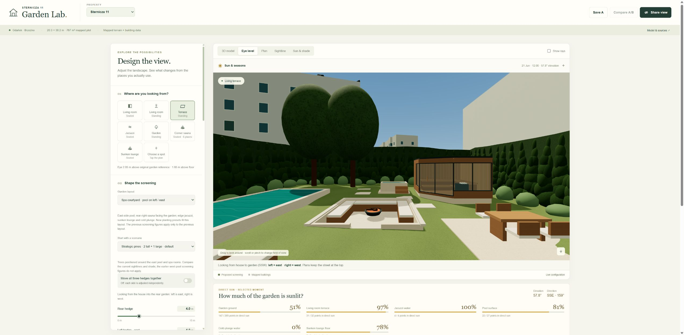

Version 1.7.0 introduced **Spa courtyard**, retained as **Previous spa** in the layout selector. The pool moves to the physical **left/east** when looking from the house into the rear garden. A six-person corner sauna occupies the rear **right/west**, with glazing toward the garden centre, pool and terrace. This is a metric proposal on the existing mapped parcel, not a replacement of the source survey or a construction-ready design.

| Feature | Proposed geometry |
| --- | --- |
| Pool | 8 × 3.5 m water footprint, x 14.7 / y 24.5; coping remains inside the parcel |
| Corner sauna | 4.2 × 4.1 m overall, chamfered glazed corner, L-shaped benches for six; x 3.3 / y 30.5 |
| Terrace jacuzzi | 2.2 × 2.2 m, outer end aligned with the terrace edge; water 35 mm below the terrace and a garden-facing overflow lip with a catch slot |
| Sunken fire lounge | 4.4 × 4.4 m, floor 0.6 m below its rim, built-in seating and four 150 mm steps; x 8.4 / y 26.8 |
| Cold plunge | 2.2 × 1.3 m beside the sauna, 1.1 m water depth, raised rim and entry steps; x 8.3 / y 33.2 |

Coordinates use the simulator's local metre frame. The pool coping and flat spa pads account for the mapped slope; the garden itself retains that slope under a uniform soil addition. The pool occupies part of the old garage position, so this layout includes removing the detached garage. Sauna, firepit, pool and plunge do not overlap, and the default firepit-to-pool-coping passage is at least 1.5 m. Extreme terrace height/depth changes can lengthen the stairs into the fire lounge; an in-app message identifies that conflict.

**Corner sauna** and **Sunken lounge** are new eye-level viewpoints. The sauna opens diagonally toward the house and garden centre. Its glass is transparent to the numerical sightline and sunlight calculations; opaque timber, roof and raised pad are modeled. The fire-lounge observer stands or sits relative to its lowered floor, rather than floating at garden grade. The plan, section, 3D model and sun map share these positions and elevations.

The jacuzzi is an **overflow-style concept**. Final structural support, waterproofing, balance tank/circulation and the overflow detail require a pool designer. The sunken lounge also needs an actual drainage and retaining design; its illustrated floor drop is not an excavation quantity or a claim that it can drain by gravity.

### Sunlight is a tradeoff

The requested left-side location is not uniformly sunnier in the current model. With the same 4 m hedges and no specimen trees, it gains some March afternoon sun but loses June morning sun to the east hedge. The new specimen trees can shade the pool around noon and later in the afternoon. The comparison is recorded in [spa sunlight results](docs/spa-sun-comparison.json) and can be reproduced with `node scripts/compare-spa-sun.mjs`.

| Moment, Europe/Warsaw | Previous west pool, no trees | New east pool, no trees | New east pool, default pines |
| --- | ---: | ---: | ---: |
| 21 March, 15:00 | 16.7% | 66.7% | 18.5% |
| 21 June, 09:00 | 100% | 0% | 0% |
| 21 June, 12:00 | 100% | 100% | 81.5% |
| 21 June, 15:00 | 100% | 100% | 44.4% |

With the default pines retained, reducing only the east hedge from 4 m to 3 m changes June 21 at 09:00 from **0% to 55.6%** sampled pool sun; 2.5 m gives **66.7%**. This is a useful adjustable tradeoff, rather than a reason to assume the moved pool is automatically sunnier at every time.

Use **Sun & shade**, compare seasons and times, lower **Left hedge** independently if useful, and compare **Hedges only** against the pine layouts. Pool, jacuzzi, cold-plunge water and the sunken lounge floor each have direct-sun sample readouts. These are coarse 1 m-grid sample fractions at an instant, not daily sunshine hours, energy or a guarantee about actual foliage.

### Planting, quotes and compatibility

The spa's pine presets are repositioned around the new pool and spa rooms. The two tall default trees are at (17, 35.3) and (13.3, 35.3); the smaller tree is at (16.6, 22.1). Plant reference prices and sizes are unchanged. These are clear-space starting positions, not a newly optimized or guaranteed PCK 3 screen. **The v1.6 visibility counts below apply only to the previous west-pool layout.**

Earthwork area excludes the sauna, sunken lounge and plunge footprints as well as the pool and terrace. Five editable **installed quote** fields cover the pool, edge jacuzzi, sauna, cold plunge and fire lounge. Zero means **unquoted**, and the combined budget remains visibly incomplete. Positive quotes enter the total and receive contingency once. They should cover associated plant, excavation, foundations, services and drainage; the simulator does not invent construction prices.

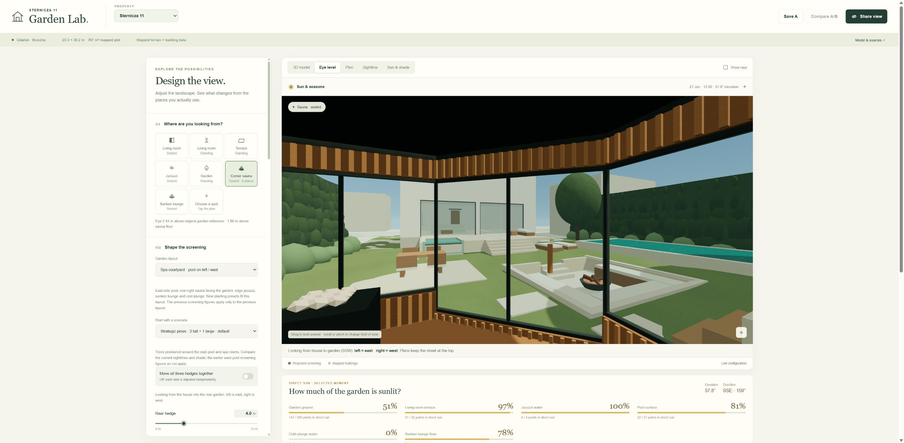

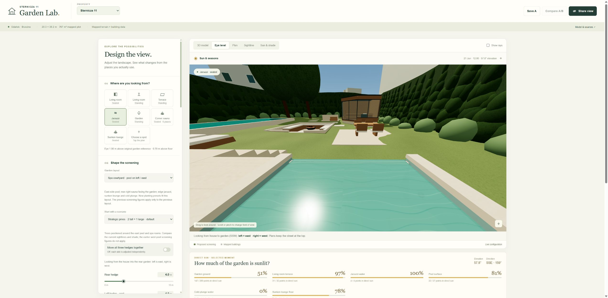

**State version 9** records the garden layout explicitly. Existing v1–8 links and saved scenarios restore the **previous layout**, including their actual tree arrays and prices. Switch **Garden layout → Spa courtyard** or use Reset to apply the new design. Known named planting presets change to their matching spa/classic positions; custom trees are retained with placement warnings. Korzeniowskiego stays on its own existing layout. Preview deployments retain separate storage.

**Automated validation:** 183 tests pass, including shared geometry, recessed surfaces, sauna glazing, terrain clearance, shadow receivers, quote accounting and v1–9 state compatibility. The static build succeeds. Hosted **WebGL** browser checks verified the plan, sauna panorama, recessed lounge and pool, the open overflow jacuzzi, 4 m → 3 m independent east-hedge sunlight changes (0% → 56% display), v8 classic restoration, spa quote accounting and Korzeniowskiego isolation. A 390 × 844 responsive check had no horizontal page overflow. No browser script errors were reported. The screenshots above are from that hosted review.

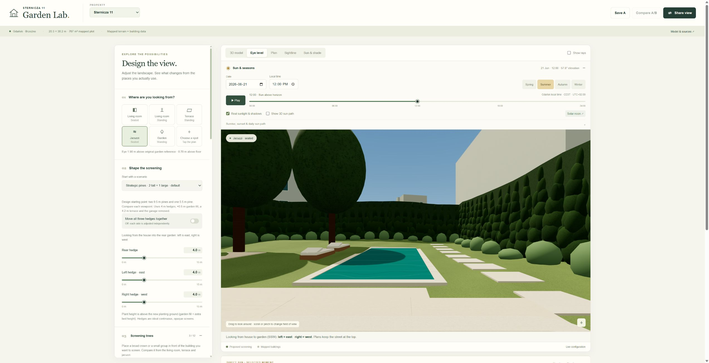

*Browser verification of version 1.6.0: the new default from the seated jacuzzi viewpoint. Crowns are geometric approximations; remaining slivers and exposure from other viewpoints are included in the comparison.*

## Previous west-pool planting study · 1.6.0

In the previous west-pool design, Sternicza starts with **two 9.5 m Austrian pines and one 5.5 m Austrian pine**, positioned against PCK 3 sightlines. The catalog plant subtotal is **136,700 PLN**. This is a design starting point, not a best-value claim or a guarantee of full concealment. Existing saved designs keep their trees; select **Previous layout** and **Strategic pines · 2 tall + 1 large · default** to reproduce this study.

| Planting scenario | Specimens | Catalog plants only |
| --- | --- | ---: |
| Strategic default | Two 9.5 m + one 5.5 m pines | 136,700 PLN |
| Larger-stock comparison | Three 9.5 m pines | 179,700 PLN |
| Lower-cost comparison | One 9.5 m + two 5.5 m pines | 93,700 PLN |
| Hedges only | No specimen trees | 0 PLN for specimen trees |

All planting choices restore the same 4 m hedges, +0.5 m garden fill, 4.2 m terrace, removed garage and disabled canopy. They retain the selected floor level, viewpoint, date, supplier allowances and building adjustments. The chosen default crowns stay inside the parcel and clear of the pool, terrace, house and stairs; trunks avoid the illustrated dining platform and loungers. Some rear crowns overlap. Actual root-ball space, access and future growth need a planting design. Korzeniowskiego retains its own tree-free default.

The mixed default saves **43,000 PLN** in plant reference costs compared with three tall pines. At the mapped standing living-room point, **103/420 PCK 3 samples remain visible**, compared with **37/420** for three tall pines; at the jacuzzi the counts are **6/460** and **3/460**. The lower-cost option prioritizes living-room views and leaves more visible from the jacuzzi and parts of the garden. Even the premium layout leaves **230/460** target samples visible from west of the pool. These are geometric sampled-point counts, not visible facade-area percentages or measured foliage opacity.

See the [13-view comparison, sunlight tradeoffs and assumptions](docs/pck3-layout-comparison.md), [recorded results](docs/pck3-layout-comparison.json), and [reproducible bounded search](scripts/search-pck3-layouts.mjs). The search is a constrained design comparison, not proof of a global optimum. Plant prices remain separate from unquoted delivery, crane/unloading, planting, anchoring and establishment.

**Verification:** 148 automated tests pass, including default placement, all historical link baselines, v7 saved designs and v8 empty-tree sharing. The hosted preview was checked for all four planting choices and prices, PCK 3 living-room counts, tree-free v7/v8 shared links, Reset, property isolation and a rendered jacuzzi view. The browser reported no script errors.

State version **8** preserves all older links and per-property saves. Versions 1–7 that omitted trees remain tree-free; version 7 explicit trees and saved scenario A retain their geometry and prices. New links always include the actual tree array, including an explicit empty array, so a later default change cannot silently alter an existing shared planting design.

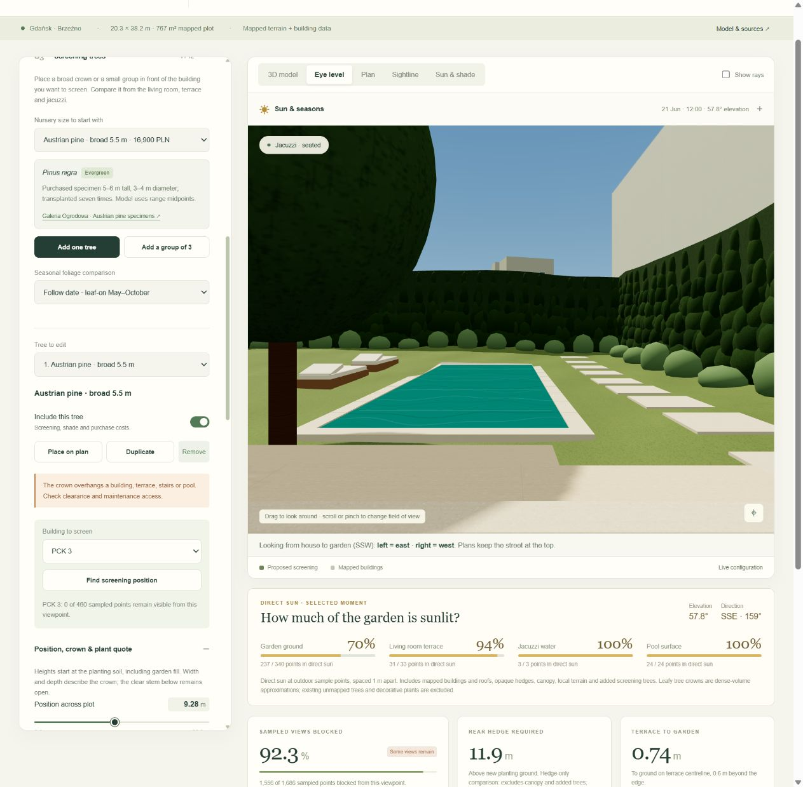

*Browser verification of version 1.5.0. One priced 5.5 m pine is shown from the jacuzzi, with crown-overhang warnings and target-specific visibility. Dense modeled foliage is illustrative, not a guarantee of actual screening.*

## Screening trees · 1.5.0

Open **Screening trees** to compare one broad specimen, a group of three narrower trees, or flat pleached panels above a hedge. Both properties use the same controls with their own mapped geometry. Trees can be selected, duplicated, disabled or removed independently. **Place on plan** moves the selected tree instead of the observer; the position sliders provide precise coordinates. Sternicza's fresh design now uses the strategic layout described above; the hedges-only scenario removes its specimen trees.

**Find screening position** searches rear-garden soil for the selected target (PCK 3 initially at Sternicza) from the current observer. It maximizes additional sampled points hidden, retaining other trees, hedges and buildings as existing screens. The result is specific to that observer and dense-crown assumption. It is not an optimization for the whole garden, sunlight, maintenance, root space or aesthetics. Trunks inside the house, retained garage, pool, terrace, threshold or stairs are rejected. Crown overhang and boundary conflicts remain visible as warnings; inspect clearance before choosing a design.

| Purchased specimen preset | Initial height / crown width | Referenced plant price |
| --- | --- | ---: |
| Austrian pine · medium | 4.25 / 3.5 m | 13,500 PLN |
| Austrian pine · large | 5.5 / 3.5 m | 16,900 PLN |
| Austrian pine · extra large | 6.5 / 5 m | 44,900 PLN |
| Austrian pine · very tall | 9.5 / 5 m | 59,900 PLN |
| Serbian spruce · narrow | 6 / 1.75 m | 4,950 PLN |
| Hornbeam · summer crown | 6 / 2.5 m | 11,300 PLN |
| Pleached hornbeam · Grande | 3.7 / 1.5 m | 2,190 PLN |

These are nursery catalog references reviewed **12 November 2026**, not confirmed available stock or installed quotations. Prices and purchased size ranges are recorded in [`data/tree-sources.json`](data/tree-sources.json), with supplier links and tax/logistics notes. Pine and broad-hornbeam amounts include VAT under Galeria Ogrodowa terms; the tax basis of the other displayed amounts requires confirmation. Wyplatane's pleached-panel delivery is included. Three matching Serbian spruces are a budget comparison, not a supplier guarantee of three identical available plants.

**Total height, crown base, width, depth and rotation are independent.** Pine and broadleaf crowns use ellipsoids, spruce uses a finite elliptical cone, and pleached foliage uses a thin rotated box. The same volumes drive 3D/plan/section, privacy and direct-sun rays. Empty space beneath a crown stays open except for its narrow trunk. A taller clear-stem tree can therefore screen less of a low sightline. Crown bases are editable assumptions except for the documented pleached stem. Round-crown depth starts equal to the listed diameter; actual specimens must be checked.

**Foliage** can follow the chosen sun date or be forced to summer/winter. Deciduous auto foliage uses May–October as an illustrative comparison assumption; leaf-off crowns receive no opaque-foliage credit. Evergreen crowns stay active. These are dense geometric envelopes, so real gaps and permeability can reveal more of the background. They are not a guarantee of complete visual concealment. Existing unmapped trees and ornamental planting remain outside the numerical model.

**Screening trees have their own budget.** Purchased stock sizes retain the catalog plant price. Out-of-spec dimensions require a custom unit quote; resizing does not extrapolate a nursery price or treat a mature crown as the purchased plant. Positive **Custom plant quote** replaces the reference; zero restores catalog pricing. Planting and anchoring are per tree, while delivery, crane/unloading and establishment are per-order allowances. Zero service values are explicitly unquoted. Incomplete budgets show known costs plus missing quotes. Disabled trees are excluded. Contingency is applied once after combining base hedge, soil and tree costs.

Shared v8 links, JSON exports, per-property local saves and A/B comparisons preserve every tree independently. Old v1–7 links remain readable. Preview deployments use separate storage and do not overwrite the production design or scenario A.

**Verification:** 142 automated tests cover the geometry, costs, solar/shade calculations and saved-state compatibility. Browser checks cover adding and resizing trees, custom and missing prices, disabling, three-tree placement, keyboard plan movement, A/B separation, winter foliage, shared-link reload and switching properties. Phone controls were checked at 390 × 844; the desktop sidebar scrolls independently to keep the model visible. Placement messages clear when their viewing or screening conditions change.

## Two properties · 1.4.0

The **Property** selector switches between complete site datasets. Each property keeps its own current design and saved scenario A. Share links and exported scenarios include the selected property. Changing properties never applies the other property's heights, camera, building overrides, costs or saved comparison.

| Mapped characteristic | Sternicza 11 | Korzeniowskiego 40 |
| --- | --- | --- |
| Design parcels | 401 + 400 | 160 |
| Polygon area | 766.86 m² | 467.72 m² |
| Approximate frontage / maximum local depth | 20.32 / 38.21 m | 15.78 / 29.91 m |
| Rear direction, true north | 203.13° · SSW | 28.05° · NNE |
| Physical left / right, looking into the garden | East / west | West / east |
| Initial assumed living-floor height above garden reference | +1.2 m | +1.7 m |
| Detached garage in source data | Present; removable | No mapped footprint within parcel |

The Korzeniowskiego parcel is irregular, so frontage multiplied by maximum depth is not its exact area. The house's closest point is **5.49 m from the street-side parcel boundary**, not from a measured kerb. The older advert used 480 m²; the simulator follows the official mapped polygon. Property title and boundaries have not been legally verified.

Korzeniowskiego has a **proposed 7.5 m wide terrace**, adjustable from 3–6 m deep, a **2.2 × 2.2 m integrated jacuzzi**, and an **8.5 × 2.2 m pool** along the physical right/east side. A short threshold connects the rectangular terrace to the actual stepped/sloping rear facade. Stairs respond to the selected floor and garden levels; loungers disappear when an extreme stair run occupies their position. These are design proposals, not existing features or a construction survey.

Its irregular house footprint, local terrain, 40 nearby building footprints, and roof returns for the house plus five privacy targets come from separate official source data. The five adjustable targets are the right/east and left/west neighbours, plus the rear right, centre and left neighbours. PCK 3 is only a Sternicza target. The NNE garden uses its own true-north conversion and location for sunlight; low winter sun from the south can be blocked by the house itself.

The house's roof boundary uses local height estimates from nearby roof returns, preserving lower projections without pulling every facade down to the lowest return. The same wall triangles and roof boundary feed the rendering and sunlight calculation. This is an interpolation of recorded points, not a surveyed eaves/roof construction model. The displayed terrace drop, plan and stairs use one ground reference on the terrace centreline, **0.6 m beyond the outer edge**; the initial Korzeniowskiego drop is approximately **1.34 m**.

### Korzeniowskiego source data

- [Official ULDK parcel 226101_1.0034.160](https://uldk.gugik.gov.pl/?request=GetParcelById&id=226101_1.0034.160&result=geom_wkt&srid=2180), retrieved 12 November 2026.
- [GUGiK Gdańsk 2024 LoD1 building archive](https://opendata.geoportal.gov.pl/InneDane/Budynki3D/LOD1/2024/22/2261.zip), house EGiB ID `226101_1.0034.287_BUD`, footprint approximately 100.42 m².
- [2024 1 m terrain tile](https://opendata.geoportal.gov.pl/NumDaneWys/NMT/81008/81008_1561323_N-34-50-C-d-1-1.asc), cropped around this parcel.
- [2024 airborne LiDAR tile N-34-50-C-d-1-1-1-3](https://opendata.geoportal.gov.pl/NumDaneWys/DanePomiaroweLAZ/81005/81005_1559924_N-34-50-C-d-1-1-1-3.laz). Class-6 building returns are clipped to the house and five neighbours, then reduced to a maximum per plan voxel. The other context roofs retain LoD1 median heights.
- [Derived dataset](data/korzeniowskiego-40.json) and [reproducible generator](scripts/build-korzeniowskiego-data.py), with source URLs, identifiers, acquisition dates, local frame and assumptions.

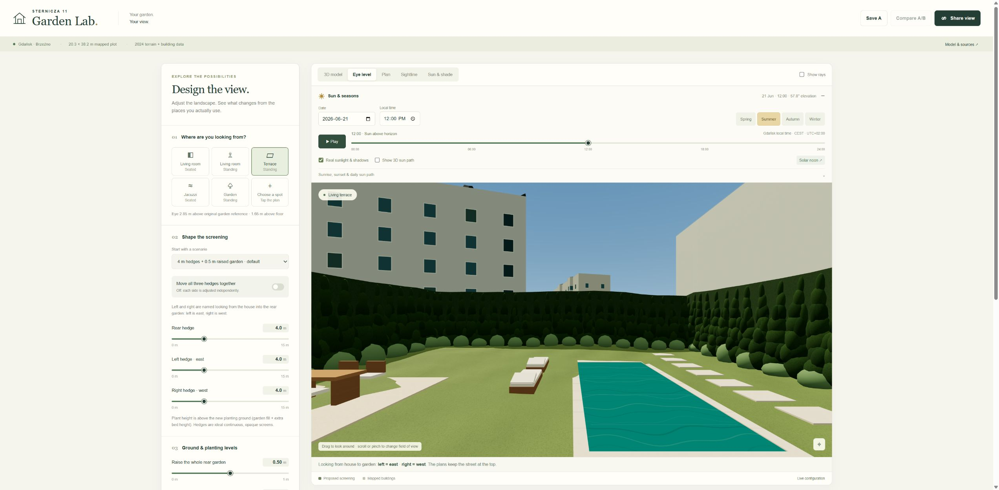

*Earlier Sternicza verification in version 1.3.1: left is east and right is west. This screenshot uses 4 m hedges and 0.5 m of garden fill.*

## Use it

A fresh or reset design starts with **4 m thujas on all three rear-garden sides and 0.5 m of garden fill**. Sternicza additionally starts with the mixed pine layout above. Extra planting-bed raise is **0 m**. The house and terrace floor stay fixed; the garden keeps its existing slope with a uniform 0.5 m addition, rather than becoming a level slab. Saved designs retain their choices. Select a named planting layout to apply its garden assumptions while retaining the comparison context, or use **Reset** to reset the entire design. The original 2.5 m / no-fill hedge settings remain available and retain any trees already placed.

Choose a viewpoint, then adjust hedge height or pick a scenario. Switch between **3D model**, **Eye level**, **Plan**, **Sightline**, and **Sun & shade**. Click the plan to move the observer. Save scenario A, change the design, then compare A/B.

**Rear, left and right hedge heights are independent by default.** Enable the explicit linked-editing switch only when you want the next height edit to move all three sides together. Turning linking on does not immediately overwrite the current different heights. Scenario presets set their specified heights but preserve your linking preference.

**Fine-tune the assumptions** includes optional building height and distance comparisons. **Budget assumptions · PLN** contains planting density, per-side supplier quotes, material rates, delivery capacity and project allowances. The budget beneath the sightline results updates with the design; expand **Quantities, itemised costs & sources** for the calculation and dated source links.

**Sun & shade** lets you choose a date and time in Gdańsk, compare seasons, and inspect the resulting sun direction, 3D shadows and outdoor shade map. Change the hedges, canopy, garden level or surrounding-building assumptions to compare their effect on direct sunlight.

**Share view** creates a `v=8` URL containing the property identity and changed settings, including independently positioned trees, foliage mode, sun controls, cost inputs and building adjustments. The complete tree array is always included. Older `v=1`–`v=5` links always reopen Sternicza. Versions 1–3 retain their original 2.5 m hedge / no-fill baseline; version 4 retains its 4 m / +0.5 m baseline. On migration from versions 1–4, left/right hedge heights and supplier quotes swap names to keep their original geographic side, and yaw changes sign to preserve the geographic viewing direction. Version 5 already uses the corrected orientation. Re-sharing writes version 8. Version 6–7 links retain both property identities; their browser saves and scenario A migrate independently per property. Version 6 has no trees; version 7 preserves any explicitly stored trees and otherwise remains tree-free. Earlier Sternicza browser saves migrate similarly and are never imported into Korzeniowskiego. Old automatically linked v1 browser preferences become independent; explicit linking in shared links is respected. **Export scenario** downloads schema-version-8 JSON containing the property, source location, settings, visibility, costs, sunlight and building adjustments.

The app has no backend, analytics, account requirement or external runtime requests. Three.js r160 is vendored with its MIT licence. A reduced SVG renderer keeps 3D interaction available on browsers without WebGL. Plan, section and the numerical shade map use SVG independently of the 3D renderer. Detailed materials and 3D cast shadows require WebGL; an in-app note explains the fallback.

## Orientation correction · 1.3.1

The source plot frame has local **+x toward ESE** and **+y toward SSW into the rear garden**. Its horizontal East/North basis has determinant −1. The old render conversion `(x, elevation, −y)` reflected that geography. The corrected Three.js conversion is `(x, elevation, +y)`; source footprints, terrain, roof points and numerical sunlight directions are unchanged.

**Left and right mean looking from the house into the rear garden.** The existing garage, PCK 3 and the east neighbour appear on the left. The west apartment block and west neighbour appear on the right. `hedgeLeft` controls the east boundary; `hedgeRight` controls the west boundary. The plans retain their street-at-top orientation, show true north, and label the physical hedge sides. Camera yaw, plan viewing cones, inverse picking, sun and shadow directions use the same coordinate convention.

The proposed jacuzzi now occupies the physical right/west edge promised by the interface; terrace furniture occupies the other end. Both its receiving-water samples and seated observer use the shared bounds. This placement change can alter the jacuzzi-specific privacy and sunlight results. Mapped surrounding buildings have not been moved to achieve the orientation repair.

The consolidation includes PR #1's 4 m / +0.5 m defaults, detailed procedural models, fixed source roof elevations, terrain cut-outs and separate jacuzzi sunlight results. It also corrects roof normals, window facing and water extrusion orientation; planting spacing now refreshes the visible crowns as well as the budget.

## Local development

Requires Node.js 18+ for the tests/build script and any ordinary static HTTP server. No npm dependencies or installation step are needed.

```sh
npm test
npm run build
python3 -m http.server 8000 --directory public
```

Open `http://localhost:8000/`. You can also serve the source folder directly. Opening `index.html` as a `file:` URL will not work because the browser must fetch modules and the site dataset over HTTP.

## GitHub Pages

The live app is published at **https://paweltroka.github.io/TROKA.Software.SmartHouse/**. GitHub Pages is already enabled and deploys the static application from **gh-pages / (root)**. No custom domain, paid service, secrets or build-time credentials are needed.

The source is maintained in `garden-lab/` on `main`. To publish later changes with an authenticated Git checkout, run the tests and build, then copy the contents of `garden-lab/public/` to a worktree of the `gh-pages` branch and commit/push that branch. Keep the `.nojekyll` file. The repository's existing house model files are unrelated to this app and are preserved on `main`.

## Sternicza coordinates and source data

- Parcel geometry: GUGiK ULDK parcels `226101_1.0034.401` and `226101_1.0034.400`. The combined design plot is approximately **20.32 × 38.21 m**, area **766.86 m²**. Inclusion of parcel 400 is a design assumption, not a title check.
- Source horizontal system: **EPSG:2180**. The app uses a local frame with x along the frontage and y into the rear garden, approximately SSW.
- Vertical datum: **PL-EVRF2007-NH**, retained as absolute metres internally.
- Main house/garage and context footprints: [GUGiK Gdańsk 2024 LoD1 building models](https://opendata.geoportal.gov.pl/InneDane/Budynki3D/LOD1/2024/22/2261.zip).
- Terrain: [2024 1 m DTM tile](https://opendata.geoportal.gov.pl/NumDaneWys/NMT/81008/81008_1561323_N-34-50-C-d-1-1.asc), native-grid crop with bilinear interpolation.
- Nearby roof points: [2024 airborne LiDAR tile](https://opendata.geoportal.gov.pl/NumDaneWys/DanePomiaroweLAZ/81005/81005_1559930_N-34-50-C-d-1-1-3-1.laz), class 6 building returns reduced to one maximum per plan voxel. This source is a large download; the app ships only the compact derived dataset.
- Detailed provenance and assumptions are embedded in `data/site-data.json` and the **Model & sources** dialog.

## What is measured, proposed and approximate

Mapped property/footprint geometry and the terrain crop are data-derived. Nearby blocks include sampled roof elevations; the farther central blocks have only LoD1 median roofs. The tall thin return near PCK 3 is unverified and excluded by default, with an optional sensitivity toggle.

The living floor starts at an **assumed 1.2 m for Sternicza or 1.7 m for Korzeniowskiego above the property's original near-house garden reference**. Neither is a measured floor survey. The terrace, jacuzzi, pool, canopy, new openings, furniture and finishes are proposed. House and garage roof meshes interpolate the available mapped roof samples, with the original source elevations fixed when the assumed floor height changes. These are approximations of the recorded returns, not measured construction roof models. The default **0.5 m hedge inset** is a design choice: setting it to zero reproduces the earlier boundary-screen calculations.

The 3D view displays proposed walls and window openings, but these are not used as verified occluders in the privacy ray score. Ornamental planting is illustrative and does not improve the numerical score. The privacy score covers the active property's five target building volumes regardless of which direction the camera faces.

## Sun and shade model

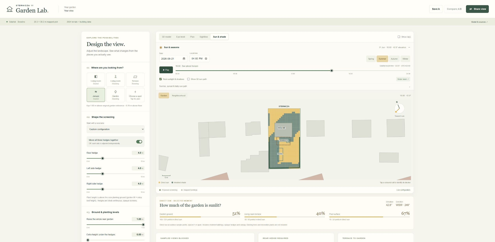

Version 1.2.1 was checked with 68 passing automated tests, desktop and phone layouts, and live WebGL summer, evening and winter shadows. The optional sun path is an illustrative direction guide; its display radius does not change lighting geometry. This screenshot and browser verification describe that earlier published version.

Choose a date from **2000–2100** and a time of day. The initial view is **21 June 2026 at 12:00**, an illustrative summer scenario. All times use **Europe/Warsaw**, including CET/CEST daylight saving, regardless of the device's timezone. A repeated autumn hour uses its first occurrence; a missing spring hour advances by the clock-change gap and displays an explanation. Future clock rules depend on the browser's timezone database.

Sun position uses NOAA/Meeus equations at the selected property's coordinates: **54.405452° N, 18.6312142° E** for Sternicza and **54.4075710° N, 18.6301101° E** for Korzeniowskiego. The mapped EPSG:2180 orientation is corrected for meridian convergence: the rear axes point approximately **203.131° true** and **28.051° true**, respectively. Azimuth is clockwise from true north; elevation is above the level geometric horizon. Independent NREL SPA comparisons validate the seasonal solar direction. General method references and the original Sternicza calibration are recorded in [`data/solar-sources.json`](data/solar-sources.json); each active dataset supplies its own location and frame.

The shade calculation traces rays toward the sun from outdoor surface samples on a **1 m grid**. It accounts for surrounding buildings using the shared rendered roof/wall envelope where reconstructed and the mapped fallback elsewhere, the house and retained-garage roof meshes at fixed source elevations, opaque hedge/bed screens, the raised terrace with its jacuzzi opening, the proposed canopy, finite added screening-tree crowns and trunks, optional measured existing-canopy envelopes, and the supplied local terrain with garden fill. Building height/distance overrides, garage removal, hedge edits and surface-level changes feed the same comparison geometry. The model does not calculate sunlight through living-room windows or indoor illumination.

The garden, terrace, jacuzzi, pool and front-area percentages are the **fraction of outdoor sample centres receiving direct sun at the selected instant**. They approximate surface coverage and can change in steps near shadow edges. They do not represent irradiance, weather, cumulative daily sunlight hours, thermal comfort or plant growth. Night is shown separately from architectural shade. Sunrise, solar noon and sunset describe the astronomical day; sunrise/sunset use the conventional −0.833° apparent horizon, while shadow rays use the geometric sun centre above 0°. Buildings and trees can delay the property's actual direct sun.

Pool and jacuzzi receivers use their flat rendered water levels rather than the varying terrain beneath them. The jacuzzi zone samples its inset, rounded water footprint on the same 1 m grid, so only a few samples describe this small surface; their counts are shown. Pool terrain is excavated from the rendered and numerical ground; the jacuzzi opening is removed from the terrace occluder. Local terrain is sampled only inside the supplied crop.

Hedges are treated as opaque screens, not as measured foliage. Decorative planting/furniture/water rims, optional isolated high-feature samples, distant terrain horizon, cloud cover and diffuse/reflected light are excluded from the numerical sunlight result. Existing measured crowns participate only when the existing-canopy analysis control is enabled. Source roof detail and proposed geometry remain approximate; 3D shadow-map resolution and visual decoration can also produce small differences from the sampled shade map. The result is a planning comparison, not a surveyed solar-access assessment.

## 3D appearance

The scene adds original procedural stone, timber, stucco, grass, foliage, water and textile materials; layered individual thuja crowns; varied facade and window details; pool coping; furniture; and a recessed integrated jacuzzi with a rounded basin, seats and jets. No external models, texture downloads or additional runtime dependencies are needed.

Plant crowns and finishes illustrate the proposal. The ideal continuous hedge screen still controls privacy and hedge shadows, so decorative foliage gaps do not silently change the numerical model. Sun direction, sky colour and lighting follow the selected date/time; neutral lighting remains available. Roof geometry follows available samples, while proposed openings and finishes remain assumptions.

## Building sensitivity comparisons

The selected property's five privacy targets can be adjusted independently. Sternicza uses **PCK 3**, the west and east blocks, the farther central block and its continuation; Korzeniowskiego uses its five neighbouring buildings described above. Select a building under **Fine-tune the assumptions → Surrounding buildings**. The readout shows the mapped baseline and current comparison side by side.

- **Height adjustment** changes roof-top height above the block's fixed base. All roof, facade and optional high-feature sample elevations scale consistently above that base. The allowed adjustment is −10 to +15 m, with a minimum modeled building height of 2 m.
- **Distance adjustment** translates the whole building along its original bearing from the house's rear-wall midpoint to the building's footprint area centroid. Positive values move it farther away; negative values move it closer. The adjustment range is −15 to +40 m, with a minimum centre distance of 5 m. The footprint shape and elevations remain unchanged; moving the observer does not change this reference.
- Adjusted geometry feeds **3D, plan, section and visibility calculations together**. A visible what-if status identifies active overrides. **Reset this building** or **Reset all** restores the original mapped coordinates exactly, without accumulating earlier edits.

These controls are sensitivity scenarios. They do not modify the source dataset or survey the buildings again. A translated building keeps its original base elevation rather than snapping to terrain at its hypothetical new location, and hypothetical positions are not checked for collisions or planning feasibility.

## Sightline model

For an observer at absolute eye height `E`, target roof/facade height `B`, and screen intersection fraction `r` along the horizontal ray:

```text
required top elevation = (1 − r) × E + r × B
required hedge height = required top elevation − planting-ground elevation
```

The engine intersects finite hedge segments, finite tree crowns and trunks, the canopy roof and front/side fascia, and the resolved surrounding-building roof/wall envelopes. Buildings without a supported roof reconstruction retain their approximate mapped prisms. The required rear hedge metric ignores canopy and tree protection, but retains occlusion from mapped surrounding buildings. It refers to new planting ground, or original ground when existing hedge tops are held fixed.

**Raising the garden is distinct from raising the hedge beds.** The house floor and terrace stay fixed. A garden observer moves with garden fill; a living-room observer does not. New planting rises with the soil only when the corresponding switch is enabled. Adding soil never lifts retained foliage. The terrain model applies uniform fill within the rear-garden area; retaining structures, drainage, soil settling and construction feasibility are outside scope.

Coverage is the **unweighted fraction of sampled target points blocked from one eye position**. It is not visual-field area, not a guarantee for all points in the garden, and not an assurance that real foliage is opaque. Real gaps, foliage density, roof details and survey uncertainty can affect the result. Measured roof targets are conservatively retained rather than silently hidden by a median-height flat roof approximation; synthetic back-facing facade samples are filtered.

## Thuja and rear-garden cost model

The budget is in **PLN** and uses editable planning inputs. Price observations were reviewed on **11 November 2026** and are recorded with supplier links, units and tax treatment in [`data/cost-sources.json`](data/cost-sources.json). Displayed retail plant prices are reference offers, not guaranteed availability or a national market price range. Explicit net observations remain identified as net; the app does not impose one VAT rate on all work. Use supplier-confirmed final amounts, including applicable tax, for a purchasing budget.

### Thujas

Only the modeled **rear, left and right rear-garden hedge segments** are priced. No front hedge is silently added. Each side's count is its total segment length divided by the selected centre-to-centre spacing, rounded up. Heights are priced separately, so changing the rear hedge leaves the left and right plant prices unchanged.

Automatic **Smaragd** stock-price bands cover small plants through **4 m**. They use observed nursery offers rather than extrapolating a cost-per-metre curve. Different nurseries and stock types can make the bands non-monotonic. Above 4 m, the affected side and combined total show **Quote needed**; the incomplete known subtotal remains visible. Tall specimen reference offers are listed separately in the sources and are not treated as interchangeable hedge stock.

Enter a positive **Rear / Left / Right: custom tree price** to use your own PLN-per-tree quote; zero selects automatic pricing. The automatic-price multiplier does not alter a custom quote. Planting labour is per tree, while tree delivery and lifting are whole-order allowances. **Buy new thujas** can be switched off independently of the screening geometry to budget only earthworks or retain existing plants. Plant height and spacing do not establish that real foliage will form an opaque screen.

### Soil quantities and raising the garden

The automatic fill area is the selected property's mapped land behind its rear-wall reference, excluding the **house footprint, terrace, pool and any retained garage**. Overlapping exclusions are subtracted once. Removing Sternicza's garage makes its footprint available for fill, but demolition costs are not included. Terrace depth therefore changes the priced fill area. The following numerical examples are for **Sternicza**: at the initial 4.2 m terrace depth with the garage removed, the automatic area is approximately **338.69 m²**, rather than the property's full 766.86 m². Korzeniowskiego calculates quantities from its own smaller polygon and layout.

Finished in-place volume is:

```text
rear-garden fill = selected fill area × garden raise
extra bed fill = bed area × additional bed raise
total added volume = rear-garden fill + extra bed fill
```

Raised-bed strips are centred on the active hedge segments, clipped to the property and exclusions, and united so overlapping corners count once. Only the extra bed height is added above the general garden raise. With the initial 0.5 m hedge inset and 1 m bed width, the combined bed area is approximately **57.62 m²**.

The topsoil setting is a cap **within the chosen added depth**, not another layer added on top. A shallow raise cannot contain more topsoil than its total thickness. Combined garden and bed raises receive a single topsoil cap over each area. The remaining volume is bulk fill. The loose-delivery multiplier converts both finished material volumes to delivery quantities; it is an editable assumption, not a soil investigation. Truck loads are rounded up separately for bulk fill and topsoil.

For example, a **0.5 m garden raise** over the initial automatic area requires approximately **169.35 m³ finished / 203.22 m³ loose** at a 1.20× multiplier. Raising only the initial hedge beds by 0.5 m requires approximately **28.81 m³ finished / 34.57 m³ loose**. These are added-volume calculations; the model does not level the existing terrain to a single horizontal elevation.

A positive **Fill area override** changes cost quantities only and is capped at the mapped gross rear area. It does not reshape the rendered fill or privacy geometry. When combining an override with raised beds, the quantity calculation assumes the selected garden-fill area overlaps the beds up to the smaller of the two areas.

### Editable budget assumptions

The main defaults are visible in the interface and defined in `src/costs.js`:

| Input | Initial value | Basis |
| --- | --- | --- |
| Tree spacing | 0.80 m | Editable layout assumption |
| Planting | PLN 75/tree | Labour allowance |
| Tree delivery | PLN 1,000/order | Transport allowance |
| Tree lifting/equipment | PLN 0 | Not budgeted until entered |
| Extra hedge-bed width | 1.00 m | Geometry assumption |
| Topsoil within added depth | 0.15 m | Material specification assumption |
| Loose-delivery multiplier | 1.20× | Quantity allowance |
| Bulk fill material | PLN 75/loose m³ | Editable planning rate, excluding transport |
| Topsoil material | PLN 110/loose m³ | Editable planning rate, excluding transport |
| Spreading/compaction | PLN 50/finished m³ | Editable work rate |
| Truck capacity | 10 loose m³/load | Access and vehicle assumption |
| Soil transport | PLN 500/load | Editable allowance |
| Retaining edges | PLN 8,000/project | Provisional allowance |
| Drainage | PLN 3,000/project | Provisional allowance |
| Access/preparation | PLN 1,500/project | Provisional allowance |
| Upper-budget uncertainty | 20% | Applied once to the high estimate only |

The lower and upper figures combine observed plant-price bands and the selected uncertainty allowance; they are **not a statistical confidence interval or a contractor quote**. Material/work rates and fixed site allowances must be updated for actual access and specifications. Set transport to zero when a supplier price already includes delivery. A zero allowance means that item is not budgeted, not that it is unnecessary. All earthwork allowances are zeroed automatically when there is no added soil, and tree allowances are zeroed when no trees are being purchased.

The estimate excludes garage demolition, reuse of excavated pool soil, stripping/disposal of existing topsoil, new paving, professional design and the rest of the renovation. Retaining and drainage allowances do not determine engineering feasibility. **Reset cost assumptions** restores budget defaults without resetting the garden design.

## Checks

Version 1.4.0 passes **114 automated tests**. New regressions independently reconstruct the Korzeniowskiego parcel and house from official source coordinates; check physical east/west sides, the NNE garden and winter house shade; validate terrace/pool/jacuzzi placement and extreme stair runs; preserve every wall/roof seam; check shared terrace-drop readouts; and isolate property defaults, saved scenarios, version-6 links, target-building adjustments and solar caches. Sternicza's original source dataset and audited roof-ray benchmarks remain unchanged.

The hosted preview was checked for independent hedge edits, separate property settings and scenario A, neighbour height/distance adjustments, seasonal shade updates, the corrected 3D house and eye-level view, and a 390 px phone-sized iframe without horizontal overflow. The testing browser had WebGL disabled, so these new visual checks exercised the SVG fallback and numerical shade map; the earlier 1.3.1 WebGL review below is not a claim that 1.4.0 received a new GPU-rendered review.

The test suite covers finite ray intersections, the audited roof-ray benchmarks, terrain interpolation, garden versus bed raise, retained foliage, fixed house floors, screen inset, finite canopy roof/front/side edges, approximate building occlusion and garage removal.

Cost regressions cover per-side tree pricing, zero-work totals, retained planting, polygon exclusions and overlaps, garden/bed volumes, topsoil partitioning, loose quantities, material-specific truck loads, area overrides, quote-required tall stock, custom unit prices and applying contingency once. Building tests cover unchanged zero overrides, area centroids, coherent height and position transformations, independence, caching without cumulative edits, exact reset and feeding changed targets into sightline calculations. State tests cover independent/link-controlled editing, legacy migration, v1–v4 legacy defaults and v5 URLs, browser-save migration, sun controls, budget and building settings, and validation of untrusted URL values.

Solar checks compare NREL SPA reference directions and seasonal daylight events, validate true-north/local-frame rotation, and cover Warsaw DST gaps/folds and supported date boundaries. Shade checks exercise finite blockers, building and roof geometry, independent hedge sides, canopy protection, fixed mapped roofs across floor changes, pool/jacuzzi water elevations and excavation openings, local terrain, garage removal and explicit night/disabled states.

Audited zero-inset benchmark requirements are **13.7132423316 m** for the seated living-room controlling PCK 3 ray and **10.4933350440 m** for the garden ray at local y = 30 m. These are requirements for particular sampled rays, not suggested hedge purchases.

## Structure

| File | Purpose |
| --- | --- |
| `src/geometry.js` | Terrain, observers, finite intersections and sampled visibility |
| `src/sites.js` | Property registry, locations, physical side labels and site-specific defaults |
| `src/layout.js` | Shared proposed furniture and level-dependent stair layout |
| `src/roof-envelope.js` | Locally varying inferred wall/roof boundary shared by visual and sunlight models |
| `src/scene.js` | 3D model, cameras and WebGL/SVG rendering |
| `src/scene-materials.js` | Original procedural surface textures and materials |
| `src/diagrams.js` | Interactive plan and precise sightline section |
| `src/state.js` | Validated controls, independent hedge editing, migration and versioned share links |
| `src/buildings.js` | Non-destructive building height/distance sensitivity transforms |
| `src/costs.js` | Hedge quantities, fill geometry, material/load quantities and editable PLN budgets |
| `src/budget-view.js` | Budget summaries, itemised costs and price-source presentation |
| `src/solar.js` | Solar direction, mapped orientation, Warsaw civil time and daily horizon events |
| `src/garden-program.js` | Shared metric spa footprints and previous-layout compatibility |
| `src/scene-spa.js` | Sauna, plunge and recessed lounge meshes using shared absolute levels |
| `src/shade.js` | Outdoor direct-sun rays, modeled blockers and 1 m sampled shade coverage |
| `src/sun-view.js` | Seasonal controls, daily elevation chart, shade map and zone readouts |
| `src/sun.css` | Responsive sun controls and shade-map presentation |
| `src/app.js` | Interface and model integration |
| `data/site-data.json` | Compact derived Sternicza site and surrounding-building dataset |
| `data/korzeniowskiego-40.json` | Separate Korzeniowskiego parcel, terrain, house and neighbour dataset |
| `scripts/build-korzeniowskiego-data.py` | Reproduce the second dataset from official source files |
| `data/cost-sources.json` | Dated supplier observations, tax notes and planning-assumption evidence |
| `data/solar-sources.json` | Solar/timezone references, site orientation and shade-model limitations |
| `tests/` | Numerical and state checks |
| `vendor/` | Pinned Three.js r160 and its licence |


Orientation regressions use actual mapped anchors, geographic East/North projections, camera handedness, screen-side projections, world picking, overhead plans, triangle normals, rounded extrusion bounds, morning/afternoon sun directions, physical hedge-side pricing and migrated asymmetric saved designs.

## Consolidation verification · 1.3.1

PR #1 was merged after 91 automated tests passed, a successful build and syntax checks for all application modules. A real WebGL browser review verified the garage/PCK 3 left and west block right, unequal physical-side hedge edits, plan orientation, the recessed jacuzzi and furniture, evening shade and four sunlight readouts. A v3 asymmetric design was opened and re-shared as v5 to check geographic heights, quotes and yaw migration. The preserved published roof-ray benchmark still passes.
