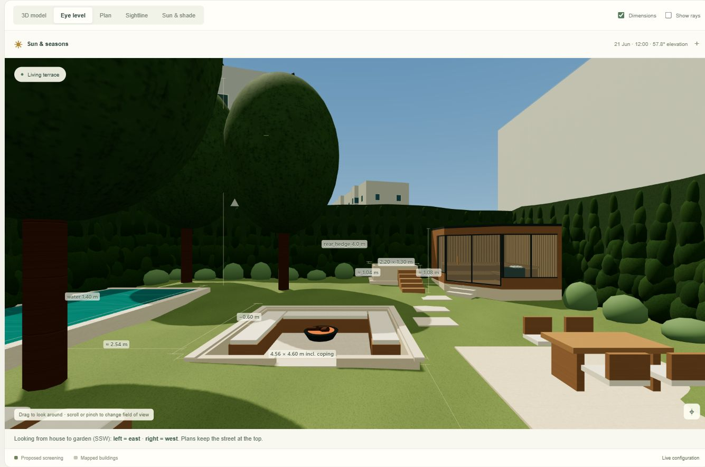
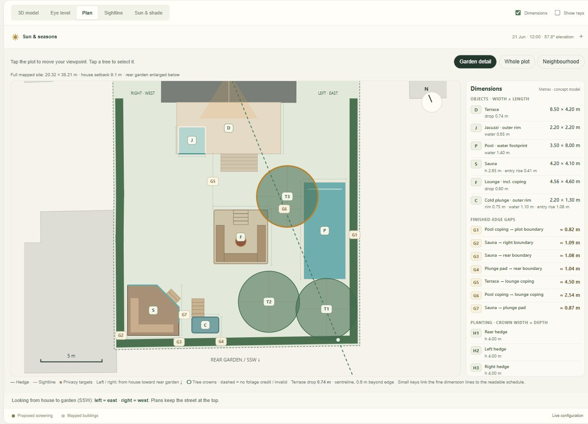
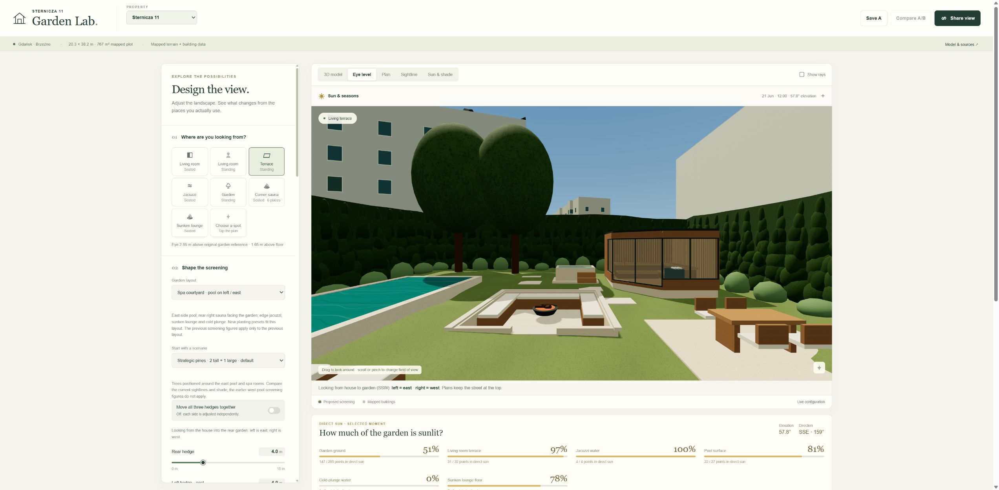
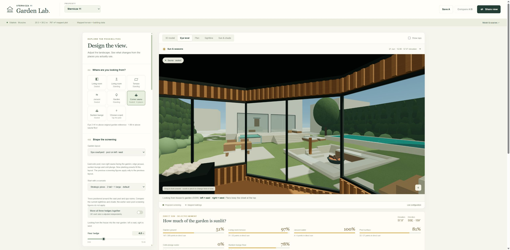
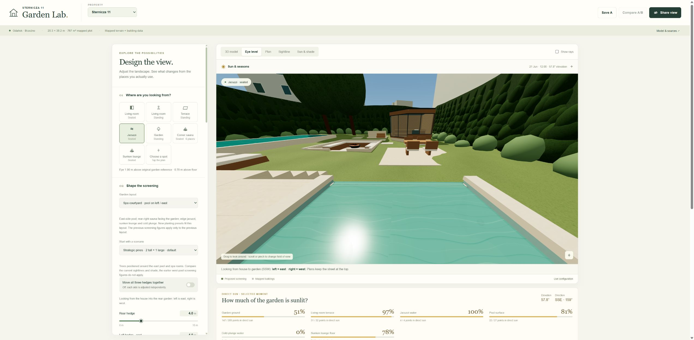
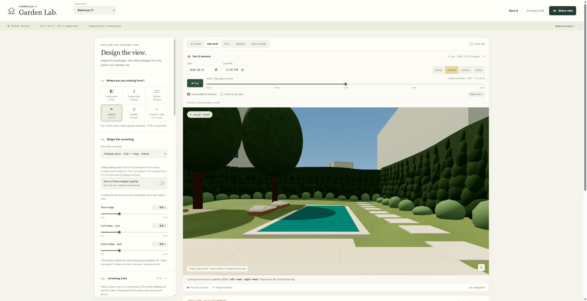
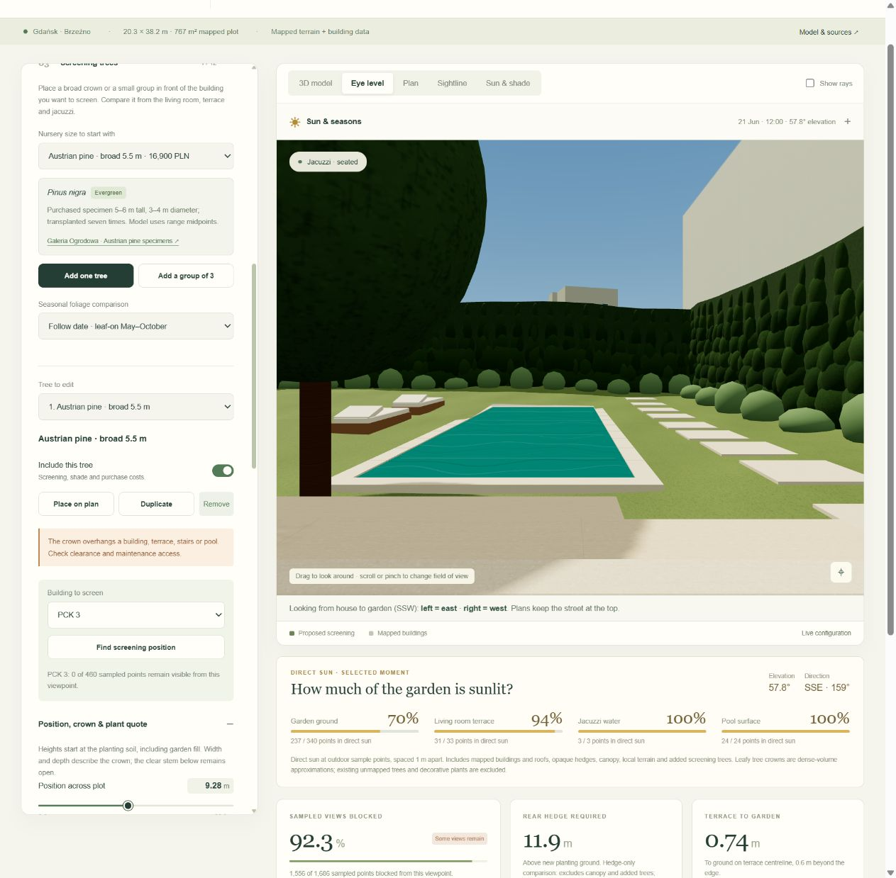
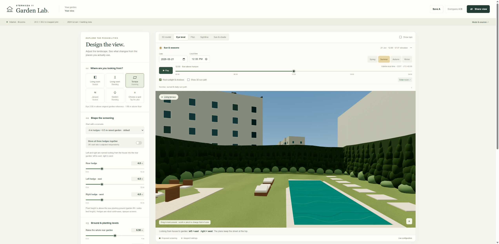
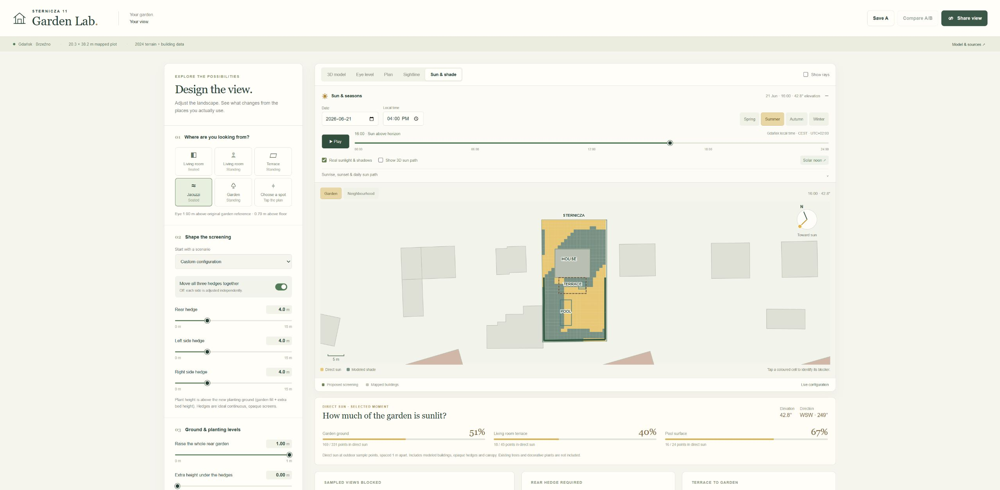

# Brzeźno · Garden Lab

An interactive, browser-only garden privacy and sunlight simulator for **Sternicza 11 and Konrada Korzeniowskiego 40, Gdańsk Brzeźno**. Explore each property's mapped plot and neighbouring buildings, change the proposed hedge, ground and terrace geometry, place specimen screening trees, compare editable hedge, tree and earthwork budgets, and see how seasonal sun changes the shade.

**[Open Korzeniowskiego 40](https://paweltroka.github.io/TROKA.Software.SmartHouse/?site=korzeniowskiego-40&v=1.8.0)** · **[Open Sternicza 11](https://paweltroka.github.io/TROKA.Software.SmartHouse/?site=sternicza-11&v=1.8.0#v=10&site=sternicza-11)**

## Sternicza: three tall pines, perimeter layout and dimensions · 1.8.0

The latest fresh/reset design is **Spa courtyard · near plot edges**. The pool is farther toward the physical **left/east**, the six-person sauna is tucked into the far **right/west rear corner**, and the cold plunge is next to the rear boundary. The large terrace and edge jacuzzi remain, with the sunken fire lounge in the middle.



### Finished edges and real levels

| Feature | Size | Mapped boundary clearance |
| --- | --- | --- |
| Pool | 3.50 × 8.00 m water; 0.28 m coping | **≈ 0.82 m** from outer coping to the east/left parcel edge |
| Sauna | 4.20 × 4.10 m outer envelope; 2.65 m external height | **≈ 1.09 m west/right**, **≈ 1.08 m rear** |
| Cold plunge | 2.20 × 1.30 m outer rim; 1.10 m water depth | **≈ 1.04 m** from the outer pad to the rear parcel edge |
| Sunken lounge | 4.40 × 4.40 m pit; **4.56 × 4.60 m including coping** | **2.54 m** between its outer coping and the pool coping |
| Living terrace | 8.50 × 4.20 m, including the 2.20 × 2.20 m edge jacuzzi | **≈ 0.74 m** down to the proposed garden at the existing reference point |

The dimensions use the actual mapped boundary segments, including the small inward kink beside the pool. They are not measured from an axis-aligned rectangle. The rear garden keeps the measured slope under the selected uniform fill. Sauna and plunge pads reach down to the low side of their footprints; their access treads use the actual approach grade. The sauna has two treads with approximately 0.136 m risers; the plunge has five 0.30 m treads and approximately 0.179 m risers.

The pool-to-boundary strip is planting space, not a full clear walkway behind a thick hedge. Pool access is from the inner garden; hedge width and trimming must fit the narrow strip. These are model clearances, not approved building setbacks. The near-boundary sauna needs a project-specific siting check.

### Third full-height pine restored

The balanced default now has **three 9.5 m Austrian pines**, each with the existing catalog **5 m crown** assumption. Pine 3 is brought forward beside the pool, where its height intercepts the elevated living-room rays. The reference plant subtotal is **179,700 PLN**; delivery, lifting, planting and establishment remain separately editable and unquoted unless supplied.

The new layouts are tested against PCK3 from **seven named viewpoints plus ten additional occupied/path locations**, using the current spa geometry. The balanced design materially improves the living room, terrace and jacuzzi compared with the previous behind-pool planting, while preserving better garden coverage than a house-only arrangement. It still leaves residual sampled views: **three trees do not establish 100% concealment from everywhere**. Crowns are dense idealized shapes, and actual foliage gaps can expose more.

**Start with a scenario** includes:

- **Three 9.5 m pines · balanced views · default**: the main proposal.
- **Three 9.5 m pines · living-room priority**: puts more screening in front of the house, with more exposure around the fire lounge and pool paths.
- **Two 9.5 m + one 5.5 m pine**: optimized lower-cost comparison; 136,700 PLN plants only.
- **One 9.5 m + two 5.5 m pines**: budget comparison; 93,700 PLN plants only.
- **Hedges only**: same spa, 4 m hedges and 0.5 m fill without specimen trees.

The comparison includes both historical planting arrangements, same-position size changes and instantaneous sunlight checks. Full results and reproduction details are in [the new screening comparison](docs/edge-screening-comparison.md) and [machine-readable results](docs/edge-screening-comparison.json) and `scripts/search-edge-pck3-layouts.mjs`. Tree trunks retain concept planting space, but their crowns intentionally overhang parts of the pool/spa edges. The modeled crowns stay clear of the fire bowl itself; this is not a fire-safety or arboricultural certification. The additional screening also changes shade, so compare **Sun & shade** at your own times and seasons.

### Subtle dimension overlay

The **Dimensions** checkbox above the viewer is on in fresh designs. It shows fine lines and metre labels in the 3D model, eye view, plan and garden shade map. Sightline sections label only objects actually cut by that section. Measurements include feature width/length, boundary gaps, selected gaps between features, terrace and lounge drops, water depths, sauna height, separate hedge heights, and tree height/crown sizes.

3D labels remain small, avoid overlapping one another and disappear behind opaque geometry. With dimensions on, the plan starts in **Garden detail**: a closer drawing with quiet keys and a complete measurement schedule beside it (below it on a phone). **Whole plot** and **Neighbourhood** remain available. The sunlight map uses the same readable keys and schedule. Measurement bases are included in the scenario export. Lines are non-interactive, so selecting a viewpoint or tree still works. The switch is independent of sightline rays and is saved/shared with the design. JSON exports include the full metric records even when the overlay is hidden.



**State version 10** preserves older designs: v9 keeps the original spa and its actual pines; v1–8 keep the original west-pool arrangement. Existing scenarios do not silently acquire taller trees or move their pool. Select the new garden layout, use Reset, or follow the current Sternicza link above to load the latest defaults. Known named planting layouts transfer to a compatible preset; custom trees remain with conflict warnings. Korzeniowskiego retains its own geometry.

**Verification:** 212 automated checks pass and the static build succeeds. Hosted browser checks cover the three-pine presets, live PCK3 counts, independent hedges, fill-responsive terrace drop, dimension visibility, readable plan and sun-map schedules, v9 saved designs, property isolation and a 390 × 844 phone layout. All 40 current dimension records appear in the schedule; the phone schedule scrolls without horizontal overflow. The browser reported no script errors.

## Previous spa courtyard · 1.7.0



Version 1.7.0 introduced **Spa courtyard**, retained as **Previous spa** in the layout selector. The pool moves to the physical **left/east** when looking from the house into the rear garden. A six-person corner sauna occupies the rear **right/west**, with glazing toward the garden centre, pool and terrace. This is a metric proposal on the existing mapped parcel, not a replacement of the source survey or a construction-ready design.

| Feature | Proposed geometry |
| --- | --- |
| Pool | 8 × 3.5 m water footprint, x 14.7 / y 24.5; coping remains inside the parcel |
| Corner sauna | 4.2 × 4.1 m overall, chamfered glazed corner, L-shaped benches for six; x 3.3 / y 30.5 |
| Terrace jacuzzi | 2.2 × 2.2 m, outer end aligned with the terrace edge; water 35 mm below the terrace and a garden-facing overflow lip with a catch slot |
| Sunken fire lounge | 4.4 × 4.4 m, floor 0.6 m below its rim, built-in seating and four 150 mm steps; x 8.4 / y 26.8 |
| Cold plunge | 2.2 × 1.3 m beside the sauna, 1.1 m water depth, raised rim and entry steps; x 8.3 / y 33.2 |

Coordinates use the simulator's local metre frame. The pool coping and flat spa pads account for the mapped slope; the garden itself retains that slope under a uniform soil addition. The pool occupies part of the old garage position, so this layout includes removing the detached garage. Sauna, firepit, pool and plunge do not overlap, and the default firepit-to-pool-coping passage is at least 1.5 m. Extreme terrace height/depth changes can lengthen the stairs into the fire lounge; an in-app message identifies that conflict.

**Corner sauna** and **Sunken lounge** are new eye-level viewpoints. The sauna opens diagonally toward the house and garden centre. Its glass is transparent to the numerical sightline and sunlight calculations; opaque timber, roof and raised pad are modeled. The fire-lounge observer stands or sits relative to its lowered floor, rather than floating at garden grade. The plan, section, 3D model and sun map share these positions and elevations.

The jacuzzi is an **overflow-style concept**. Final structural support, waterproofing, balance tank/circulation and the overflow detail require a pool designer. The sunken lounge also needs an actual drainage and retaining design; its illustrated floor drop is not an excavation quantity or a claim that it can drain by gravity.

### Sunlight is a tradeoff

The requested left-side location is not uniformly sunnier in the current model. With the same 4 m hedges and no specimen trees, it gains some March afternoon sun but loses June morning sun to the east hedge. The new specimen trees can shade the pool around noon and later in the afternoon. The comparison is recorded in [spa sunlight results](docs/spa-sun-comparison.json) and can be reproduced with `node scripts/compare-spa-sun.mjs`.

| Moment, Europe/Warsaw | Previous west pool, no trees | New east pool, no trees | New east pool, default pines |
| --- | ---: | ---: | ---: |
| 21 March, 15:00 | 16.7% | 66.7% | 18.5% |
| 21 June, 09:00 | 100% | 0% | 0% |
| 21 June, 12:00 | 100% | 100% | 81.5% |
| 21 June, 15:00 | 100% | 100% | 44.4% |

With the default pines retained, reducing only the east hedge from 4 m to 3 m changes June 21 at 09:00 from **0% to 55.6%** sampled pool sun; 2.5 m gives **66.7%**. This is a useful adjustable tradeoff, rather than a reason to assume the moved pool is automatically sunnier at every time.

Use **Sun & shade**, compare seasons and times, lower **Left hedge** independently if useful, and compare **Hedges only** against the pine layouts. Pool, jacuzzi, cold-plunge water and the sunken lounge floor each have direct-sun sample readouts. These are coarse 1 m-grid sample fractions at an instant, not daily sunshine hours, energy or a guarantee about actual foliage.

### Planting, quotes and compatibility

The spa's pine presets are repositioned around the new pool and spa rooms. The two tall default trees are at (17, 35.3) and (13.3, 35.3); the smaller tree is at (16.6, 22.1). Plant reference prices and sizes are unchanged. These are clear-space starting positions, not a newly optimized or guaranteed PCK 3 screen. **The v1.6 visibility counts below apply only to the previous west-pool layout.**

Earthwork area excludes the sauna, sunken lounge and plunge footprints as well as the pool and terrace. Five editable **installed quote** fields cover the pool, edge jacuzzi, sauna, cold plunge and fire lounge. Zero means **unquoted**, and the combined budget remains visibly incomplete. Positive quotes enter the total and receive contingency once. They should cover associated plant, excavation, foundations, services and drainage; the simulator does not invent construction prices.





**State version 9** records the garden layout explicitly. Existing v1–8 links and saved scenarios restore the **previous layout**, including their actual tree arrays and prices. Switch **Garden layout → Spa courtyard** or use Reset to apply the new design. Known named planting presets change to their matching spa/classic positions; custom trees are retained with placement warnings. Korzeniowskiego stays on its own existing layout. Preview deployments retain separate storage.

**Automated validation:** 183 tests pass, including shared geometry, recessed surfaces, sauna glazing, terrain clearance, shadow receivers, quote accounting and v1–9 state compatibility. The static build succeeds. Hosted **WebGL** browser checks verified the plan, sauna panorama, recessed lounge and pool, the open overflow jacuzzi, 4 m → 3 m independent east-hedge sunlight changes (0% → 56% display), v8 classic restoration, spa quote accounting and Korzeniowskiego isolation. A 390 × 844 responsive check had no horizontal page overflow. No browser script errors were reported. The screenshots above are from that hosted review.



*Browser verification of version 1.6.0: the new default from the seated jacuzzi viewpoint. Crowns are geometric approximations; remaining slivers and exposure from other viewpoints are included in the comparison.*

## Previous west-pool planting study · 1.6.0

In the previous west-pool design, Sternicza starts with **two 9.5 m Austrian pines and one 5.5 m Austrian pine**, positioned against PCK 3 sightlines. The catalog plant subtotal is **136,700 PLN**. This is a design starting point, not a best-value claim or a guarantee of full concealment. Existing saved designs keep their trees; select **Previous layout** and **Strategic pines · 2 tall + 1 large · default** to reproduce this study.

| Planting scenario | Specimens | Catalog plants only |
| --- | --- | ---: |
| Strategic default | Two 9.5 m + one 5.5 m pines | 136,700 PLN |
| Larger-stock comparison | Three 9.5 m pines | 179,700 PLN |
| Lower-cost comparison | One 9.5 m + two 5.5 m pines | 93,700 PLN |
| Hedges only | No specimen trees | 0 PLN for specimen trees |

All planting choices restore the same 4 m hedges, +0.5 m garden fill, 4.2 m terrace, removed garage and disabled canopy. They retain the selected floor level, viewpoint, date, supplier allowances and building adjustments. The chosen default crowns stay inside the parcel and clear of the pool, terrace, house and stairs; trunks avoid the illustrated dining platform and loungers. Some rear crowns overlap. Actual root-ball space, access and future growth need a planting design. Korzeniowskiego retains its own tree-free default.

The mixed default saves **43,000 PLN** in plant reference costs compared with three tall pines. At the mapped standing living-room point, **103/420 PCK 3 samples remain visible**, compared with **37/420** for three tall pines; at the jacuzzi the counts are **6/460** and **3/460**. The lower-cost option prioritizes living-room views and leaves more visible from the jacuzzi and parts of the garden. Even the premium layout leaves **230/460** target samples visible from west of the pool. These are geometric sampled-point counts, not visible facade-area percentages or measured foliage opacity.

See the [13-view comparison, sunlight tradeoffs and assumptions](docs/pck3-layout-comparison.md), [recorded results](docs/pck3-layout-comparison.json), and [reproducible bounded search](scripts/search-pck3-layouts.mjs). The search is a constrained design comparison, not proof of a global optimum. Plant prices remain separate from unquoted delivery, crane/unloading, planting, anchoring and establishment.

**Verification:** 148 automated tests pass, including default placement, all historical link baselines, v7 saved designs and v8 empty-tree sharing. The hosted preview was checked for all four planting choices and prices, PCK 3 living-room counts, tree-free v7/v8 shared links, Reset, property isolation and a rendered jacuzzi view. The browser reported no script errors.

State version **8** preserves all older links and per-property saves. Versions 1–7 that omitted trees remain tree-free; version 7 explicit trees and saved scenario A retain their geometry and prices. New links always include the actual tree array, including an explicit empty array, so a later default change cannot silently alter an existing shared planting design.



*Browser verification of version 1.5.0. One priced 5.5 m pine is shown from the jacuzzi, with crown-overhang warnings and target-specific visibility. Dense modeled foliage is illustrative, not a guarantee of actual screening.*

## Screening trees · 1.5.0

Open **Screening trees** to compare one broad specimen, a group of three narrower trees, or flat pleached panels above a hedge. Both properties use the same controls with their own mapped geometry. Trees can be selected, duplicated, disabled or removed independently. **Place on plan** moves the selected tree instead of the observer; the position sliders provide precise coordinates. Sternicza's fresh design now uses the strategic layout described above; the hedges-only scenario removes its specimen trees.

**Find screening position** searches rear-garden soil for the selected target (PCK 3 initially at Sternicza) from the current observer. It maximizes additional sampled points hidden, retaining other trees, hedges and buildings as existing screens. The result is specific to that observer and dense-crown assumption. It is not an optimization for the whole garden, sunlight, maintenance, root space or aesthetics. Trunks inside the house, retained garage, pool, terrace, threshold or stairs are rejected. Crown overhang and boundary conflicts remain visible as warnings; inspect clearance before choosing a design.

| Purchased specimen preset | Initial height / crown width | Referenced plant price |
| --- | --- | ---: |
| Austrian pine · medium | 4.25 / 3.5 m | 13,500 PLN |
| Austrian pine · large | 5.5 / 3.5 m | 16,900 PLN |
| Austrian pine · extra large | 6.5 / 5 m | 44,900 PLN |
| Austrian pine · very tall | 9.5 / 5 m | 59,900 PLN |
| Serbian spruce · narrow | 6 / 1.75 m | 4,950 PLN |
| Hornbeam · summer crown | 6 / 2.5 m | 11,300 PLN |
| Pleached hornbeam · Grande | 3.7 / 1.5 m | 2,190 PLN |

These are nursery catalog references reviewed **12 November 2026**, not confirmed available stock or installed quotations. Prices and purchased size ranges are recorded in [`data/tree-sources.json`](data/tree-sources.json), with supplier links and tax/logistics notes. Pine and broad-hornbeam amounts include VAT under Galeria Ogrodowa terms; the tax basis of the other displayed amounts requires confirmation. Wyplatane's pleached-panel delivery is included. Three matching Serbian spruces are a budget comparison, not a supplier guarantee of three identical available plants.

**Total height, crown base, width, depth and rotation are independent.** Pine and broadleaf crowns use ellipsoids, spruce uses a finite elliptical cone, and pleached foliage uses a thin rotated box. The same volumes drive 3D/plan/section, privacy and direct-sun rays. Empty space beneath a crown stays open except for its narrow trunk. A taller clear-stem tree can therefore screen less of a low sightline. Crown bases are editable assumptions except for the documented pleached stem. Round-crown depth starts equal to the listed diameter; actual specimens must be checked.

**Foliage** can follow the chosen sun date or be forced to summer/winter. Deciduous auto foliage uses May–October as an illustrative comparison assumption; leaf-off crowns receive no opaque-foliage credit. Evergreen crowns stay active. These are dense geometric envelopes, so real gaps and permeability can reveal more of the background. They are not a guarantee of complete visual concealment. Existing unmapped trees and ornamental planting remain outside the numerical model.

**Screening trees have their own budget.** Purchased stock sizes retain the catalog plant price. Out-of-spec dimensions require a custom unit quote; resizing does not extrapolate a nursery price or treat a mature crown as the purchased plant. Positive **Custom plant quote** replaces the reference; zero restores catalog pricing. Planting and anchoring are per tree, while delivery, crane/unloading and establishment are per-order allowances. Zero service values are explicitly unquoted. Incomplete budgets show known costs plus missing quotes. Disabled trees are excluded. Contingency is applied once after combining base hedge, soil and tree costs.

Shared v8 links, JSON exports, per-property local saves and A/B comparisons preserve every tree independently. Old v1–7 links remain readable. Preview deployments use separate storage and do not overwrite the production design or scenario A.

**Verification:** 142 automated tests cover the geometry, costs, solar/shade calculations and saved-state compatibility. Browser checks cover adding and resizing trees, custom and missing prices, disabling, three-tree placement, keyboard plan movement, A/B separation, winter foliage, shared-link reload and switching properties. Phone controls were checked at 390 × 844; the desktop sidebar scrolls independently to keep the model visible. Placement messages clear when their viewing or screening conditions change.

## Two properties · 1.4.0

The **Property** selector switches between complete site datasets. Each property keeps its own current design and saved scenario A. Share links and exported scenarios include the selected property. Changing properties never applies the other property's heights, camera, building overrides, costs or saved comparison.

| Mapped characteristic | Sternicza 11 | Korzeniowskiego 40 |
| --- | --- | --- |
| Design parcels | 401 + 400 | 160 |
| Polygon area | 766.86 m² | 467.72 m² |
| Approximate frontage / maximum local depth | 20.32 / 38.21 m | 15.78 / 29.91 m |
| Rear direction, true north | 203.13° · SSW | 28.05° · NNE |
| Physical left / right, looking into the garden | East / west | West / east |
| Initial assumed living-floor height above garden reference | +1.2 m | +1.7 m |
| Detached garage in source data | Present; removable | No mapped footprint within parcel |

The Korzeniowskiego parcel is irregular, so frontage multiplied by maximum depth is not its exact area. The house's closest point is **5.49 m from the street-side parcel boundary**, not from a measured kerb. The older advert used 480 m²; the simulator follows the official mapped polygon. Property title and boundaries have not been legally verified.

Korzeniowskiego has a **proposed 7.5 m wide terrace**, adjustable from 3–6 m deep, a **2.2 × 2.2 m integrated jacuzzi**, and an **8.5 × 2.2 m pool** along the physical right/east side. A short threshold connects the rectangular terrace to the actual stepped/sloping rear facade. Stairs respond to the selected floor and garden levels; loungers disappear when an extreme stair run occupies their position. These are design proposals, not existing features or a construction survey.

Its irregular house footprint, local terrain, 40 nearby building footprints, and roof returns for the house plus five privacy targets come from separate official source data. The five adjustable targets are the right/east and left/west neighbours, plus the rear right, centre and left neighbours. PCK 3 is only a Sternicza target. The NNE garden uses its own true-north conversion and location for sunlight; low winter sun from the south can be blocked by the house itself.

The house's roof boundary uses local height estimates from nearby roof returns, preserving lower projections without pulling every facade down to the lowest return. The same wall triangles and roof boundary feed the rendering and sunlight calculation. This is an interpolation of recorded points, not a surveyed eaves/roof construction model. The displayed terrace drop, plan and stairs use one ground reference on the terrace centreline, **0.6 m beyond the outer edge**; the initial Korzeniowskiego drop is approximately **1.34 m**.

### Korzeniowskiego source data

- [Official ULDK parcel 226101_1.0034.160](https://uldk.gugik.gov.pl/?request=GetParcelById&id=226101_1.0034.160&result=geom_wkt&srid=2180), retrieved 12 November 2026.
- [GUGiK Gdańsk 2024 LoD1 building archive](https://opendata.geoportal.gov.pl/InneDane/Budynki3D/LOD1/2024/22/2261.zip), house EGiB ID `226101_1.0034.287_BUD`, footprint approximately 100.42 m².
- [2024 1 m terrain tile](https://opendata.geoportal.gov.pl/NumDaneWys/NMT/81008/81008_1561323_N-34-50-C-d-1-1.asc), cropped around this parcel.
- [2024 airborne LiDAR tile N-34-50-C-d-1-1-1-3](https://opendata.geoportal.gov.pl/NumDaneWys/DanePomiaroweLAZ/81005/81005_1559924_N-34-50-C-d-1-1-1-3.laz). Class-6 building returns are clipped to the house and five neighbours, then reduced to a maximum per plan voxel. The other context roofs retain LoD1 median heights.
- [Derived dataset](data/korzeniowskiego-40.json) and [reproducible generator](scripts/build-korzeniowskiego-data.py), with source URLs, identifiers, acquisition dates, local frame and assumptions.



*Earlier Sternicza verification in version 1.3.1: left is east and right is west. This screenshot uses 4 m hedges and 0.5 m of garden fill.*

## Use it

A fresh or reset design starts with **4 m thujas on all three rear-garden sides and 0.5 m of garden fill**. Sternicza additionally starts with the mixed pine layout above. Extra planting-bed raise is **0 m**. The house and terrace floor stay fixed; the garden keeps its existing slope with a uniform 0.5 m addition, rather than becoming a level slab. Saved designs retain their choices. Select a named planting layout to apply its garden assumptions while retaining the comparison context, or use **Reset** to reset the entire design. The original 2.5 m / no-fill hedge settings remain available and retain any trees already placed.

Choose a viewpoint, then adjust hedge height or pick a scenario. Switch between **3D model**, **Eye level**, **Plan**, **Sightline**, and **Sun & shade**. Click the plan to move the observer. Save scenario A, change the design, then compare A/B.

**Rear, left and right hedge heights are independent by default.** Enable the explicit linked-editing switch only when you want the next height edit to move all three sides together. Turning linking on does not immediately overwrite the current different heights. Scenario presets set their specified heights but preserve your linking preference.

**Fine-tune the assumptions** includes optional building height and distance comparisons. **Budget assumptions · PLN** contains planting density, per-side supplier quotes, material rates, delivery capacity and project allowances. The budget beneath the sightline results updates with the design; expand **Quantities, itemised costs & sources** for the calculation and dated source links.

**Sun & shade** lets you choose a date and time in Gdańsk, compare seasons, and inspect the resulting sun direction, 3D shadows and outdoor shade map. Change the hedges, canopy, garden level or surrounding-building assumptions to compare their effect on direct sunlight.

**Share view** creates a `v=8` URL containing the property identity and changed settings, including independently positioned trees, foliage mode, sun controls, cost inputs and building adjustments. The complete tree array is always included. Older `v=1`–`v=5` links always reopen Sternicza. Versions 1–3 retain their original 2.5 m hedge / no-fill baseline; version 4 retains its 4 m / +0.5 m baseline. On migration from versions 1–4, left/right hedge heights and supplier quotes swap names to keep their original geographic side, and yaw changes sign to preserve the geographic viewing direction. Version 5 already uses the corrected orientation. Re-sharing writes version 8. Version 6–7 links retain both property identities; their browser saves and scenario A migrate independently per property. Version 6 has no trees; version 7 preserves any explicitly stored trees and otherwise remains tree-free. Earlier Sternicza browser saves migrate similarly and are never imported into Korzeniowskiego. Old automatically linked v1 browser preferences become independent; explicit linking in shared links is respected. **Export scenario** downloads schema-version-8 JSON containing the property, source location, settings, visibility, costs, sunlight and building adjustments.

The app has no backend, analytics, account requirement or external runtime requests. Three.js r160 is vendored with its MIT licence. A reduced SVG renderer keeps 3D interaction available on browsers without WebGL. Plan, section and the numerical shade map use SVG independently of the 3D renderer. Detailed materials and 3D cast shadows require WebGL; an in-app note explains the fallback.

## Orientation correction · 1.3.1

The source plot frame has local **+x toward ESE** and **+y toward SSW into the rear garden**. Its horizontal East/North basis has determinant −1. The old render conversion `(x, elevation, −y)` reflected that geography. The corrected Three.js conversion is `(x, elevation, +y)`; source footprints, terrain, roof points and numerical sunlight directions are unchanged.

**Left and right mean looking from the house into the rear garden.** The existing garage, PCK 3 and the east neighbour appear on the left. The west apartment block and west neighbour appear on the right. `hedgeLeft` controls the east boundary; `hedgeRight` controls the west boundary. The plans retain their street-at-top orientation, show true north, and label the physical hedge sides. Camera yaw, plan viewing cones, inverse picking, sun and shadow directions use the same coordinate convention.

The proposed jacuzzi now occupies the physical right/west edge promised by the interface; terrace furniture occupies the other end. Both its receiving-water samples and seated observer use the shared bounds. This placement change can alter the jacuzzi-specific privacy and sunlight results. Mapped surrounding buildings have not been moved to achieve the orientation repair.

The consolidation includes PR #1's 4 m / +0.5 m defaults, detailed procedural models, fixed source roof elevations, terrain cut-outs and separate jacuzzi sunlight results. It also corrects roof normals, window facing and water extrusion orientation; planting spacing now refreshes the visible crowns as well as the budget.

## Local development

Requires Node.js 18+ for the tests/build script and any ordinary static HTTP server. No npm dependencies or installation step are needed.

```sh
npm test
npm run build
python3 -m http.server 8000 --directory public
```

Open `http://localhost:8000/`. You can also serve the source folder directly. Opening `index.html` as a `file:` URL will not work because the browser must fetch modules and the site dataset over HTTP.

## GitHub Pages

The live app is published at **https://paweltroka.github.io/TROKA.Software.SmartHouse/**. GitHub Pages is already enabled and deploys the static application from **gh-pages / (root)**. No custom domain, paid service, secrets or build-time credentials are needed.

The source is maintained in `garden-lab/` on `main`. To publish later changes with an authenticated Git checkout, run the tests and build, then copy the contents of `garden-lab/public/` to a worktree of the `gh-pages` branch and commit/push that branch. Keep the `.nojekyll` file. The repository's existing house model files are unrelated to this app and are preserved on `main`.

## Sternicza coordinates and source data

- Parcel geometry: GUGiK ULDK parcels `226101_1.0034.401` and `226101_1.0034.400`. The combined design plot is approximately **20.32 × 38.21 m**, area **766.86 m²**. Inclusion of parcel 400 is a design assumption, not a title check.
- Source horizontal system: **EPSG:2180**. The app uses a local frame with x along the frontage and y into the rear garden, approximately SSW.
- Vertical datum: **PL-EVRF2007-NH**, retained as absolute metres internally.
- Main house/garage and context footprints: [GUGiK Gdańsk 2024 LoD1 building models](https://opendata.geoportal.gov.pl/InneDane/Budynki3D/LOD1/2024/22/2261.zip).
- Terrain: [2024 1 m DTM tile](https://opendata.geoportal.gov.pl/NumDaneWys/NMT/81008/81008_1561323_N-34-50-C-d-1-1.asc), native-grid crop with bilinear interpolation.
- Nearby roof points: [2024 airborne LiDAR tile](https://opendata.geoportal.gov.pl/NumDaneWys/DanePomiaroweLAZ/81005/81005_1559930_N-34-50-C-d-1-1-3-1.laz), class 6 building returns reduced to one maximum per plan voxel. This source is a large download; the app ships only the compact derived dataset.
- Detailed provenance and assumptions are embedded in `data/site-data.json` and the **Model & sources** dialog.

## What is measured, proposed and approximate

Mapped property/footprint geometry and the terrain crop are data-derived. Nearby blocks include sampled roof elevations; the farther central blocks have only LoD1 median roofs. The tall thin return near PCK 3 is unverified and excluded by default, with an optional sensitivity toggle.

The living floor starts at an **assumed 1.2 m for Sternicza or 1.7 m for Korzeniowskiego above the property's original near-house garden reference**. Neither is a measured floor survey. The terrace, jacuzzi, pool, canopy, new openings, furniture and finishes are proposed. House and garage roof meshes interpolate the available mapped roof samples, with the original source elevations fixed when the assumed floor height changes. These are approximations of the recorded returns, not measured construction roof models. The default **0.5 m hedge inset** is a design choice: setting it to zero reproduces the earlier boundary-screen calculations.

The 3D view displays proposed walls and window openings, but these are not used as verified occluders in the privacy ray score. Ornamental planting is illustrative and does not improve the numerical score. The privacy score covers the active property's five target building volumes regardless of which direction the camera faces.

## Sun and shade model



Version 1.2.1 was checked with 68 passing automated tests, desktop and phone layouts, and live WebGL summer, evening and winter shadows. The optional sun path is an illustrative direction guide; its display radius does not change lighting geometry. This screenshot and browser verification describe that earlier published version.

Choose a date from **2000–2100** and a time of day. The initial view is **21 June 2026 at 12:00**, an illustrative summer scenario. All times use **Europe/Warsaw**, including CET/CEST daylight saving, regardless of the device's timezone. A repeated autumn hour uses its first occurrence; a missing spring hour advances by the clock-change gap and displays an explanation. Future clock rules depend on the browser's timezone database.

Sun position uses NOAA/Meeus equations at the selected property's coordinates: **54.405452° N, 18.6312142° E** for Sternicza and **54.4075710° N, 18.6301101° E** for Korzeniowskiego. The mapped EPSG:2180 orientation is corrected for meridian convergence: the rear axes point approximately **203.131° true** and **28.051° true**, respectively. Azimuth is clockwise from true north; elevation is above the level geometric horizon. Independent NREL SPA comparisons validate the seasonal solar direction. General method references and the original Sternicza calibration are recorded in [`data/solar-sources.json`](data/solar-sources.json); each active dataset supplies its own location and frame.

The shade calculation traces rays toward the sun from outdoor surface samples on a **1 m grid**. It accounts for mapped surrounding-building bodies, sampled apartment roofs where available, the house and retained-garage roof meshes at fixed source elevations, opaque hedge/bed screens, the raised terrace with its jacuzzi opening, the proposed canopy, finite added screening-tree crowns and trunks, and the supplied local terrain with garden fill. Building height/distance overrides, garage removal, hedge edits and surface-level changes feed the same comparison geometry. The model does not calculate sunlight through living-room windows or indoor illumination.

The garden, terrace, jacuzzi, pool and front-area percentages are the **fraction of outdoor sample centres receiving direct sun at the selected instant**. They approximate surface coverage and can change in steps near shadow edges. They do not represent irradiance, weather, cumulative daily sunlight hours, thermal comfort or plant growth. Night is shown separately from architectural shade. Sunrise, solar noon and sunset describe the astronomical day; sunrise/sunset use the conventional −0.833° apparent horizon, while shadow rays use the geometric sun centre above 0°. Buildings and trees can delay the property's actual direct sun.

Pool and jacuzzi receivers use their flat rendered water levels rather than the varying terrain beneath them. The jacuzzi zone samples its inset, rounded water footprint on the same 1 m grid, so only a few samples describe this small surface; their counts are shown. Pool terrain is excavated from the rendered and numerical ground; the jacuzzi opening is removed from the terrace occluder. Local terrain is sampled only inside the supplied crop.

Hedges are treated as opaque screens, not as measured foliage. Existing tree crowns, decorative planting/furniture/water rims, isolated unverified roof features, distant terrain horizon, cloud cover and diffuse/reflected light are excluded from the numerical result. Source roof detail and proposed geometry remain approximate; 3D shadow-map resolution and visual decoration can also produce small differences from the sampled shade map. The result is a planning comparison, not a surveyed solar-access assessment.

## 3D appearance

The scene adds original procedural stone, timber, stucco, grass, foliage, water and textile materials; layered individual thuja crowns; varied facade and window details; pool coping; furniture; and a recessed integrated jacuzzi with a rounded basin, seats and jets. No external models, texture downloads or additional runtime dependencies are needed.

Plant crowns and finishes illustrate the proposal. The ideal continuous hedge screen still controls privacy and hedge shadows, so decorative foliage gaps do not silently change the numerical model. Sun direction, sky colour and lighting follow the selected date/time; neutral lighting remains available. Roof geometry follows available samples, while proposed openings and finishes remain assumptions.

## Building sensitivity comparisons

The selected property's five privacy targets can be adjusted independently. Sternicza uses **PCK 3**, the west and east blocks, the farther central block and its continuation; Korzeniowskiego uses its five neighbouring buildings described above. Select a building under **Fine-tune the assumptions → Surrounding buildings**. The readout shows the mapped baseline and current comparison side by side.

- **Height adjustment** changes roof-top height above the block's fixed base. All roof, facade and optional high-feature sample elevations scale consistently above that base. The allowed adjustment is −10 to +15 m, with a minimum modeled building height of 2 m.
- **Distance adjustment** translates the whole building along its original bearing from the house's rear-wall midpoint to the building's footprint area centroid. Positive values move it farther away; negative values move it closer. The adjustment range is −15 to +40 m, with a minimum centre distance of 5 m. The footprint shape and elevations remain unchanged; moving the observer does not change this reference.
- Adjusted geometry feeds **3D, plan, section and visibility calculations together**. A visible what-if status identifies active overrides. **Reset this building** or **Reset all** restores the original mapped coordinates exactly, without accumulating earlier edits.

These controls are sensitivity scenarios. They do not modify the source dataset or survey the buildings again. A translated building keeps its original base elevation rather than snapping to terrain at its hypothetical new location, and hypothetical positions are not checked for collisions or planning feasibility.

## Sightline model

For an observer at absolute eye height `E`, target roof/facade height `B`, and screen intersection fraction `r` along the horizontal ray:

```text
required top elevation = (1 − r) × E + r × B
required hedge height = required top elevation − planting-ground elevation
```

The engine intersects finite hedge segments, finite tree crowns and trunks, the canopy roof and front/side fascia, and approximate surrounding-building prisms. The required rear hedge metric ignores canopy and tree protection, but retains occlusion from mapped surrounding buildings. It refers to new planting ground, or original ground when existing hedge tops are held fixed.

**Raising the garden is distinct from raising the hedge beds.** The house floor and terrace stay fixed. A garden observer moves with garden fill; a living-room observer does not. New planting rises with the soil only when the corresponding switch is enabled. Adding soil never lifts retained foliage. The terrain model applies uniform fill within the rear-garden area; retaining structures, drainage, soil settling and construction feasibility are outside scope.

Coverage is the **unweighted fraction of sampled target points blocked from one eye position**. It is not visual-field area, not a guarantee for all points in the garden, and not an assurance that real foliage is opaque. Real gaps, foliage density, roof details and survey uncertainty can affect the result. Measured roof targets are conservatively retained rather than silently hidden by a median-height flat roof approximation; synthetic back-facing facade samples are filtered.

## Thuja and rear-garden cost model

The budget is in **PLN** and uses editable planning inputs. Price observations were reviewed on **11 November 2026** and are recorded with supplier links, units and tax treatment in [`data/cost-sources.json`](data/cost-sources.json). Displayed retail plant prices are reference offers, not guaranteed availability or a national market price range. Explicit net observations remain identified as net; the app does not impose one VAT rate on all work. Use supplier-confirmed final amounts, including applicable tax, for a purchasing budget.

### Thujas

Only the modeled **rear, left and right rear-garden hedge segments** are priced. No front hedge is silently added. Each side's count is its total segment length divided by the selected centre-to-centre spacing, rounded up. Heights are priced separately, so changing the rear hedge leaves the left and right plant prices unchanged.

Automatic **Smaragd** stock-price bands cover small plants through **4 m**. They use observed nursery offers rather than extrapolating a cost-per-metre curve. Different nurseries and stock types can make the bands non-monotonic. Above 4 m, the affected side and combined total show **Quote needed**; the incomplete known subtotal remains visible. Tall specimen reference offers are listed separately in the sources and are not treated as interchangeable hedge stock.

Enter a positive **Rear / Left / Right: custom tree price** to use your own PLN-per-tree quote; zero selects automatic pricing. The automatic-price multiplier does not alter a custom quote. Planting labour is per tree, while tree delivery and lifting are whole-order allowances. **Buy new thujas** can be switched off independently of the screening geometry to budget only earthworks or retain existing plants. Plant height and spacing do not establish that real foliage will form an opaque screen.

### Soil quantities and raising the garden

The automatic fill area is the selected property's mapped land behind its rear-wall reference, excluding the **house footprint, terrace, pool and any retained garage**. Overlapping exclusions are subtracted once. Removing Sternicza's garage makes its footprint available for fill, but demolition costs are not included. Terrace depth therefore changes the priced fill area. The following numerical examples are for **Sternicza**: at the initial 4.2 m terrace depth with the garage removed, the automatic area is approximately **338.69 m²**, rather than the property's full 766.86 m². Korzeniowskiego calculates quantities from its own smaller polygon and layout.

Finished in-place volume is:

```text
rear-garden fill = selected fill area × garden raise
extra bed fill = bed area × additional bed raise
total added volume = rear-garden fill + extra bed fill
```

Raised-bed strips are centred on the active hedge segments, clipped to the property and exclusions, and united so overlapping corners count once. Only the extra bed height is added above the general garden raise. With the initial 0.5 m hedge inset and 1 m bed width, the combined bed area is approximately **57.62 m²**.

The topsoil setting is a cap **within the chosen added depth**, not another layer added on top. A shallow raise cannot contain more topsoil than its total thickness. Combined garden and bed raises receive a single topsoil cap over each area. The remaining volume is bulk fill. The loose-delivery multiplier converts both finished material volumes to delivery quantities; it is an editable assumption, not a soil investigation. Truck loads are rounded up separately for bulk fill and topsoil.

For example, a **0.5 m garden raise** over the initial automatic area requires approximately **169.35 m³ finished / 203.22 m³ loose** at a 1.20× multiplier. Raising only the initial hedge beds by 0.5 m requires approximately **28.81 m³ finished / 34.57 m³ loose**. These are added-volume calculations; the model does not level the existing terrain to a single horizontal elevation.

A positive **Fill area override** changes cost quantities only and is capped at the mapped gross rear area. It does not reshape the rendered fill or privacy geometry. When combining an override with raised beds, the quantity calculation assumes the selected garden-fill area overlaps the beds up to the smaller of the two areas.

### Editable budget assumptions

The main defaults are visible in the interface and defined in `src/costs.js`:

| Input | Initial value | Basis |
| --- | --- | --- |
| Tree spacing | 0.80 m | Editable layout assumption |
| Planting | PLN 75/tree | Labour allowance |
| Tree delivery | PLN 1,000/order | Transport allowance |
| Tree lifting/equipment | PLN 0 | Not budgeted until entered |
| Extra hedge-bed width | 1.00 m | Geometry assumption |
| Topsoil within added depth | 0.15 m | Material specification assumption |
| Loose-delivery multiplier | 1.20× | Quantity allowance |
| Bulk fill material | PLN 75/loose m³ | Editable planning rate, excluding transport |
| Topsoil material | PLN 110/loose m³ | Editable planning rate, excluding transport |
| Spreading/compaction | PLN 50/finished m³ | Editable work rate |
| Truck capacity | 10 loose m³/load | Access and vehicle assumption |
| Soil transport | PLN 500/load | Editable allowance |
| Retaining edges | PLN 8,000/project | Provisional allowance |
| Drainage | PLN 3,000/project | Provisional allowance |
| Access/preparation | PLN 1,500/project | Provisional allowance |
| Upper-budget uncertainty | 20% | Applied once to the high estimate only |

The lower and upper figures combine observed plant-price bands and the selected uncertainty allowance; they are **not a statistical confidence interval or a contractor quote**. Material/work rates and fixed site allowances must be updated for actual access and specifications. Set transport to zero when a supplier price already includes delivery. A zero allowance means that item is not budgeted, not that it is unnecessary. All earthwork allowances are zeroed automatically when there is no added soil, and tree allowances are zeroed when no trees are being purchased.

The estimate excludes garage demolition, reuse of excavated pool soil, stripping/disposal of existing topsoil, new paving, professional design and the rest of the renovation. Retaining and drainage allowances do not determine engineering feasibility. **Reset cost assumptions** restores budget defaults without resetting the garden design.

## Checks

Version 1.4.0 passes **114 automated tests**. New regressions independently reconstruct the Korzeniowskiego parcel and house from official source coordinates; check physical east/west sides, the NNE garden and winter house shade; validate terrace/pool/jacuzzi placement and extreme stair runs; preserve every wall/roof seam; check shared terrace-drop readouts; and isolate property defaults, saved scenarios, version-6 links, target-building adjustments and solar caches. Sternicza's original source dataset and audited roof-ray benchmarks remain unchanged.

The hosted preview was checked for independent hedge edits, separate property settings and scenario A, neighbour height/distance adjustments, seasonal shade updates, the corrected 3D house and eye-level view, and a 390 px phone-sized iframe without horizontal overflow. The testing browser had WebGL disabled, so these new visual checks exercised the SVG fallback and numerical shade map; the earlier 1.3.1 WebGL review below is not a claim that 1.4.0 received a new GPU-rendered review.

The test suite covers finite ray intersections, the audited roof-ray benchmarks, terrain interpolation, garden versus bed raise, retained foliage, fixed house floors, screen inset, finite canopy roof/front/side edges, approximate building occlusion and garage removal.

Cost regressions cover per-side tree pricing, zero-work totals, retained planting, polygon exclusions and overlaps, garden/bed volumes, topsoil partitioning, loose quantities, material-specific truck loads, area overrides, quote-required tall stock, custom unit prices and applying contingency once. Building tests cover unchanged zero overrides, area centroids, coherent height and position transformations, independence, caching without cumulative edits, exact reset and feeding changed targets into sightline calculations. State tests cover independent/link-controlled editing, legacy migration, v1–v4 legacy defaults and v5 URLs, browser-save migration, sun controls, budget and building settings, and validation of untrusted URL values.

Solar checks compare NREL SPA reference directions and seasonal daylight events, validate true-north/local-frame rotation, and cover Warsaw DST gaps/folds and supported date boundaries. Shade checks exercise finite blockers, building and roof geometry, independent hedge sides, canopy protection, fixed mapped roofs across floor changes, pool/jacuzzi water elevations and excavation openings, local terrain, garage removal and explicit night/disabled states.

Audited zero-inset benchmark requirements are **13.7132423316 m** for the seated living-room controlling PCK 3 ray and **10.4933350440 m** for the garden ray at local y = 30 m. These are requirements for particular sampled rays, not suggested hedge purchases.

## Structure

| File | Purpose |
| --- | --- |
| `src/geometry.js` | Terrain, observers, finite intersections and sampled visibility |
| `src/sites.js` | Property registry, locations, physical side labels and site-specific defaults |
| `src/layout.js` | Shared proposed furniture and level-dependent stair layout |
| `src/roof-envelope.js` | Locally varying inferred wall/roof boundary shared by visual and sunlight models |
| `src/scene.js` | 3D model, cameras and WebGL/SVG rendering |
| `src/scene-materials.js` | Original procedural surface textures and materials |
| `src/diagrams.js` | Interactive plan and precise sightline section |
| `src/state.js` | Validated controls, independent hedge editing, migration and versioned share links |
| `src/buildings.js` | Non-destructive building height/distance sensitivity transforms |
| `src/costs.js` | Hedge quantities, fill geometry, material/load quantities and editable PLN budgets |
| `src/budget-view.js` | Budget summaries, itemised costs and price-source presentation |
| `src/solar.js` | Solar direction, mapped orientation, Warsaw civil time and daily horizon events |
| `src/garden-program.js` | Shared metric spa footprints and previous-layout compatibility |
| `src/scene-spa.js` | Sauna, plunge and recessed lounge meshes using shared absolute levels |
| `src/shade.js` | Outdoor direct-sun rays, modeled blockers and 1 m sampled shade coverage |
| `src/sun-view.js` | Seasonal controls, daily elevation chart, shade map and zone readouts |
| `src/sun.css` | Responsive sun controls and shade-map presentation |
| `src/app.js` | Interface and model integration |
| `data/site-data.json` | Compact derived Sternicza site and surrounding-building dataset |
| `data/korzeniowskiego-40.json` | Separate Korzeniowskiego parcel, terrain, house and neighbour dataset |
| `scripts/build-korzeniowskiego-data.py` | Reproduce the second dataset from official source files |
| `data/cost-sources.json` | Dated supplier observations, tax notes and planning-assumption evidence |
| `data/solar-sources.json` | Solar/timezone references, site orientation and shade-model limitations |
| `tests/` | Numerical and state checks |
| `vendor/` | Pinned Three.js r160 and its licence |


Orientation regressions use actual mapped anchors, geographic East/North projections, camera handedness, screen-side projections, world picking, overhead plans, triangle normals, rounded extrusion bounds, morning/afternoon sun directions, physical hedge-side pricing and migrated asymmetric saved designs.

## Consolidation verification · 1.3.1

PR #1 was merged after 91 automated tests passed, a successful build and syntax checks for all application modules. A real WebGL browser review verified the garage/PCK 3 left and west block right, unequal physical-side hedge edits, plan orientation, the recessed jacuzzi and furniture, evening shade and four sunlight readouts. A v3 asymmetric design was opened and re-shared as v5 to check geographic heights, quotes and yaw migration. The preserved published roof-ray benchmark still passes.
