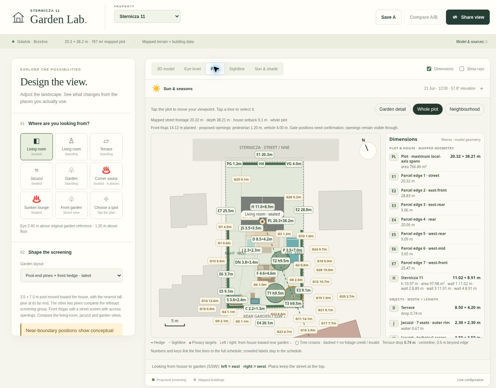

# Garden Lab 1.11.0 validation

Checked 13 November 2026 against source commit `858e423c35debd962e17b59bfca5263370cfcbc7` and the hosted preview built from the same static assets.

## Automated checks

`npm test`: **271 passed, 0 failed**. `npm run build`: successful. Checks cover front hedge spans and clear openings, front ground independent of rear earthworks, shared privacy and shade geometry, finite front hedge requirements, per-span plant quantities, quote overrides, the revised pool and pine clearances, historical v1–v12 state migration, property isolation, and every reported PCK3 study count.

## Hosted preview

The [preview](https://paweltroka.github.io/TROKA.Software.SmartHouse/review-front-pool-v1-11/?site=sternicza-11#v=13&site=sternicza-11) was deployed by [successful Pages run 43441745244](https://github.com/PawelTroka/TROKA.Software.SmartHouse/actions/runs/43441745244).

- Application version reads 1.11.0; fresh layout is `spa-screened`, front height 4.0 m.
- Plan → Whole plot shows the 14.12 m front screen, 1.20 m pedestrian and 4.00 m vehicle openings. Garden detail shows the 3.50 × 7.00 m pool, 1.23 m coping-to-house gap and 1.02 m near-pine-to-coping gap.
- Front garden → Street view opens an eye-level street view and describes clear access gaps. Rear apartment-target percentage cards are hidden there to avoid conflating street screening with apartment-target sampling through the unmodeled house-wall obstruction.
- Setting the front hedge to 0 leaves all three rear/side heights at 4.0 m and reduces the hedge count from 93 to 74. Restoring 4 m restores 93 plants and the approximately 785,900–1,360,900 PLN displayed planning budget.
- Living-room seated PCK3 count: 41/420 visible. Standing: 42/420. Jacuzzi seated: 37/460.
- The preview browser uses the existing lightweight SVG 3D fallback. Plan, dimensions, street view and the shared analytical calculations work in that environment; this check does not claim a WebGL visual test.

The complete geometry comparison, including the exposed walking positions and terrace shade, is in [pool-end-screening-comparison.md](pool-end-screening-comparison.md). Published product references and planning allowances remain distinct in [garden-budget-2026-11-13.md](garden-budget-2026-11-13.md).
