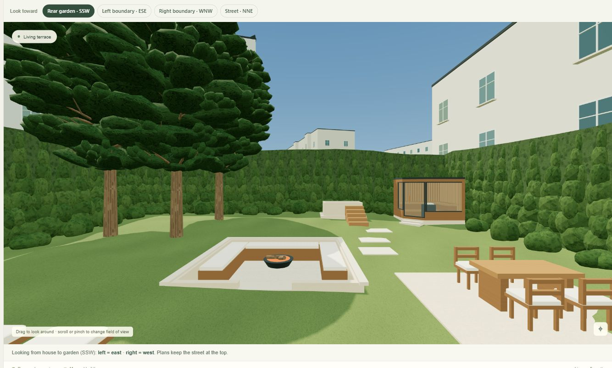
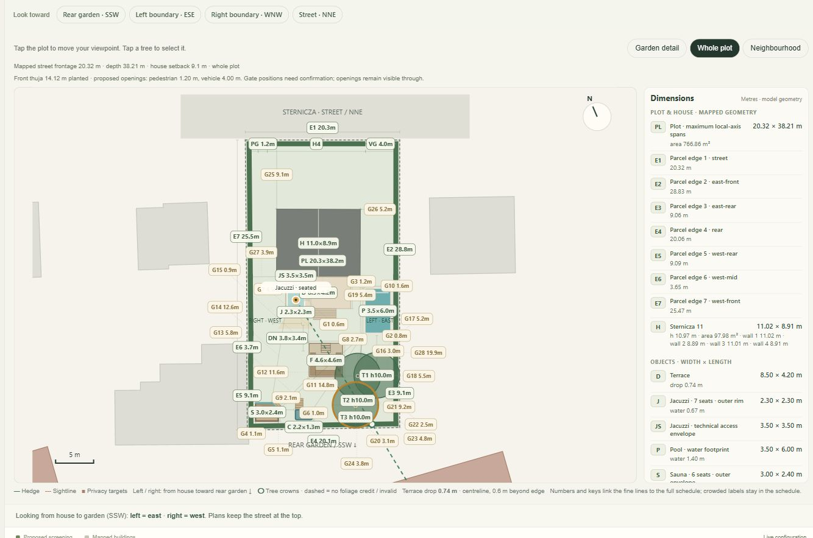
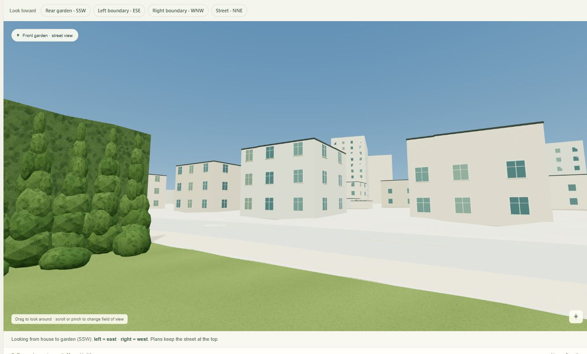

# Garden Lab 1.14.0 validation

Checked on 13 November 2026. Release state schema: **16**.

## Requested result

The three pine trunks remain in the rear-left/east corner, at (17.30,31.00), (14.80,31.10), and (14.50,34.90) m. The group spans 2.8 × 3.9 m; the nearest pair is 2.502 m apart. All nominal crown pairs overlap. The default uses the supplier-band upper endpoints of 10 m height and 6 m crown width/depth, with actual stock and shape unconfirmed. The nominal eastern crown clearance is only about 7 mm, so containment is a mathematical fit, not a surveyed growth allowance.

The corner preference is respected even where it reduces screening compared with the previous forward arrangement. Living-room façade exposure is 859/5,214 seated and 930/5,214 standing; jacuzzi exposure is 2,649/9,702. The terrace is 33/5,214 and the named garden point 139/5,214. Roof samples are separate. No observer or PCK3 geometry was moved to improve these results.

## Automated checks

The final suite contains **339 tests**, all passing, and `npm run build` succeeds. Coverage includes:

- All original building, parcel, terrain and benchmark records retained exactly; 124 additional source footprints and heights verified from the retained official extract.
- All 142 surrounding buildings selectable, including 85 across Sternicza; neighbourhood plan extent and coordinate round-trips verified.
- Native property terrain isolated from the 4 m rendering context grid.
- Outdoor own-house occlusion in both directions, with indoor glazing sightline convention preserved.
- 852 segment cases establishing parity between the bounding-box rejection and prior exact building intersections.
- All botanical vertices inside the analytical crown, deterministic branch/needle geometry, finite heights and rotation, SVG fallback and shadow proxies.
- Historical screening results, pool/spa geometry, budgets and schema 1–16 migration checks, including an explicit frozen sparse-v15 default.

## Hosted browser verification

Verified in WebGL in the connected Brave browser using the review deployment. A fresh final preview path was used after visual changes to avoid stale cached modules.

- The default selects `spa-corner` and the supplied corner coordinates/sizes. All four hedge heights are 4 m and the full-perimeter setting is on.
- Seated living-room and jacuzzi readouts match the dense façade counts above. Terrace readout is 33/5,214 façade points and 6/365 roof points.
- Camera direction controls turn the view while leaving the observer fixed. Selecting a mapped building and choosing **Look at building** points toward it without moving the eye.
- The Front garden preset selects the nearest front-context building (`building-6`). With the front hedge at 4 m, 0/2,730 façade samples are exposed. Turning only the front hedge off exposes 2,730/2,730; restoring 4 m returns to 0. The side, rear and front settings were restored after the comparison.
- The Whole plot plan contains 54 dimension-schedule records and the full side hedges. The Neighbourhood view reports 142 mapped buildings and renders the wider extent.
- The displayed budget is approximately 804,300–1,384,700 PLN and the hedge quantity is 137 plants / 107.3 m at 0.80 m spacing.
- No browser console errors were observed during the final model check.

The visual review identified and corrected pale, overly rounded foliage and coarse context-terrain triangles appearing above the native front lawn. The final terrain uses the same local vertices as the lawn, with the coarser surrounding grid outside that frame. Property elevations and analytical visibility are unchanged.

## Visual evidence

The last image deliberately shows the temporary **front hedge off** comparison so the mapped buildings can be inspected. The published default has the full 4 m front hedge restored.

## Practical limits

Needle pads, branches, bark, thuja foliage, reflective water and façade details improve the visual model. The analytical tree result still uses an ideal dense crown envelope; real gaps and specimen shape can expose more. Windows and finishes are illustrative. New LoD1 context heights are official 2024 median laser heights, not measured roof ridges or current construction surveys. The 179,700 PLN pine subtotal remains a catalogue reference, not a received quotation. Historical and custom saved designs retain their own positions.
